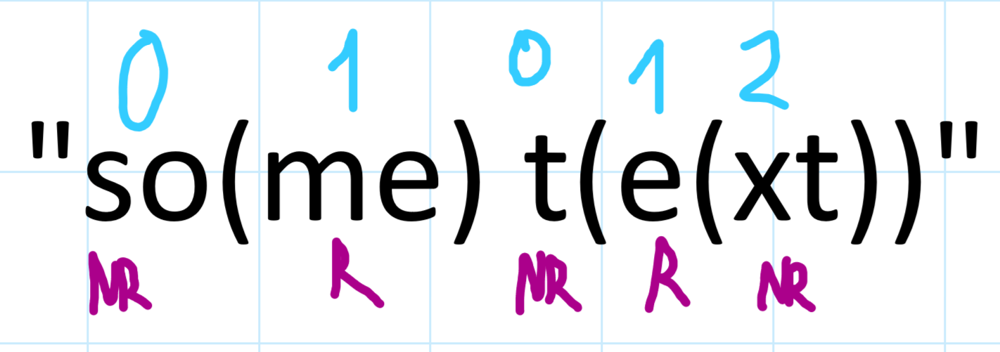
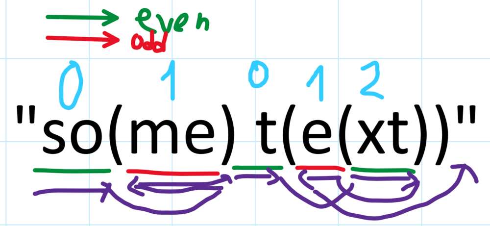
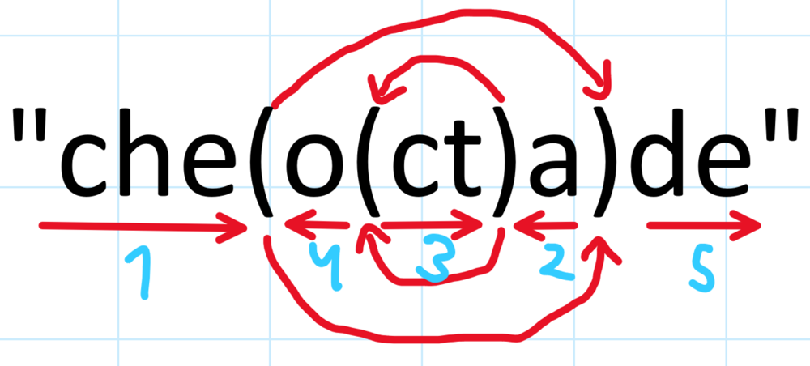
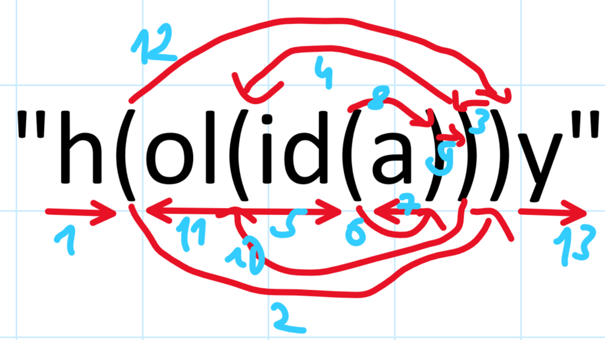

# ✅💯🔥Explanations No One Will Give You🎓🧠2 Detailed Approaches🎯🔥Extremely Simple And Effective🔥

**Author:** heir-of-god
**Votes:** 192
**Link:** [https://leetcode.com/problems/reverse-substrings-between-each-pair-of-parentheses/solutions/5458638/](https://leetcode.com/problems/reverse-substrings-between-each-pair-of-parentheses/solutions/5458638/)

---

<blockquote>
        <p>
            <b>
                Stay afraid, but do it anyway. What's important is the action. You don\u2019t have to wait to be confident. Just do it and eventually the confidence will follow.
            </b>        
        </p>
        <p>
            --- Carrie Fisher ---
        </p>
</blockquote>

# \uD83D\uDC51Problem Explanation and Understanding:

## \uD83C\uDFAF Problem Description
You are given a string `s` which consists only of lower-case letters and parentheses. It's guaranteed that parentheses are balanced. You need to reverse this string such that girst you reverse the innermost part of string, then pre-innermost etc.

## \uD83D\uDCE5\u2935\uFE0F Input:
- String `s`

## \uD83D\uDCE4\u2934\uFE0F Output:
The result string after reversing

---

# 1\uFE0F\u20E3\uD83E\uDDE0 Approach 1: Stack And Brute Force Reverse

# \uD83E\uDD14 Intuition
It took time for me to come up even with this approach, so don't worry if something seems hard, I'll try my best so after my explanations you can write code by yourself.
- Let's say we iterate through `s` and we found `)`. What does this mean for us? Well, this means that we want to know the pair to which match this bracket and then reverse string from that bracket to this. How'd we know? Common data structure related to problems with parentheses - stack. Because if brackets are balanced than you can match them like this:
    - If you encountered `)` then the matching open bracket is the one last in the stack - this is the last bracket we found which is still unmatched with any close bracket.
- So, all we want to do - create stack and keep track of indeces of open brackets. Each time we find close bracket we match it to the last unmatched open bracket and `reverse` string beetween them.
- This approach guarantee that we first reverse innermost parts and only then reverse them one more time on the next layer.

### Dry Run
The last post someone was needed dry run, so here it is:
`s = "b(na)ana"`

| Step | char  | ind_stack   | res           | Action                                    |
|------|-------|-------------|---------------|-------------------------------------------|
| 1    | b     | []          | ['b']         | Append 'b' to `res`                       |
| 2    | (     | [1]         | ['b']         | Push index 1 to `ind_stack`               |
| 3    | n     | [1]         | ['b', 'n']    | Append 'n' to `res`                       |
| 4    | a     | [1]         | ['b', 'n', 'a'] | Append 'a' to `res`                       |
| 5    | )     | []          | ['b', 'a', 'n'] | Pop index 1 from `ind_stack` and reverse substring `['n', 'a']` |
| 6    | a     | []          | ['b', 'a', 'n', 'a'] | Append 'a' to `res`                       |
| 7    | n     | []          | ['b', 'a', 'n', 'a', 'n'] | Append 'n' to `res`                       |
| 8    | a     | []          | ['b', 'a', 'n', 'a', 'n', 'a'] | Append 'a' to `res`                       |

Final result: `"banana"`


# \uD83D\uDC69\uD83C\uDFFB\u200D\uD83D\uDCBB Coding 
- Initialize an empty stack `ind_stack` to store indices of opening parentheses.
- Initialize an empty list `res` to build the result string.
- Iterate over each character `char` in the input string `s`:
    - If the character is an opening parenthesis `"("`:
        - Append the current length of `res` to `ind_stack`, indicating the start of a new substring to be reversed later.
    - If the character is a closing parenthesis `")"`:
        - Pop the last index from `ind_stack`, which marks the start of the substring to be reversed.
        - Reverse the substring in `res` starting from the popped index to the current end of `res`.
    - If the character is neither `"("` nor `")"`:
        - Append the character to `res`.
- After processing all characters, join the list `res` into a string and return it.

# \uD83D\uDCD5 Complexity Analysis
- \u23F0 Time complexity: O(n^2), since we iterate through whole `s` and every time we encounter `)` we reverse substring so in worst case we will have O(n) * O(n) = O(n^2)
- \uD83E\uDDFA Space complexity: O(n), since we use array `ind_stack` with size up to `n / 2` -> O(n)

# \uD83D\uDCBB Code
``` python []
class Solution:
    def reverseParentheses(self, s: str) -> str:
        ind_stack: deque[int] = deque()
        res: list[str] = []

        for char in s:
            if char == "(":  # start new string we need to reverse first
                ind_stack.append(len(res))  # string starts on next index
            elif char == ")":  # reverse string from last added start index
                start_ind: int = ind_stack.pop()
                res[start_ind:] = res[start_ind:][::-1]
            else:
                res.append(char)

        return "".join(res)
```
``` C++ []
class Solution {
public:
    string reverseParentheses(string s) {
        deque<int> ind_stack;
        vector<char> res;

        for (char char_s : s) {
            if (char_s == '(') {
                ind_stack.push_back(res.size());
            } else if (char_s == ')') {
                int start_ind = ind_stack.back();
                ind_stack.pop_back();
                reverse(res.begin() + start_ind, res.end());
            } else {
                res.push_back(char_s);
            }
        }

        return string(res.begin(), res.end());
    }
};
```
``` JavaScript []
var reverseParentheses = function(s) {
    let indStack = [];
    let res = [];

    for (let char_s of s) {
        if (char_s === '(') {
            indStack.push(res.length);
        } else if (char_s === ')') {
            let startInd = indStack.pop();
            let subArr = res.slice(startInd).reverse();
            res.splice(startInd, subArr.length, ...subArr);
        } else {
            res.push(char_s);
        }
    }

    return res.join('');
};
```
``` Java []
class Solution {
    public String reverseParentheses(String s) {
        Deque<Integer> indStack = new LinkedList<>();
        StringBuilder res = new StringBuilder();

        for (char char_s : s.toCharArray()) {
            if (char_s == '(') {
                indStack.push(res.length());
            } else if (char_s == ')') {
                int startInd = indStack.pop();
                String reversed = new StringBuilder(res.substring(startInd)).reverse().toString();
                res.replace(startInd, res.length(), reversed);
            } else {
                res.append(char_s);
            }
        }

        return res.toString();
    }
}
```
``` C []
char* reverseParentheses(char* s) {
    int len = strlen(s);
    int* ind_stack = (int*)malloc(len * sizeof(int));
    int ind_top = -1;
    char* res = (char*)malloc((len + 1) * sizeof(char));
    int res_len = 0;

    for (int i = 0; i < len; i++) {
        if (s[i] == '(') {
            ind_stack[++ind_top] = res_len;
        } else if (s[i] == ')') {
            int start_ind = ind_stack[ind_top--];
            for (int j = start_ind, k = res_len - 1; j < k; j++, k--) {
                char temp = res[j];
                res[j] = res[k];
                res[k] = temp;
            }
        } else {
            res[res_len++] = s[i];
        }
    }

    res[res_len] = '\\0';
    free(ind_stack);
    return res;
}
```


# 2\uFE0F\u20E3\uD83C\uDFC6 Approach 2: Wormhole Teleportation (or WT - what the HELL IS THIS)

# \uD83E\uDD14 Intuition
I've guessed this approach after I looked at some examples, but after writing very messy code with 50+ lines I've given up and observe code of others.
- I think there's no way to normally explain this approach so let's better look at some examples with my comment along them.
- My first thought when I see this question was that if part of the string is nested even number of times then it will be in normal order in the result and if odd - it will be reversed



- Here NR means `not reversed` and R `reversed`. This logic can be applied in the other way. Let's think about direction in which we read every part of string:




- This logic brought me to the optimal solution. As you can see you like "Jump" from bracket to bracket with changing the direction. If you ever found `(` and jumped to `)` it matching you'll always return to this `(` and then jump one more time to `)` but with another direction which means you escape from this pair of brackets. I draw some examples for you to understand this better:






# \uD83D\uDC69\uD83C\uDFFB\u200D\uD83D\uDCBB Coding 
- Initialize a list `index_pairs` of length `n` with all elements set to 0. This list will store the matching indices of the parentheses.
- Initialize an empty deque `stack_start_ind` to store indices of opening parentheses.
- Iterate over each character index `char_ind` in the range of `n`:
  - Retrieve the character `char` at index `char_ind` from `s`.
  - If the character is an opening parenthesis `"("`:
    - Append the current index `char_ind` to `stack_start_ind`.
  - If the character is a closing parenthesis `")"`:
    - Pop the last index from `stack_start_ind`, which marks the start of the matching opening parenthesis.
    - Set the `index_pairs` at the current index `char_ind` to the popped index.
    - Set the `index_pairs` at the popped index to the current index `char_ind`.
- Initialize an empty list `res` to build the result string.
- Initialize an integer `cur_ind` to 0, representing the current index in the string.
- Initialize an integer `cur_dir` to 1, representing the current direction of traversal (1 for forward, -1 for backward).
- While `cur_ind` is within the range of `n` (as you saw we always reached the end of the string):
  - Retrieve the character `char` at index `cur_ind` from `s`.
  - If the character is an opening or closing parenthesis `"("` or `")"`:
    - Update `cur_ind` to the corresponding index from `index_pairs`.
    - Reverse the direction by multiplying `cur_dir` by -1.
  - Otherwise:
    - Append the character `char` to `res`.
  - Update `cur_ind` by adding `cur_dir`.
- After processing all characters, join the list `res` into a string and return it.

# \uD83D\uDCD7 Complexity Analysis
- \u23F0 Time complexity: O(n), since we ho through each character of `s` twice which is still O(n)
- \uD83E\uDDFA Space complexity: O(n), since we use `stack_start_ind` of size up to `n / 2` and `index_pairs` of size `n` which is O(n) 

# \uD83D\uDCBB Code
``` python []
class Solution:
    def reverseParentheses(self, s: str) -> str:
        n: int = len(s)
        index_pairs: list[int] = [0 for _ in range(n)]
        stack_start_ind: deque[int] = deque()

        for char_ind in range(n):
            char = s[char_ind]
            if char == "(":
                stack_start_ind.append(char_ind)
            elif char == ")":
                start_ind: int = stack_start_ind.pop()
                index_pairs[char_ind] = start_ind
                index_pairs[start_ind] = char_ind

        res = []
        cur_ind = 0
        cur_dir = 1

        while cur_ind < n:
            char = s[cur_ind]
            if char in "()":
                cur_ind: int = index_pairs[cur_ind]
                cur_dir *= -1
            else:
                res.append(s[cur_ind])
            cur_ind += cur_dir

        return "".join(res)
```
``` C++ []
class Solution {
public:
    string reverseParentheses(string s) {
        int n = s.length();
        vector<int> index_pairs(n, 0);
        deque<int> stack_start_ind;

        for (int char_ind = 0; char_ind < n; ++char_ind) {
            char char_s = s[char_ind];
            if (char_s == '(') {
                stack_start_ind.push_back(char_ind);
            } else if (char_s == ')') {
                int start_ind = stack_start_ind.back();
                stack_start_ind.pop_back();
                index_pairs[char_ind] = start_ind;
                index_pairs[start_ind] = char_ind;
            }
        }

        string res;
        int cur_ind = 0;
        int cur_dir = 1;

        while (cur_ind < n) {
            char char_s = s[cur_ind];
            if (char_s == '(' || char_s == ')') {
                cur_ind = index_pairs[cur_ind];
                cur_dir *= -1;
            } else {
                res.push_back(char_s);
            }
            cur_ind += cur_dir;
        }

        return res;
    }
};
```
``` JavaScript []
var reverseParentheses = function(s) {
    let n = s.length;
    let index_pairs = new Array(n).fill(0);
    let stack_start_ind = [];

    for (let char_ind = 0; char_ind < n; ++char_ind) {
        let char_s = s[char_ind];
        if (char_s === '(') {
            stack_start_ind.push(char_ind);
        } else if (char_s === ')') {
            let start_ind = stack_start_ind.pop();
            index_pairs[char_ind] = start_ind;
            index_pairs[start_ind] = char_ind;
        }
    }

    let res = [];
    let cur_ind = 0;
    let cur_dir = 1;

    while (cur_ind < n) {
        let char_s = s[cur_ind];
        if (char_s === '(' || char_s === ')') {
            cur_ind = index_pairs[cur_ind];
            cur_dir *= -1;
        } else {
            res.push(char_s);
        }
        cur_ind += cur_dir;
    }

    return res.join('');
};
```
``` Java []
class Solution {
    public String reverseParentheses(String s) {
        int n = s.length();
        int[] index_pairs = new int[n];
        Deque<Integer> stack_start_ind = new LinkedList<>();

        for (int char_ind = 0; char_ind < n; ++char_ind) {
            char char_s = s.charAt(char_ind);
            if (char_s == '(') {
                stack_start_ind.push(char_ind);
            } else if (char_s == ')') {
                int start_ind = stack_start_ind.pop();
                index_pairs[char_ind] = start_ind;
                index_pairs[start_ind] = char_ind;
            }
        }

        StringBuilder res = new StringBuilder();
        int cur_ind = 0;
        int cur_dir = 1;

        while (cur_ind < n) {
            char char_s = s.charAt(cur_ind);
            if (char_s == '(' || char_s == ')') {
                cur_ind = index_pairs[cur_ind];
                cur_dir *= -1;
            } else {
                res.append(char_s);
            }
            cur_ind += cur_dir;
        }

        return res.toString();
    }
}
```
``` C []
char* reverseParentheses(char* s) {
    int n = strlen(s);
    int* index_pairs = (int*)malloc(n * sizeof(int));
    int* stack_start_ind = (int*)malloc(n * sizeof(int));
    int stack_top = -1;

    for (int char_ind = 0; char_ind < n; ++char_ind) {
        char char_s = s[char_ind];
        if (char_s == '(') {
            stack_start_ind[++stack_top] = char_ind;
        } else if (char_s == ')') {
            int start_ind = stack_start_ind[stack_top--];
            index_pairs[char_ind] = start_ind;
            index_pairs[start_ind] = char_ind;
        }
    }

    char* res = (char*)malloc((n + 1) * sizeof(char));
    int cur_ind = 0;
    int cur_dir = 1;
    int res_len = 0;

    while (cur_ind < n) {
        char char_s = s[cur_ind];
        if (char_s == '(' || char_s == ')') {
            cur_ind = index_pairs[cur_ind];
            cur_dir *= -1;
        } else {
            res[res_len++] = s[cur_ind];
        }
        cur_ind += cur_dir;
    }

    res[res_len] = '\\0';
    free(index_pairs);
    free(stack_start_ind);
    return res;
}
```

## \uD83D\uDCA1\uD83D\uDCA1\uD83D\uDCA1I encourage you to check out [my profile](https://leetcode.com/heir-of-god/) and [Project-S](https://github.com/Heir-of-God/Project-S) project for detailed explanations and code for different problems (not only Leetcode). Happy coding and learning!\uD83D\uDCDA

### Please consider *upvote*\u2B06\uFE0F\u2B06\uFE0F\u2B06\uFE0F because I try really hard not just to put here my code and rewrite testcase to show that it works but explain you WHY it works and HOW. Thank you\u2764\uFE0F

## If you have any doubts or questions feel free to ask them in comments. I will be glad to help you with understanding\u2764\uFE0F\u2764\uFE0F\u2764\uFE0F


