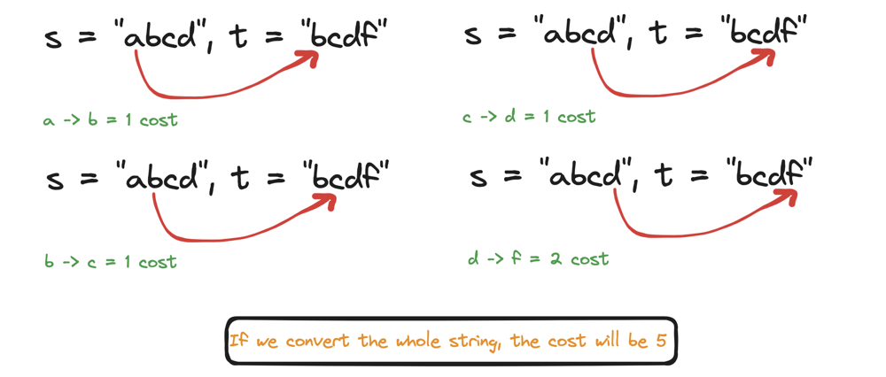
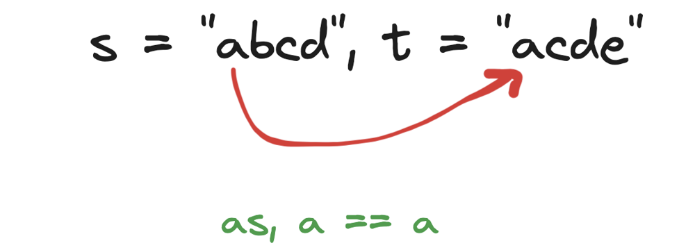

# 🔥🔥 Diagrammatic  Explanation 👁️👁️

**Author:** hi-malik
**Votes:** 55
**Link:** [https://leetcode.com/problems/get-equal-substrings-within-budget/solutions/5218506/](https://leetcode.com/problems/get-equal-substrings-within-budget/solutions/5218506/)

---

What the question is saying, we have **two strings** and have **maxCost**. Keep **maxCost** in your mind and tell, a big to big **s** string can be converted to **t** string. And if we converted the whole string, how much will be the cost!

Let\\s undrestand with an example;
```
Input: s = "abcd", t = "bcdf", maxCost = 3
Output: 3
```


> But, what the question is saying! We have to be in the **maxCost**
> > What it saying is, get that string out! Which can be converted within the given **maxCost**

So, in the above example! **abc** length is **three** and it can be converted into **bcd** within this **maxCost**

> But what if were unable to conert, then what will be! Let;s take one more example!

```
Input: s = "abcd", t = "acde", maxCost = 0
Output: 1
```

Now, as **a == a** and how we got the **Output 1** because, we just have to get the length out from the string! How long a string can be converted and return it's length!

So, how we going to code is,

1. Initialize `n` to the length of string `s`.
2. Initialize `ans` to 0, which will hold the maximum length of the substring that can be changed within the given cost.
3. Initialize `window` to 0, which will accumulate the cost of changing the substring from `s` to `t`.
4. Initialize `left` to 0, which will be the starting index of the sliding window.
5. Loop through the string using `right` as the ending index of the sliding window.
6. Add the cost of changing `s[right]` to `t[right]` to `window`.
7. If `window` exceeds `maxCost`, shrink the window from the left by subtracting the cost of changing `s[left]` to `t[left]` and incrementing `left`.
8. Update `ans` with the maximum length of the substring found so far.
9. Return the maximum length `ans`.

```plaintext
Function equalSubstring(s, t, maxCost):
    n = length of s
    ans = 0
    window = 0
    left = 0

    For right from 0 to n - 1:
        window += absolute difference between ASCII values of s[right] and t[right]

        While window > maxCost:
            window -= absolute difference between ASCII values of s[left] and t[left]
            left += 1

        ans = maximum of ans and (right - left + 1)

    Return ans
```

**Let's Code it UP** *ladies n gentlemen*

**C++**
```
class Solution {
public:
    int equalSubstring(string s, string t, int maxCost) {
        int n = s.length();
        int ans = 0, window = 0, left = 0;
        for (int right = 0; right < n; right++) {
            window += abs(s[right] - t[right]);
            while (window > maxCost) {
                window -= abs(s[left] - t[left]);
                left++;
            }
            ans = max(ans, right - left + 1);
        }
        return ans;
    }
};
```
**JAVA**
```
class Solution {
    public int equalSubstring(String s, String t, int maxCost) {
        int n = s.length();
        int ans = 0, window = 0, left = 0;
        for (int right = 0; right < n; right++) {
            window += Math.abs(s.charAt(right) - t.charAt(right));
            while (window > maxCost) {
                window -= Math.abs(s.charAt(left) - t.charAt(left));
                left++;
            }
            ans = Math.max(ans, right - left + 1);
        }
        return ans;
    }
}
```
**PYTHON**
```
class Solution:
    def equalSubstring(self, s: str, t: str, maxCost: int) -> int:
        n = len(s)
        ans = 0
        window = 0
        left = 0
        
        for right in range(n):
            window += abs(ord(s[right]) - ord(t[right]))
            while window > maxCost:
                window -= abs(ord(s[left]) - ord(t[left]))
                left += 1
            ans = max(ans, right - left + 1)
        
        return ans
```

___
Complexity Analysis

___
* **Time Complexity :-** BigO(N) 
* **Space Complexity :-** BigO(1)