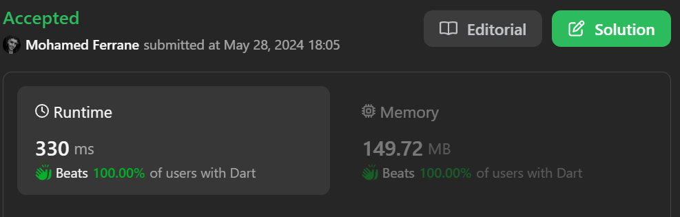

# BEATS 100% DART solution with explanation

**Author:** Mohamed_Sadeck
**Votes:** 0
**Link:** [https://leetcode.com/problems/get-equal-substrings-within-budget/solutions/5222248/](https://leetcode.com/problems/get-equal-substrings-within-budget/solutions/5222248/)

---



# Intuition
The problem is asking to find the maximum length of a substring in `s` that can be changed to be the same as the corresponding substring in `t` with a cost less than or equal to `maxCost`. The cost of changing a character is the absolute difference between the ASCII values of the characters. The intuition here is to use a sliding window approach to keep track of the cost and find the maximum length of the substring.

# Approach
We first calculate the absolute differences between the ASCII values of the characters in `s` and `t` and store them in a list. Then we initialize two pointers `left` and `right` to represent the window, and a variable `curr` to store the current cost. We iterate over the list, and for each difference, if the current cost plus the difference is less than or equal to `maxCost`, we add the difference to the current cost, move the right pointer, and update the maximum length. If the current cost plus the difference is greater than `maxCost`, we subtract the difference at the left pointer from the current cost and move the left pointer. We continue this process until we have iterated over all differences. Finally, we return the maximum length.

Let's illustrate this approach with the example `s = "abcd", t = "bcdf", maxCost = 3`:

1. We calculate the absolute differences between the ASCII values of the characters in `s` and `t` and get `[1,1,1,1]`.
2. We initialize `left = 0`, `right = 0`, `curr = 0`, and `ans = 0`.
3. We start iterating over the list. For the first difference `1`, since `curr + 1 <= 3`, we add `1` to `curr`, move `right` to `1`, and update `ans` to `1`.
4. For the second difference `1`, since `curr + 1 <= 3`, we add `1` to `curr`, move `right` to `2`, and update `ans` to `2`.
5. For the third difference `1`, since `curr + 1 <= 3`, we add `1` to `curr`, move `right` to `3`, and update `ans` to `3`.
6. For the fourth difference `1`, since `curr + 1 > 3`, we subtract `1` from `curr` and move `left` to `1`.
7. We have iterated over all differences, so we return `ans = 3`.

# Complexity
- Time complexity: The time complexity is O(n), where n is the length of the strings. We iterate over the strings once to calculate the differences and once to find the maximum length.
- Space complexity: The space complexity is O(n), where n is the length of the strings. We store the differences in a list.

# Code
```
class Solution {
  int equalSubstring(String s, String t, int maxCost) {
    // Initialize a list to store the absolute differences between the ASCII values of the characters in s and t
    List<int> diff = [];
    final n = s.length;
    // Calculate the absolute differences and add them to the list
    for(int i=0;i<n;i++){
        diff.add((s.codeUnitAt(i)-t.codeUnitAt(i)).abs().toInt());
    }
    // Initialize two pointers and a variable to store the current cost
    int left = 0;
    int right = 0;
    int curr = 0;
    // Initialize a variable to store the maximum length of a substring
    int ans = 0;
    // Iterate over the list
    while(right<n){
        // If the current cost plus the next difference is less than or equal to maxCost
        if(curr + diff[right] <= maxCost){
            // Add the difference to the current cost
            curr+=diff[right];
            // Move the right pointer
            right++;
            // Update the maximum length
            ans=max(ans,right-left);
        }else{
            // Subtract the difference at the left pointer from the current cost
            curr-=diff[left];
            // Move the left pointer
            left++;
        }
    }
    // Return the maximum length
    return ans;
  }
}
```