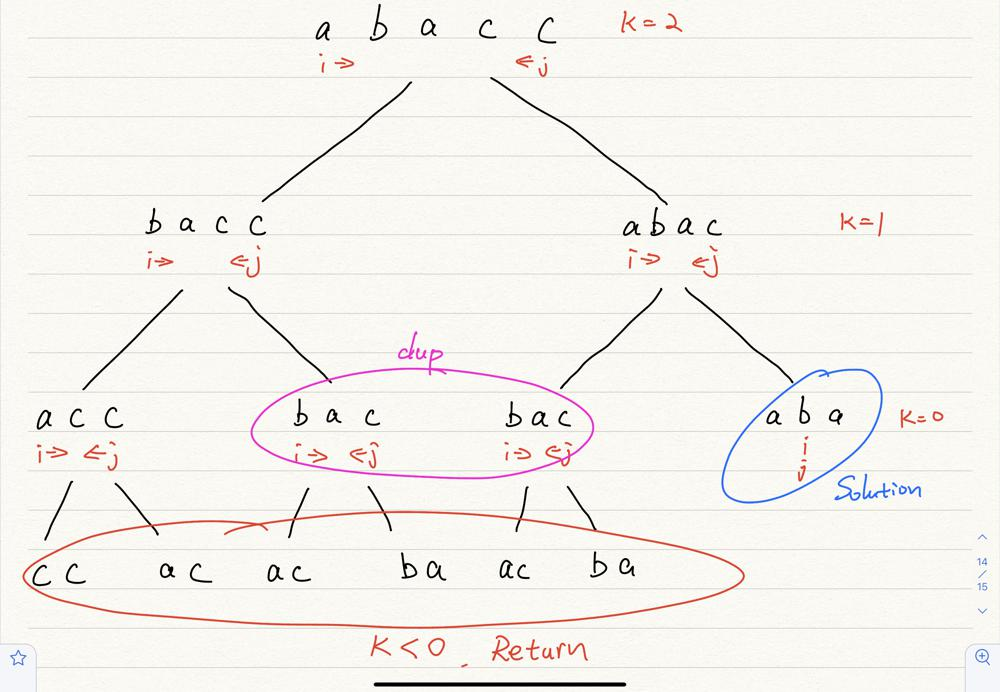
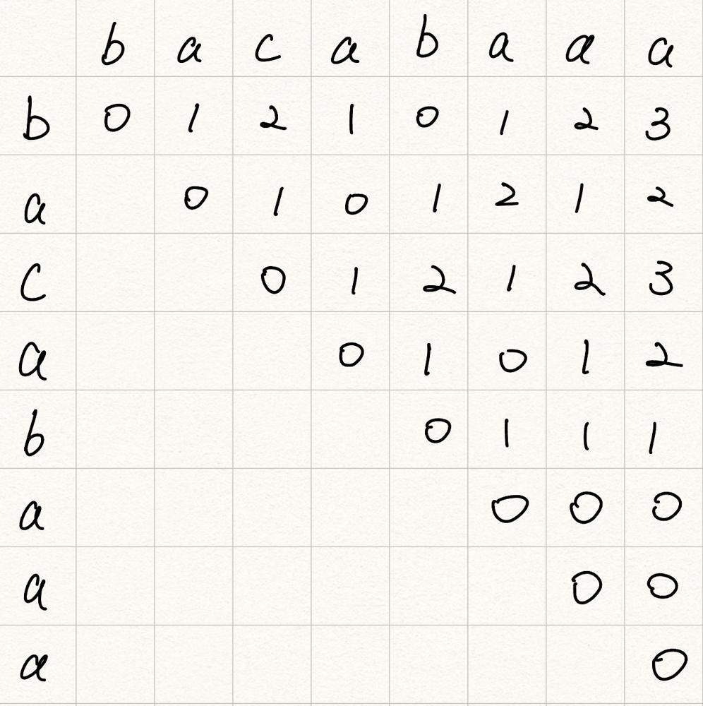

# Java from brute force to bottom-up DP explained in detail

**Author:** Chenaiier
**Votes:** 16
**Link:** [https://leetcode.com/problems/valid-palindrome-iii/solutions/2409089/](https://leetcode.com/problems/valid-palindrome-iii/solutions/2409089/)

---

**TLDR:** Bottom up dp, where each dp[i][j] represents minimum character need to delete to from a valid Palindrome between s[i] to s[j].

At each window, if first letter equals last letter, dp[i][j] = dp[i + 1][j - 1] (left bottom)

If first and last is not equal, we choose Math.min(dp[i][j - 1], dp[i + 1][j]) + 1 (left and bottom)

----------------------------------------
**From brute force to bottom-up DP**
Before discuss dp, The brute force for this problem is similar to [Valid Palindrome II ](https://leetcode.com/problems/valid-palindrome-ii/)but for this we have to call it recursively. 

We will have two pointer approching each other from each side. And whenever two pointer isn't pointing to same character, there are two possible branch we can went through.

One branch is to take out left-most character and check if the remaining string is valid with (k-1) operation. And the other branch is to take out right-most character and does same thing.

The above image is the recursion tree for our brute force problem. We could see there could be a lot of duplication where can increase our TS since we have to compute it recursively.

Here is the bf code:
```
class Solution {
    public boolean isValidPalindrome(String s, int k) {
        return helper(s, k, 0, s.length() - 1);
    }

    private boolean helper(String s, int k, int left, int right) {
        if (k < 0) {
            return false;
        }
        while (left < right) {
            if (s.charAt(left) != s.charAt(right)) {
                if (k == 0) {
                    return false;
                } 
                return helper(s, k - 1, left + 1, right) || helper(s, k - 1, left, right - 1);
            }
            left++;
            right--;
        }
        return true;
    }
}
```
TC: The recursion tree will have at most k level (maximum char we could delete), each node will have at most 2 branch, and each node itself can cost at most n.

Thus, overall TC would be O(n * 2 ^ k)
SC would just be O(k) which is the height of the recursion tree(call stack space)

Now you get bf solution, how can we implement it?

As we mentioned above, there might be too many duplicated case. Therefore, it might be a good approch if we can **store the solution for smaller case** and to build up big case.

For this problem, bottom-up dp is the way to go. The definition of our dp matrix:

**dp[i][j] represents the minimum character we have to delete to from a valid Palindrome between String s[i] to s[j];**

For example, if String s = "abacz", then dp[0][3] = 1 represents we need to delete one character from "abac" to make it Palindrome: "abac" -> "aba" is one character away.

Now you probably have a little bit sence of what are we going to do. But before that, let's go though some cases.

We know that "cab" take two steps to from a Palindrome, so I want to ask you, what about "caba"? 

Intuitively, you know we only needs one step by deleting 'c'. But how can we get this answer from previously results?

note that the first and last letter of "caba"  is not same. That means in order to make it Palindrome, we have to at least delete one of it.

So it becames either "cab" or "aba", these should be in our previous results! We should have "cab" = 2 steps and "aba" = 0 steps.

So we choose the minimum one, and plus one.

Now, what about "cabac"? where first letter is same as last letter? We just need to get the steps of "aba"!

Here is dp matrix in detail:

At each window, if first letter equals last letter, dp[i][j] = dp[i + 1][j - 1] (left bottom)

If first and last is not equal, we choose Math.min(dp[i][j - 1], dp[i + 1][j]) + 1 (left and bottom)

And finally, the code:
```
class Solution {
    public boolean isValidPalindrome(String s, int k) {
        int[][] dp = new int[s.length()][s.length()];
        for (int j = 1; j < s.length(); j++) {
            int row = 0;
            int col = j;
            while (col < s.length()) {
                if (s.charAt(col) == s.charAt(col - j)) {
                    dp[row][col] = dp[row + 1][col - 1];
                } else {
                    dp[row][col] = Math.min(dp[row][col - 1], dp[row + 1][col]) + 1;
                }
                row++;
                col++;
            }

        }
        return dp[0][s.length() - 1] <= k;
    }
}
```