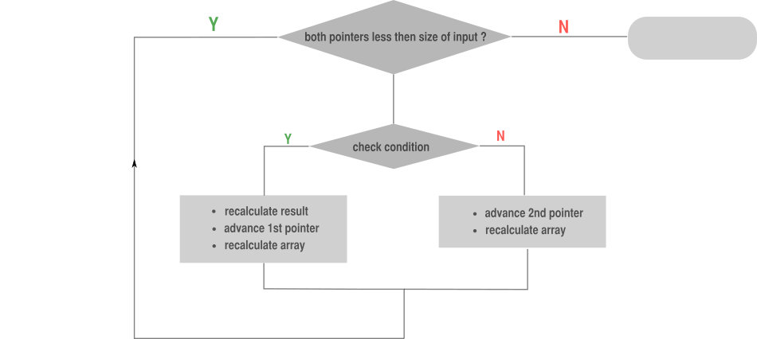
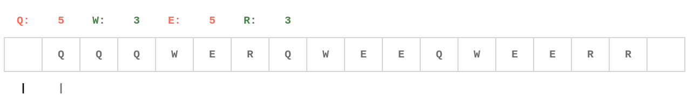
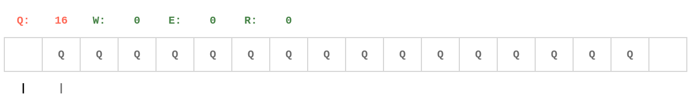
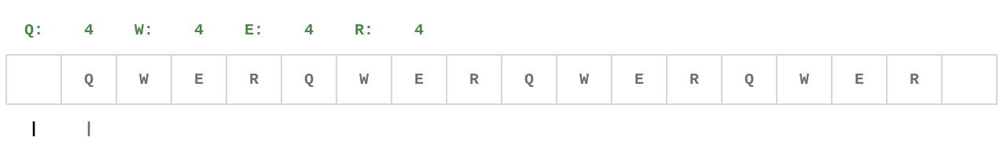
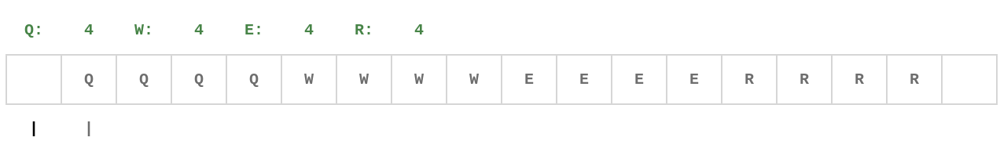

# 🚩 breathing window ^^

**Author:** andrii_khlevniuk
**Votes:** 15
**Link:** [https://leetcode.com/problems/replace-the-substring-for-balanced-string/solutions/1366164/](https://leetcode.com/problems/replace-the-substring-for-balanced-string/solutions/1366164/)

---

**breathing  window/two pointers**

**two pass**
**time: `O(N)`; space: `O(1)`**

This is not a sliding window, I would rather call this technique "a caterpillar" or "breathing window" as the window not only slides but also gets wider or narrower.
I need space to store only `4` ints, but use a bigger array to make code simpler (and to handle one nasty edge case).
I don't particularly like `for`-cycles inside `for`-cycles so I've come up with this solution.

There's few things I like about this algo:
* two pointers are independent (no `i<j` condition in the code). So the first pointer("the lower" one) can go past the second("the bigger" one) and its'ok;
* the algo automatically handles already balanced strings;
* only one cycle = no fastforwarding (no `for` inside `for`);
* only one condition `f(m['Q']<=sz/4 and m['W']<=sz/4 and m['E']<=sz/4 and m['R']<=sz/4)` check (no duplication);
* only one `return` statement;





```
int balancedString(const string s)
{
	int m[128]{};
	for(const auto & c : s) ++m[c];

	int out{INT_MAX};
	for(int i{}, j{-1}, sz(size(s)); i<sz and j<sz; )
		if(m['Q']<=sz/4 and m['W']<=sz/4 and m['E']<=sz/4 and m['R']<=sz/4)
		{
			out = min(out, j-i+1);
			++m[s[i++]];     		
		}
		else
			--m[s[++j]];     
	return out;
}
```
*Note*, that in the `else` section I can peek the element `s[size(s)]` (That's the nasty edge case I was referring to). It is safe to do it since `C+03` for the `const string` ([prooflink](https://stackoverflow.com/questions/30187915/is-it-safe-to-use-operator-for-stdstring)). ASCII code for `"\\0"` is `0` so I just decrease `m[0]` without affecting `m["Q"]`, `m["W"]`, `m["E"]` or `m["R"]` and will leave the cycle on the next step.

**Gifs**

All examples below use the string of size `16`, so each of `Q`,`W`,`E` and `R` should occur `4` times in a balanced string. Answer equals length of the shortest green "caterpillar" encountered during run of the algo.

`s="QQQWERQWEEQWEERR"`
Answer : `2`



`s="QQQQQQQQQQQQQQQQ"`
Answer : `12`


`s="QWERQWERQWERQWER"`
Answer : `0`



`s="QQQQWWWWEEEERRRR"`
Answer : `0`



**Here's a similar [problem](https://leetcode.com/problems/maximum-distance-between-a-pair-of-values/discuss/1218846/nice-gifs) with nice gifs.**


