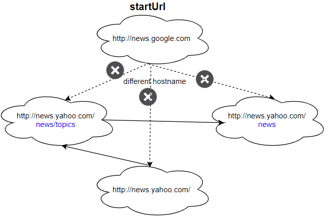

# [1236. Web Crawler](https://leetcode.com/problems/web-crawler/)

| Category | Difficulty | Likes | Dislikes |
| :------: | :--------: | :---: | :------: |
| Algorithms | Medium | 304 | 333 |

**Tags:** [`string`](https://leetcode.com/tag/string), [`depth-first-search`](https://leetcode.com/tag/depth-first-search), [`breadth-first-search`](https://leetcode.com/tag/breadth-first-search), [`interactive`](https://leetcode.com/tag/interactive)

**Companies:** `snowflake`, `microsoft`, `dropbox`, `facebook`

## Description

Given a url `startUrl` and an interface `HtmlParser`, implement a web crawler to crawl all links that are under the **same hostname** as `startUrl`. 

Return all urls obtained by your web crawler in **any** order.

Your crawler should:

	- Start from the page: `startUrl`

	- Call `HtmlParser.getUrls(url)` to get all urls from a webpage of given url.

	- Do not crawl the same link twice.

	- Explore only the links that are under the **same hostname** as `startUrl`.


As shown in the example url above, the hostname is `example.org`. For simplicity sake, you may assume all urls use **http protocol** without any **port** specified. For example, the urls `http://leetcode.com/problems` and `http://leetcode.com/contest` are under the same hostname, while urls `http://example.org/test` and `http://example.com/abc` are not under the same hostname.

The `HtmlParser` interface is defined as such: 

```

interface HtmlParser {
  // Return a list of all urls from a webpage of given url.
  public List&lt;String&gt; getUrls(String url);
}
```

Below are two examples explaining the functionality of the problem, for custom testing purposes you'll have three variables urls, edges and startUrl. Notice that you will only have access to startUrl in your code, while urls and edges are not directly accessible to you in code.

Note: Consider the same URL with the trailing slash "/" as a different URL. For example, "http://news.yahoo.com", and "http://news.yahoo.com/" are different urls.

 

**Example 1:**


```

Input:
urls = [
&nbsp; &quot;http://news.yahoo.com&quot;,
&nbsp; &quot;http://news.yahoo.com/news&quot;,
&nbsp; &quot;http://news.yahoo.com/news/topics/&quot;,
&nbsp; &quot;http://news.google.com&quot;,
&nbsp; &quot;http://news.yahoo.com/us&quot;
]
edges = [[2,0],[2,1],[3,2],[3,1],[0,4]]
startUrl = &quot;http://news.yahoo.com/news/topics/&quot;
Output: [
&nbsp; &quot;http://news.yahoo.com&quot;,
&nbsp; &quot;http://news.yahoo.com/news&quot;,
&nbsp; &quot;http://news.yahoo.com/news/topics/&quot;,
&nbsp; &quot;http://news.yahoo.com/us&quot;
]

```

**Example 2:**

****

```

Input: 
urls = [
&nbsp; &quot;http://news.yahoo.com&quot;,
&nbsp; &quot;http://news.yahoo.com/news&quot;,
&nbsp; &quot;http://news.yahoo.com/news/topics/&quot;,
&nbsp; &quot;http://news.google.com&quot;
]
edges = [[0,2],[2,1],[3,2],[3,1],[3,0]]
startUrl = &quot;http://news.google.com&quot;
Output: [&quot;http://news.google.com&quot;]
Explanation: The startUrl links to all other pages that do not share the same hostname.
```

 

**Constraints:**

	- `1 https://en.wikipedia.org/wiki/Hostname#Restrictions_on_valid_hostnames

	- You may assume there're no duplicates in url library.

---

**Links:** [Submissions](https://leetcode.com/problems/web-crawler/) | [Solutions](https://leetcode.com/problems/web-crawler/)
