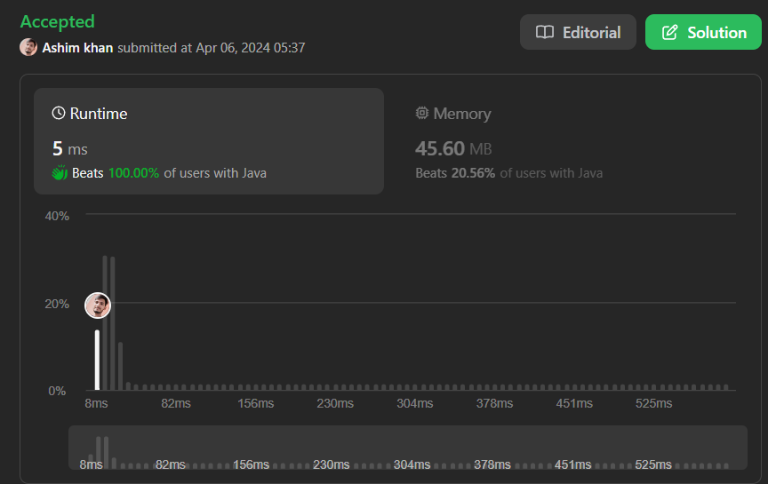

# 100% Beat | Easy 2 Approaches Stack & Without Stack || Detailed Explanation

**Author:** ashimkhan
**Votes:** 254
**Link:** [https://leetcode.com/problems/minimum-remove-to-make-valid-parentheses/solutions/4980158/](https://leetcode.com/problems/minimum-remove-to-make-valid-parentheses/solutions/4980158/)

---

*Note: Code is Re Formatted using chatgpt for bettter Comments and variable names so that you can better understand..*
# Personal opinion
Leetcode is trying to teach us Stack DS so before doing this you should try the daily problem of day before yesterday
https://leetcode.com/problems/maximum-nesting-depth-of-the-parentheses/description/ and then yesterday 
https://leetcode.com/problems/make-the-string-great/description/
and then this problem. 
i hope next day we will get another problem of stack DS.
# Intuition

<!-- Describe your first thoughts on how to solve this problem. -->
Imagine a shoe store where each customer needs a matching pair of shoes.

**Preparing:**

- The store manager sets up empty shelves for left and right shoes (startPart and endPart).
- They get a list of all customers' shoe requests (char[] arr).
- They have a counter to track the number of customers who still need a left shoe (openParenthesesCount).

**First Pass: Finding Extra Right Shoes:**

- The manager goes through the list one customer at a time.
- If a customer needs a left shoe (arr[i] == '('), they increase the counter.
- If a customer needs a right shoe (`arr[i] == ')'), they check:
- If no customers need left shoes (openParenthesesCount == 0), the right shoe is extra (arr[i] = '*'). They mark it for return.
- If there are customers needing left shoes, a pair is made, and the counter goes down.

**Second Pass: Finding Extra Left Shoes:**

- The manager starts from the end of the list, looking for extra left shoes.
- If a customer needs a left shoe (arr[i] == '(') and there are still customers needing right shoes (openParenthesesCount > 0), the left shoe is extra. They mark it for return.

 **Arranging the Shelves:**

- The manager takes all non-marked shoes (arr[i] != '*') and puts them neatly on the shelves.

**Displaying the Shoes:**

- They beautifully display the matching pairs from the shelves (result).

# Approach
<!-- Describe your approach to solving the problem. -->
**Initialization:**
- Initialize pointers for the start and end of the string, variables to store the start and end parts of the string, and the final result. Convert the input string into a character array for easier manipulation.

**First Pass:** 
- Iterate through the string from left to right. Track the count of open parentheses encountered. If an excess closing parenthesis is encountered (i.e., a closing parenthesis with no matching opening parenthesis), mark it with '*'. Keep track of the count of open parentheses encountered.

**Second Pass:** 
- Iterate through the string from right to left. If there are excess opening parentheses remaining (i.e., opening parentheses with no matching closing parenthesis), mark them with '*'.

**Filtering:** 
- Filter out the marked characters ('*') from the character array, leaving only the valid parentheses.

**Construct Result:** 
- Construct the result string from the filtered character array.

**Return Result:** 
- Return the final result string, which contains the minimum number of parentheses required to make the input string valid.

# Complexity
- Time complexity:
<!-- Add your time complexity here, e.g. $$O(n)$$ -->
O(n)

- Space complexity:
<!-- Add your space complexity here, e.g. $$O(n)$$ -->
O(n)

# Approach -1  Without Stack
```java []

class Solution {
    public String minRemoveToMakeValid(String s) {
        // Initialize pointers for the start and end of the string
        int startPointer = 0;
        int endPointer = s.length() - 1;

        String result;

        // Convert input string to character array for easier manipulation
        char[] arr = s.toCharArray();
        
        // Counter for open parentheses
        int openParenthesesCount = 0;

        // First pass: mark excess closing parentheses with '*'
        for (int i = 0; i < arr.length; i++) {
            if (arr[i] == '(')
                openParenthesesCount++;
            else if (arr[i] == ')') {
                if (openParenthesesCount == 0)
                    arr[i] = '*'; // Mark excess closing parentheses
                else
                    openParenthesesCount--;
            }
        }

        // Second pass: mark excess opening parentheses from the end
        for (int i = arr.length - 1; i >= 0; i--) {
            if (openParenthesesCount > 0 && arr[i] == '(') {
                arr[i] = '*'; // Mark excess opening parentheses
                openParenthesesCount--;
            }
        }
        
        // Filter out marked characters and store the result in the character array
        int p = 0; // Pointer for updating the character array
        for (int i = 0; i < arr.length; i++) {
            if (arr[i] != '*')
                arr[p++] = arr[i];
        }

        // Construct the result string from the filtered character array
        result = new String(arr).substring(0, p);

        return result;
    }
}
```
```C++ []

class Solution {
public:
    string minRemoveToMakeValid(string s) {
        // Initialize variables
        int openParenthesesCount = 0;
        vector<char> arr(s.begin(), s.end()); // Convert string to character array

        // First pass: mark excess closing parentheses with '*'
        for (int i = 0; i < arr.size(); i++) {
            if (arr[i] == '(')
                openParenthesesCount++;
            else if (arr[i] == ')') {
                if (openParenthesesCount == 0)
                    arr[i] = '*'; // Mark excess closing parentheses
                else
                    openParenthesesCount--;
            }
        }

        // Second pass: mark excess opening parentheses from the end
        for (int i = arr.size() - 1; i >= 0; i--) {
            if (openParenthesesCount > 0 && arr[i] == '(') {
                arr[i] = '*'; // Mark excess opening parentheses
                openParenthesesCount--;
            }
        }
        
        // Filter out marked characters and store the result in a new string
        string result = "";
        for (char c : arr) {
            if (c != '*')
                result += c;
        }

        return result;
    }
};

```
```Python []
class Solution:
    def minRemoveToMakeValid(self, s: str) -> str:
        # Initialize variables
        openParenthesesCount = 0
        arr = list(s)

        # First pass: mark excess closing parentheses with '*'
        for i in range(len(arr)):
            if arr[i] == '(':
                openParenthesesCount += 1
            elif arr[i] == ')':
                if openParenthesesCount == 0:
                    arr[i] = '*' # Mark excess closing parentheses
                else:
                    openParenthesesCount -= 1

        # Second pass: mark excess opening parentheses from the end
        for i in range(len(arr) - 1, -1, -1):
            if openParenthesesCount > 0 and arr[i] == '(':
                arr[i] = '*' # Mark excess opening parentheses
                openParenthesesCount -= 1
        
        # Filter out marked characters and construct the result string
        result = ''.join(c for c in arr if c != '*')

        return result

```

# Approach -2 With Stack
```java []
class Solution {
    public String minRemoveToMakeValid(String s) {
        // Initialize counts for left and right parentheses
        int leftCount = 0;
        int rightCount = 0;

        // Use a stack to keep track of valid parentheses
        Stack<Character> stack = new Stack<>();

        // Pass 1: Iterate through the string and process parentheses
        for (int i = 0; i < s.length(); i++) {
            char currentChar = s.charAt(i);

            // Increment count for left parentheses
            if (currentChar == '(') {
                leftCount++;
            }
            // Increment count for right parentheses
            if (currentChar == ')') {
                rightCount++;
            }

            // If there are more right parentheses than left, skip the current right parenthesis
            if (rightCount > leftCount) {
                rightCount--; // Decrease right count
                continue;     // Skip processing this right parenthesis
            } else {
                stack.push(currentChar); // Add valid parentheses to the stack
            }
        }

        // Pass 2: Reconstruct the string using the valid parentheses in the stack
        StringBuilder result = new StringBuilder();
        while (!stack.isEmpty()) {
            char currentChar = stack.pop();
            // If there are more left parentheses than right, skip the current left parenthesis
            if (leftCount > rightCount && currentChar == '(') {
                leftCount--; // Decrease left count
                // Do nothing, skip this left parenthesis
            } else {
                result.append(currentChar); // Add valid parentheses to the result
            }
        }

        // Reverse the result string and return
        return result.reverse().toString();
    }
}

```
```python []
class Solution:
    def minRemoveToMakeValid(self, s: str) -> str:
        left_count = 0
        right_count = 0
        stack = []

        # Pass 1
        for ch in s:
            if ch == '(':
                left_count += 1
            elif ch == ')':
                right_count += 1
            if right_count > left_count:
                right_count -= 1
            else:
                stack.append(ch)

        result = ""

        # Pass 2
        while stack:
            current_char = stack.pop()
            if left_count > right_count and current_char == '(':
                left_count -= 1
            else:
                result += current_char

        # Reverse the result string
        return result[::-1]

```
```C++ []

class Solution {
public:
    std::string minRemoveToMakeValid(std::string s) {
        int leftCount = 0;
        int rightCount = 0;
        std::stack<char> stack;

        // Pass 1
        for (char ch : s) {
            if (ch == '(') {
                leftCount++;
            } else if (ch == ')') {
                rightCount++;
            }
            if (rightCount > leftCount) {
                rightCount--;
                continue;
            } else {
                stack.push(ch);
            }
        }

        std::string result = "";
        
        // Pass 2
        while (!stack.empty()) {
            char currentChar = stack.top();
            stack.pop();
            if (leftCount > rightCount && currentChar == '(') {
                leftCount--;
            } else {
                result += currentChar;
            }
        }

        // Reverse the result string
        std::reverse(result.begin(), result.end());
        return result;
    }
};
```


