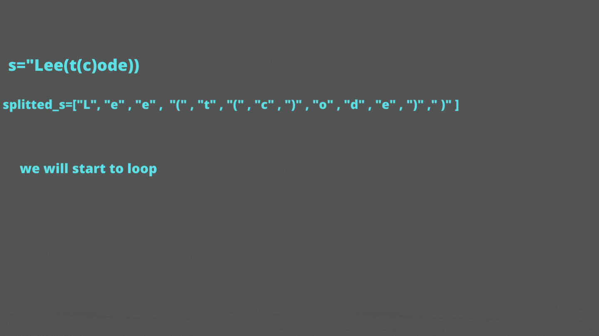

# [Python , Javascript]  Easy solution with very clear Explanation

**Author:** mageshyt
**Votes:** 244
**Link:** [https://leetcode.com/problems/minimum-remove-to-make-valid-parentheses/solutions/1850411/](https://leetcode.com/problems/minimum-remove-to-make-valid-parentheses/solutions/1850411/)

---

**Please dont downvote guys if cannot support,We are putting lot of effort in it\uD83D\uDE42**

```
What the Question asking us to do \uD83E\uDD14 ?
Your task is to remove the minimum number of parentheses ( '(' or ')', in any positions )
so that the resulting parentheses string is valid and return any valid string
```





```
Big o:
    n-->size of the s
    Time: O(n)
    Space: O(n)
```

`Javascript`

```
const minRemoveToMakeValid = (str)=> {
     const stack = [];
  const splitted_str = str.split("");
  for (let i = 0; i < str.length; i++) {
    const char = str[i];
    if (char === "(") stack.push(i); // if curr char is (  then we will push into our stack
    else if (char === ")") {
      if (stack.length === 0) {
          // if out stack is empty then we will make ) as ''
        splitted_str[i] = "";
      } else {
          //! if stack is not empty then we will pop top of the stack
        stack.pop();
      }
    }
  }
    // if we have extra ( bracket we will remove it by making it as ''
  for (let i = 0; i < stack.length; i++) {
    const char = stack[i];
    splitted_str[char] = "";
  }

  return splitted_str.join(""); // at last we will join the splitted_str
};
```

`Python`

```
class Solution:
    def minRemoveToMakeValid(self, s) :
        stack=[]
        split_str=list(s)
        for i in range(len(s)):
            if s[i]=='(':
                # if current char is '(' then push it to stack
                stack.append(i)
            elif s[i]==')':
                # if current char is ')' then pop top of the stack
                if len(stack) !=0:
                    stack.pop()
                else:
                    # if our stack is empty then we can't pop so make  current char as ''
                    split_str[i]=""
        for i in stack:
            split_str[i]=""
        return '' .join(split_str)
```

```
UPVOTE if you like \uD83D\uDE03 , If you have any question, feel free to ask.
```