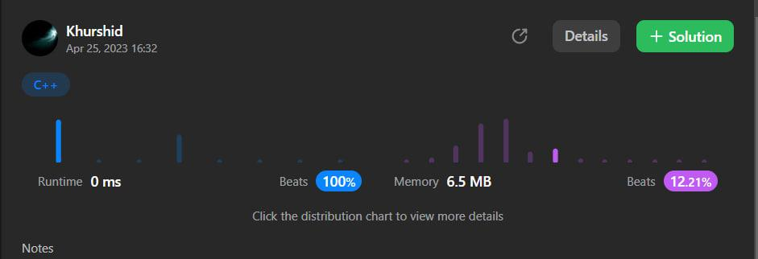

# [C++] [C#] easy and fast solution.Beats 100%.Explained.

**Author:** aloneguy
**Votes:** 9
**Link:** [https://leetcode.com/problems/generate-a-string-with-characters-that-have-odd-counts/solutions/3459992/](https://leetcode.com/problems/generate-a-string-with-characters-that-have-odd-counts/solutions/3459992/)

---

# Intuition:First of all,we have to determine that the given number is odd or even.If the given number is odd,then we return a new string which contains only 'a' n times.Otherwise we create a string with 'a' n-1 times and one 'b'.



<!-- Describe your first thoughts on how to solve this problem. -->
```C++ []
class Solution {
public:
    string generateTheString(int n) {
        string s(n-1, 'a');
        s += n%2==0? 'b':'a';
        return s;
    }
};
```
```C# []
public class Solution {
    public string GenerateTheString(int n) {
       string s=s=new string('a',n-1);
      s+=n%2==0? 'b':'a';
      return s;
    }
}
```


