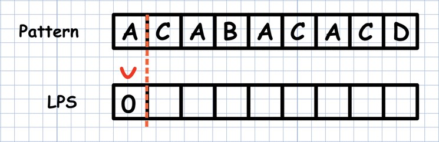
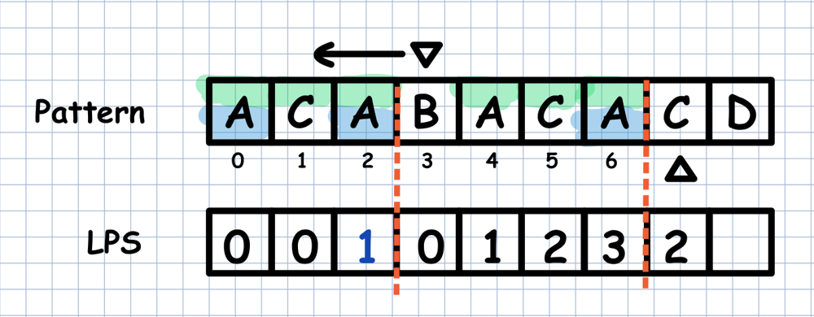
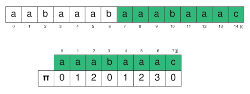
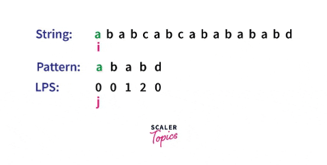

# ✅ C++ || KMP ALGO || explained properly with pictures

**Author:** rab8it
**Votes:** 7
**Link:** [https://leetcode.com/problems/longest-happy-prefix/solutions/2146100/](https://leetcode.com/problems/longest-happy-prefix/solutions/2146100/)

---

* ***APPROACH*** : 

# KMP ALGORITHM:









in this way as the above figures shows we gather the lps values.
```
string longestPrefix(string s) {
        int n=s.size();
        vector<int>lps(n,0);
        int i=1,len=0;
        while(i<n){
            if(s[i]==s[len])lps[i++]=++len;     //if the chars are same then simply increase index and length
            else{
                if(len)len=lps[len-1];            //if length is not zero then it will become the length upto the previous longest prefix
                else lps[i++]=0;     //if length is zero then just increase index
            }
        }
        return s.substr(0,len);
    }
```

if this is a little confusing i am suggesting a youtube video that can be helpful(**not sponsored or my channel**)----->https://www.youtube.com/watch?v=4jY57Ehc14Y

\u2705 HAPPY CODING \uD83D\uDE0E\uD83D\uDE4C


