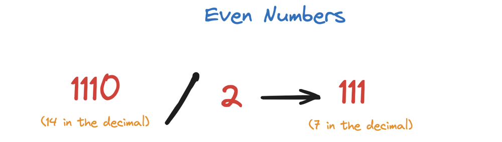
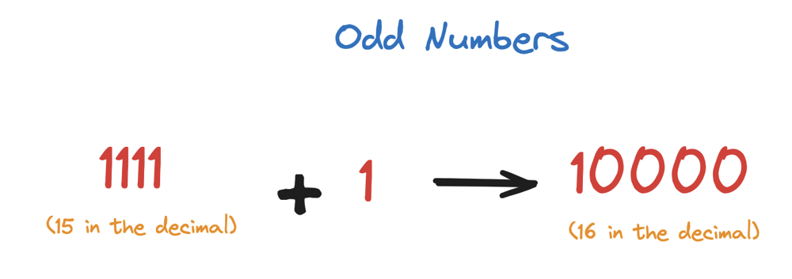
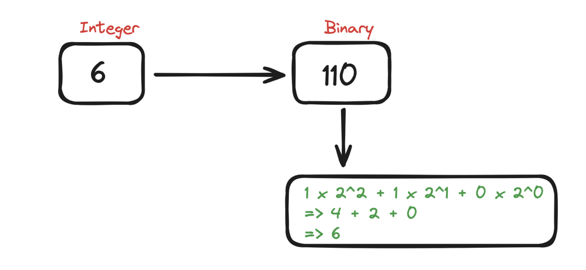
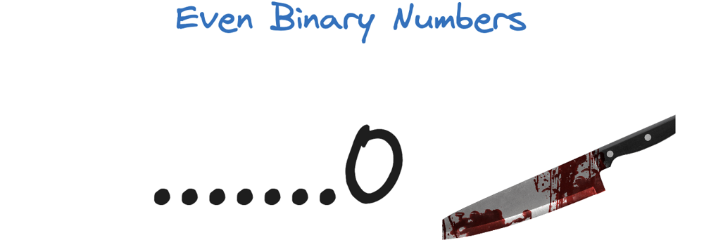

# 🔥🔥 Highly Detailed, Step By Step Explanation with Diagram 😱😨🤯

**Author:** hi-malik
**Votes:** 101
**Link:** [https://leetcode.com/problems/number-of-steps-to-reduce-a-number-in-binary-representation-to-one/solutions/5223471/](https://leetcode.com/problems/number-of-steps-to-reduce-a-number-in-binary-representation-to-one/solutions/5223471/)

---

```
Let's understand the Question First!
```

If the current number is **even**, you have to divide by **2**.

But, if the current number is **odd**, we have to add **1** to it!

> We know that binary numbers are composed of **0s** and **1s**, 
> > the decimal number **6** in a binary number of representation is **`110`** which is `2^2 + 2^1`, what I mean is :



* To solve this question, we need to understand that, the last digit of any **even binary number is zero**
```
Even Binary Numbers
.........0
=......+ 0 x 2^0
=......+ 0 
```

* And, the last digit of any **odd binary number is one**
```
Odd Binary Numbers
.........1
=......+ 1 x 2^0
=......+ 1 
```

To divide an even binary number by 2, we only need to chop the last digit off!


For example, 
```
110 / 2 => 11
```
Since divide by 2 means, -1 each power of 2 in 2 to the power of 2 plus 2 to the power one, which is 2 to the power of 1 plus 2 to the power 0, i.e. **11** in binary number
```
      110          /              2 => 11
1 x 2^2 + 1 x 2^1 + 0 x 2^0       1 x 2^1 + 1 x 2^0
=4 + 2 + 0                       =2 + 1
=6                               =3
```
For any Odd binary number, adding 1 turns it into an even number with the last digit **0**
```
. | . | . | . | 1
```
```
. | . | . | . | 0
```
And the **1** is carry on to the 2nd last digit. Example :
```
1 | 0 | 1
```
adding 1
```
1 | 1 | 0
```
**If there's not a second last digit, the one is carried over and will result in a new bit**

___
Approach
___
So, how do we approach this problem!

Suppose we're given the binary number **`1101`** and which to reduce to one, we do not change the original binary number and instead use a variable carry to record a carryover digit.
We start from the last digit of a binary number.
```
Steps :

1 1 0 1
      ^
```
Since it is odd, we first add 1 to the number, 
``` 
Steps :

     +1
1 1 0 1
      ^
```
and 1 is carried over to the second last digit
``` 
Steps :

1 1 0 1
    1 
	carry
```
Another number is even, we're divided by 2, by chopping it into **one one zero**
``` 
Steps : 2

1 1 0 
    1 
	carry
```
With a carryover digit one, this takes to **Step:2**

Now, the number is still odd, we add 1 to it
``` 
Steps : 2

   +1
1 1 0 
    1 
	carry
```
and divide it by 2, 
``` 
Steps : 2

   +1
1 1 
    1 
	carry
```
So that we have one one with another carryover digit 1
``` 
Steps : 2 + 2

1 1 
  1 
  carry
```
Now, this take 2 steps :
One way with our carry digit one is even, so dividing two means, chopping one more digit
``` 
Steps : 2 + 2

1 
  1 
  carry
```
Which results in one, with a carry over digit one, this take one step
``` 
Steps : 2 + 2 + 1

1 
1 
carry
```
Now, the number has only one digit, the carry digit will result to one more digit to the left and result, in the binary string 
```
Steps : 2 + 2 + 1

1 0
```
And we know that **`1 0`** is an even number, so we divide by 2 and obtain 1. Which is our last step
```
Steps : 2 + 2 + 1 + 1

1
```
Finally, we reduce the number to 1 in **6 steps**

Now, let's code it UP!

**C++**
```
class Solution {
public:
    int numSteps(string s) {
        int l = s.length() - 1;
        int carry = 0;
        int count = 0;
        
        while (l > 0) {
            // even number with carry = 0, result even
            if (s[l] - '0' + carry == 0) {
                carry = 0;
                count++;
            // odd number with carry = 1, result even
            } else if (s[l] - '0' + carry == 2) {
                carry = 1;
                count++;
            // even number with carry = 1, result odd
            // odd number with carry = 0, result odd
            } else {
                carry = 1;
                count += 2;
            }
            l--;
        }
        
        // last digit 1 needs to add a carried over digit 1, which gives 10.
        // So need one more divide to make it 1 (one more step)
        if (carry == 1) {
            count++;
        }
        
        return count;
    }
};
```
**JAVA**
```
class Solution {
    public int numSteps(String s) {
        int l = s.length() - 1;
        int carry = 0;
        int count = 0;
        
        while (l > 0) {
            // even number with carry = 0, result even
            if (Character.getNumericValue(s.charAt(l)) + carry == 0) {
                carry = 0;
                count++;
            // odd number with carry = 1, result even
            } else if (Character.getNumericValue(s.charAt(l)) + carry == 2) {
                carry = 1;
                count++;
            // even number with carry = 1, result odd
            // odd number with carry = 0, result odd
            } else {
                carry = 1;
                count += 2;
            }
            l--;
        }
        
        // last digit 1 needs to add a carried over digit 1, which gives 10.
        // So need one more divide to make it 1 (one more step)
        if (carry == 1) {
            count++;
        }
        
        return count;
    }
}
```
**PYTHON**
```
class Solution:
    def numSteps(self, s: str) -> int:
        l = len(s) - 1
        carry = 0
        count = 0
        while (l > 0):
            ##even number with carry = 0, result even
            if int(s[l]) + carry == 0:
                carry = 0
                count += 1
            ##odd number with carry = 1, result even
            elif int(s[l]) + carry == 2:
                carry = 1
                count += 1
            ##even number with carry = 1, result odd
            ##odd number with carry = 0, result odd
            else:
                carry = 1
                count += 2
            l -= 1
        #last digit 1 needs to add a carried over digit 1, which gives 10.
        #So need one more divide to make it 1 (one more step)
        if carry == 1:
            count += 1
        return count
```

___
Complexity Analysis
___

* **Time Complexity :-** BigO(N)
* **Space Complexity :-** BigO(1)