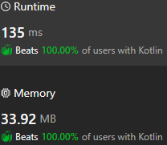

# One incomplete pass

**Author:** sav20011962
**Votes:** 3
**Link:** [https://leetcode.com/problems/number-of-steps-to-reduce-a-number-in-binary-representation-to-one/solutions/5224105/](https://leetcode.com/problems/number-of-steps-to-reduce-a-number-in-binary-representation-to-one/solutions/5224105/)

---

# Approach
One incomplete pass.
Analysis at each step taking into account the additive bit.
# Complexity
- Time complexity:
O(n)
- Space complexity:
O(1)
# Code

```
class Solution {
    fun numSteps(s: String): Int {
        val len = s.length
        var dop = 0
        var rez = 0
        for (i in len-1 downTo 1) {
            val ch = s[i]
            when {
                ch=='1' && dop == 0 -> {
                    rez+=2
                    dop = 1
                }
                ch=='1' && dop == 1 -> {
                    rez++                    
                }
                ch=='0' && dop == 0 -> {
                    rez++                    
                }
                ch=='0' && dop == 1 -> {
                    rez+=2
                }
            }
        }
        return rez+dop
    }
}
```