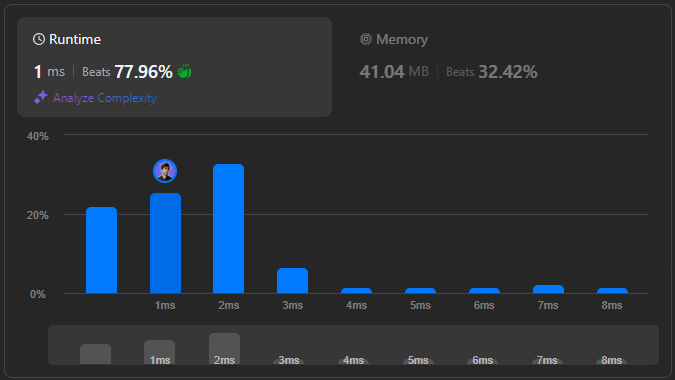

# 🌟 How to Easily Solve the Longest Happy String Problem in Multiple Languages 💯🔥

**Author:** withaarzoo
**Votes:** 117
**Link:** [https://leetcode.com/problems/longest-happy-string/solutions/5918628/](https://leetcode.com/problems/longest-happy-string/solutions/5918628/)

---


## **\uD83C\uDF1F Access Daily LeetCode Solutions Repo :** [click here](https://github.com/withaarzoo/LeetCode-Solutions)

---



---

# Intuition
The problem asks to construct the longest possible string using the letters `'a'`, `'b'`, and `'c'` such that:
1. No three consecutive characters are the same.
2. The counts of `'a'`, `'b'`, and `'c'` do not exceed the given values `a`, `b`, and `c` respectively.

The intuition here is that we should always aim to use the character with the highest count, while ensuring that it does not violate the "no three consecutive characters" rule. A greedy approach works well here because we can construct the string step by step by selecting the most available character, and if adding that character leads to three consecutive letters, we switch to the next most available character.

---

# Approach
1. **Greedy Strategy**: Always try to use the character with the highest remaining count. If that character has been used twice consecutively, switch to the next most frequent character.
2. **Priority Queue**: Use a max-heap (or priority queue) to keep track of the character counts. This ensures that at every step, we can easily pick the character with the highest remaining count.
3. **Condition Handling**: If the character with the highest count has been used twice in a row, we temporarily switch to the second-highest character to avoid three consecutive characters.
4. **Stop When No Characters Left**: The process stops when no more characters can be added without violating the conditions.

---

# Complexity
- **Time complexity**:  
  $$O(n)$$ where \\(n = a + b + c\\) since each character is processed at most once and we make at most 3 log operations per step (for the heap).
  
- **Space complexity**:  
  $$O(1)$$ for the priority queue, as we store a maximum of three characters. The result string takes \\(O(n)\\), but that is required for the output, so the effective auxiliary space is constant.

---

# Code
```C++ []
#include <queue>
#include <string>
using namespace std;

class Solution {
public:
    string longestDiverseString(int a, int b, int c) {
        // Priority queue to store the characters and their counts.
        priority_queue<pair<int, char>> pq;
        if (a > 0) pq.push({a, 'a'});
        if (b > 0) pq.push({b, 'b'});
        if (c > 0) pq.push({c, 'c'});

        string result = "";

        while (!pq.empty()) {
            // Get the character with the most count.
            auto [count1, char1] = pq.top();
            pq.pop();

            // Check if the last two characters in result are the same.
            if (result.size() >= 2 && result.back() == char1 && result[result.size() - 2] == char1) {
                if (pq.empty()) break;  // No valid characters left.

                // Get the second most character.
                auto [count2, char2] = pq.top();
                pq.pop();

                // Add the second character to avoid consecutive repetition.
                result += char2;
                count2--;

                if (count2 > 0) pq.push({count2, char2});

                // Push back the most frequent character for later use.
                pq.push({count1, char1});
            } else {
                // If no repetition issue, add the most frequent character.
                result += char1;
                count1--;

                if (count1 > 0) pq.push({count1, char1});
            }
        }

        return result;
    }
};

```
```Java []
import java.util.PriorityQueue;

class Solution {
    public String longestDiverseString(int a, int b, int c) {
        // Priority queue to store the characters and their counts.
        PriorityQueue<int[]> pq = new PriorityQueue<>((x, y) -> y[0] - x[0]);
        if (a > 0) pq.offer(new int[]{a, 'a'});
        if (b > 0) pq.offer(new int[]{b, 'b'});
        if (c > 0) pq.offer(new int[]{c, 'c'});

        StringBuilder result = new StringBuilder();

        while (!pq.isEmpty()) {
            int[] first = pq.poll();

            // Check if last two characters are the same.
            if (result.length() >= 2 && result.charAt(result.length() - 1) == first[1] &&
                result.charAt(result.length() - 2) == first[1]) {

                if (pq.isEmpty()) break;  // No more valid characters.

                // Pick the second character.
                int[] second = pq.poll();
                result.append((char) second[1]);
                second[0]--;

                if (second[0] > 0) pq.offer(second);
                pq.offer(first);
            } else {
                result.append((char) first[1]);
                first[0]--;

                if (first[0] > 0) pq.offer(first);
            }
        }

        return result.toString();
    }
}

```
```JavaScript []
var longestDiverseString = function(a, b, c) {
    // Priority queue to keep the characters sorted by count.
    const pq = [];
    if (a > 0) pq.push([a, 'a']);
    if (b > 0) pq.push([b, 'b']);
    if (c > 0) pq.push([c, 'c']);
    pq.sort((x, y) => y[0] - x[0]);  // Sort in descending order.

    let result = "";

    while (pq.length > 0) {
        let [count1, char1] = pq.shift();

        // If last two characters are the same as char1, pick the next one.
        if (result.length >= 2 && result[result.length - 1] === char1 && result[result.length - 2] === char1) {
            if (pq.length === 0) break;

            let [count2, char2] = pq.shift();
            result += char2;
            if (--count2 > 0) pq.push([count2, char2]);

            pq.push([count1, char1]);  // Push char1 back for later use.
        } else {
            result += char1;
            if (--count1 > 0) pq.push([count1, char1]);
        }

        pq.sort((x, y) => y[0] - x[0]);  // Sort after each modification.
    }

    return result;
};

```
```Python []
import heapq

class Solution:
    def longestDiverseString(self, a: int, b: int, c: int) -> str:
        # Max heap to always pick the character with the highest count.
        pq = []
        if a > 0:
            heapq.heappush(pq, (-a, 'a'))
        if b > 0:
            heapq.heappush(pq, (-b, 'b'))
        if c > 0:
            heapq.heappush(pq, (-c, 'c'))

        result = []

        while pq:
            count1, char1 = heapq.heappop(pq)

            # If the last two characters are the same as char1.
            if len(result) >= 2 and result[-1] == char1 and result[-2] == char1:
                if not pq:
                    break  # No valid characters left to pick.

                count2, char2 = heapq.heappop(pq)
                result.append(char2)
                count2 += 1  # Decrease count (negated)

                if count2 < 0:
                    heapq.heappush(pq, (count2, char2))

                heapq.heappush(pq, (count1, char1))
            else:
                result.append(char1)
                count1 += 1  # Decrease count (negated)

                if count1 < 0:
                    heapq.heappush(pq, (count1, char1))

        return ''.join(result)

```
```Go []
import (
    "container/heap"
    "strings"
)

type CharCount struct {
    count int
    ch    byte
}

// Priority queue implementation for Go
type MaxHeap []CharCount

func (h MaxHeap) Len() int           { return len(h) }
func (h MaxHeap) Less(i, j int) bool { return h[i].count > h[j].count }
func (h MaxHeap) Swap(i, j int)      { h[i], h[j] = h[j], h[i] }

func (h *MaxHeap) Push(x interface{}) {
    *h = append(*h, x.(CharCount))
}

func (h *MaxHeap) Pop() interface{} {
    old := *h
    n := len(old)
    x := old[n-1]
    *h = old[0 : n-1]
    return x
}

func longestDiverseString(a int, b int, c int) string {
    pq := &MaxHeap{}
    heap.Init(pq)

    if a > 0 {
        heap.Push(pq, CharCount{a, 'a'})
    }
    if b > 0 {
        heap.Push(pq, CharCount{b, 'b'})
    }
    if c > 0 {
        heap.Push(pq, CharCount{c, 'c'})
    }

    var result strings.Builder

    for pq.Len() > 0 {
        first := heap.Pop(pq).(CharCount)

        if result.Len() >= 2 && result.String()[result.Len()-1] == first.ch && result.String()[result.Len()-2] == first.ch {
            if pq.Len() == 0 {
                break
            }
            second := heap.Pop(pq).(CharCount)
            result.WriteByte(second.ch)
            second.count--
            if second.count > 0 {
                heap.Push(pq, second)
            }
            heap.Push(pq, first)
        } else {
            result.WriteByte(first.ch)
            first.count--
            if first.count > 0 {
                heap.Push(pq, first)
            }
        }
    }

    return result.String()
}

```

---

# Step-by-Step Detailed Explanation
1. **Priority Queue Setup**: In each solution, we use a priority queue (or similar structure) to maintain the counts of `'a'`, `'b'`, and `'c'`. This allows us to efficiently pick the character with the highest remaining count.
  
2. **Main Loop**: The loop continues as long as there are valid characters to add to the result string. In each iteration, we pick the character with the highest count. If it forms three consecutive characters, we switch to the second-highest count character.

3. **Character Addition**: We append the selected character to the result string. If it doesn't violate the "no three consecutive" rule, we reduce its count and push it back to the queue for future consideration.

4. **Stopping Condition**: The process stops when no more valid characters can be added without breaking the rule. The result string is then returned as the final output.

---


