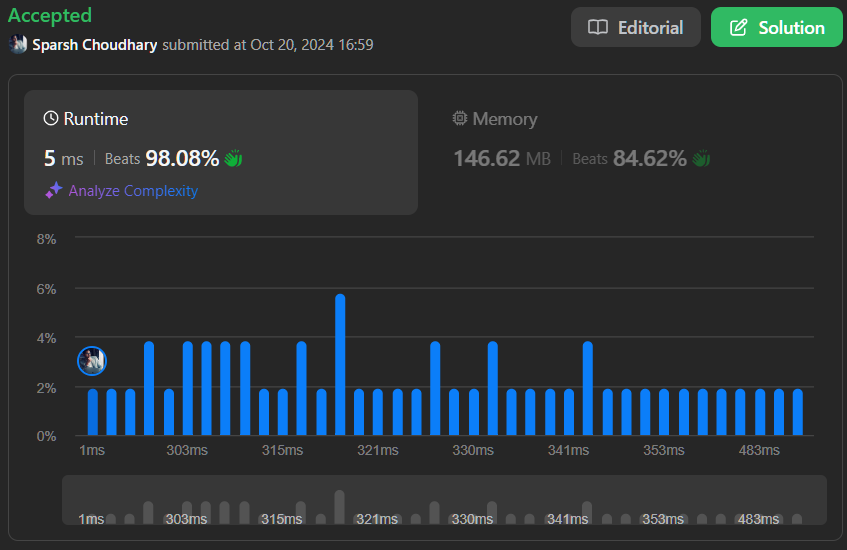

# 🔥BEATS *98.08* % 🎯 |✨SUPER EASY BEGINNERS 👏

**Author:** CodeWithSparsh
**Votes:** 3
**Link:** [https://leetcode.com/problems/longest-happy-string/solutions/5942184/](https://leetcode.com/problems/longest-happy-string/solutions/5942184/)

---



### **Intuition**

The problem involves constructing the longest diverse string using characters `a`, `b`, and `c`, such that no three consecutive characters are the same. The main challenge is to balance the usage of the characters in such a way that the most frequent ones are used without violating the constraint.

### **Approach**

1. **Priority Queue**: To keep track of the most frequent characters, we can use a priority queue (or a list with sorting). This helps us efficiently pick the character with the highest frequency to append to the result.
   
2. **Choosing Characters**: Each time we choose a character to add, we must check if the last two characters in the result are the same as the one we want to add. If they are, we should pick the next most frequent character to avoid violating the condition.

3. **Updating and Sorting**: After adding a character to the result, we decrease its frequency. Then, we push it back to the priority queue (or re-sort the list) to ensure the next pick is always the character with the highest frequency.

4. **Handling Edge Cases**: If no valid character is left (i.e., we can't avoid having three consecutive characters), we stop the process.

### **Complexity**

- **Time Complexity**: 
  - Sorting the priority queue takes \\(O(1)\\) when there are only three elements (`a`, `b`, `c`), so the main time complexity comes from the number of characters in the output, which is \\(O(n)\\), where \\(n\\) is the total number of characters (sum of `a`, `b`, and `c`).
  
- **Space Complexity**: 
  - \\(O(1)\\) since the priority queue or list only stores the frequencies of three characters.

---


### **Explanation**

- **Priority Queue**: A priority queue (`pq`) is used to manage the characters based on their frequency. At each step, we select the most frequent character.
  
- **Checking Repetition**: Before adding the most frequent character, we check if the last two characters in the result are the same as the one we want to add. If so, we pick the next most frequent character.

- **Re-sorting**: After each addition of a character to the result, we update its frequency and re-sort the list to ensure the next character we pick is the most frequent one.


---

### **Code**

```dart []
import 'dart:collection';

class Solution {
  String longestDiverseString(int a, int b, int c) {
    List<List<dynamic>> pq = [];
    if (a > 0) pq.add([a, 'a']);
    if (b > 0) pq.add([b, 'b']);
    if (c > 0) pq.add([c, 'c']);

    pq.sort((x, y) => y[0] - x[0]);
    String result = "";

    while (pq.isNotEmpty) {
      var top1 = pq[0];
      int count1 = top1[0];
      String char1 = top1[1];
      pq.removeAt(0);

      int n = result.length;
      if (result.length >= 2 && result[n - 1] == char1 && result[n - 2] == char1) {
        if (pq.isEmpty) break;

        var top2 = pq[0];
        int count2 = top2[0];
        String char2 = top2[1];
        pq.removeAt(0);

        result += char2;
        count2--;

        if (count2 > 0) pq.add([count2, char2]);
        pq.add([count1, char1]);
      } else {
        result += char1;
        count1--;

        if (count1 > 0) pq.add([count1, char1]);
      }

      pq.sort((x, y) => y[0] - x[0]);
    }

    return result;
  }
}
```
```c []
#include <stdio.h>
#include <stdlib.h>
#include <string.h>

typedef struct {
    int count;
    char ch;
} CharFreq;

int cmp(const void *a, const void *b) {
    return ((CharFreq *)b)->count - ((CharFreq *)a)->count;
}

char *longestDiverseString(int a, int b, int c) {
    CharFreq pq[3] = {{a, 'a'}, {b, 'b'}, {c, 'c'}};
    qsort(pq, 3, sizeof(CharFreq), cmp);

    char *result = (char *)malloc(1000 * sizeof(char));
    int pos = 0;

    while (pq[0].count > 0) {
        if (pos >= 2 && result[pos - 1] == pq[0].ch && result[pos - 2] == pq[0].ch) {
            if (pq[1].count == 0) break;
            result[pos++] = pq[1].ch;
            pq[1].count--;
        } else {
            result[pos++] = pq[0].ch;
            pq[0].count--;
        }
        qsort(pq, 3, sizeof(CharFreq), cmp);
    }

    result[pos] = '\\0';
    return result;
}

int main() {
    printf("%s\
", longestDiverseString(1, 1, 7));
    return 0;
}
```


```cpp []
#include <iostream>
#include <queue>
#include <string>

using namespace std;

struct CharFreq {
    int count;
    char ch;
    bool operator<(const CharFreq &other) const {
        return count < other.count;
    }
};

class Solution {
public:
    string longestDiverseString(int a, int b, int c) {
        priority_queue<CharFreq> pq;
        if (a > 0) pq.push({a, 'a'});
        if (b > 0) pq.push({b, 'b'});
        if (c > 0) pq.push({c, 'c'});

        string result = "";
        while (!pq.empty()) {
            auto top1 = pq.top();
            pq.pop();
            if (result.length() >= 2 && result.back() == top1.ch && result[result.length() - 2] == top1.ch) {
                if (pq.empty()) break;
                auto top2 = pq.top();
                pq.pop();
                result += top2.ch;
                if (--top2.count > 0) pq.push(top2);
                pq.push(top1);
            } else {
                result += top1.ch;
                if (--top1.count > 0) pq.push(top1);
            }
        }

        return result;
    }
};

int main() {
    Solution sol;
    cout << sol.longestDiverseString(1, 1, 7) << endl;
    return 0;
}
```

```java []
import java.util.PriorityQueue;

class Solution {
    public String longestDiverseString(int a, int b, int c) {
        PriorityQueue<int[]> pq = new PriorityQueue<>((x, y) -> y[0] - x[0]);
        if (a > 0) pq.add(new int[]{a, 'a'});
        if (b > 0) pq.add(new int[]{b, 'b'});
        if (c > 0) pq.add(new int[]{c, 'c'});

        StringBuilder result = new StringBuilder();
        while (!pq.isEmpty()) {
            int[] top1 = pq.poll();
            if (result.length() >= 2 && result.charAt(result.length() - 1) == top1[1] && result.charAt(result.length() - 2) == top1[1]) {
                if (pq.isEmpty()) break;
                int[] top2 = pq.poll();
                result.append((char) top2[1]);
                if (--top2[0] > 0) pq.add(top2);
                pq.add(top1);
            } else {
                result.append((char) top1[1]);
                if (--top1[0] > 0) pq.add(top1);
            }
        }

        return result.toString();
    }
}
```

```python []
from heapq import heappush, heappop

def longestDiverseString(a: int, b: int, c: int) -> str:
    pq = []
    if a > 0:
        heappush(pq, (-a, 'a'))
    if b > 0:
        heappush(pq, (-b, 'b'))
    if c > 0:
        heappush(pq, (-c, 'c'))

    result = []
    while pq:
        count1, char1 = heappop(pq)
        if len(result) >= 2 and result[-1] == char1 and result[-2] == char1:
            if not pq:
                break
            count2, char2 = heappop(pq)
            result.append(char2)
            if count2 + 1 < 0:
                heappush(pq, (count2 + 1, char2))
            heappush(pq, (count1, char1))
        else:
            result.append(char1)
            if count1 + 1 < 0:
                heappush(pq, (count1 + 1, char1))

    return ''.join(result)
```

```javascript []
var longestDiverseString = function(a, b, c) {
    let pq = [];
    if (a > 0) pq.push([a, 'a']);
    if (b > 0) pq.push([b, 'b']);
    if (c > 0) pq.push([c, 'c']);
    
    pq.sort((x, y) => y[0] - x[0]);

    let result = "";
    
    while (pq.length > 0) {
        let [count1, char1] = pq.shift();
        
        if (result.length >= 2 && result[result.length - 1] === char1 && result[result.length - 2] === char1) {
            if (pq.length === 0) break;
            
            let [count2, char2] = pq.shift();
            result += char2;
            count2--;
            
            if (count2 > 0) pq.push([count2, char2]);
            pq.push([count1, char1]);
        } else {
            result += char1;
            count1--;
            if (count1 > 0) pq.push([count1, char1]);
        }
        
        pq.sort((x, y) => y[0] - x[0]);
    }
    
    return result;
};
```

```go []
package main

import (
	"fmt"
	"sort"
)

func longestDiverseString(a int, b int, c int) string {
	pq := [][]int{}
	if a > 0 {
		pq = append(pq, []int{a, 'a'})
	}
	if b > 0 {
		pq = append(pq, []int{b, 'b'})
	}
	if c > 0 {
		pq = append(pq, []int{c, 'c'})
	}

	sort.Slice(pq, func(i, j int) bool {
		return pq[i][0] > pq[j][0]
	})

	result := ""

	for len(pq) > 0 {
		top1 := pq[0]
		pq = pq[1:]
		count1, char1 := top1[0], rune(top1[1])

		n := len(result)
		if n >= 2 && result[n-1] == byte(char1) &&

 result[n-2] == byte(char1) {
			if len(pq) == 0 {
				break
			}

			top2 := pq[0]
			pq = pq[1:]
			count2, char2 := top2[0], rune(top2[1])

			result += string(char2)
			count2--

			if count2 > 0 {
				pq = append(pq, []int{count2, int(char2)})
			}
			pq = append(pq, []int{count1, int(char1)})
		} else {
			result += string(char1)
			count1--

			if count1 > 0 {
				pq = append(pq, []int{count1, int(char1)})
			}
		}

		sort.Slice(pq, func(i, j int) bool {
			return pq[i][0] > pq[j][0]
		})
	}

	return result
}

func main() {
	fmt.Println(longestDiverseString(1, 1, 7))
}
``` 


This approach ensures that the string is as long as possible while respecting the condition of avoiding three consecutive identical characters.

---

 {:style='width:250px'}