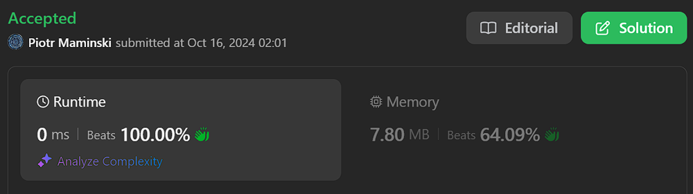
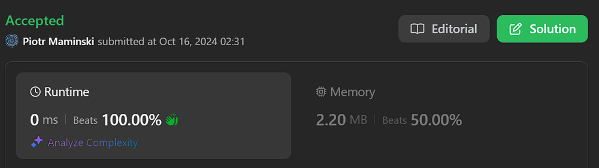

# ✅ Explained step by step | Beats 100% | O(n) | ✅ Working 16.10.2024

**Author:** Piotr_Maminski
**Votes:** 9
**Link:** [https://leetcode.com/problems/longest-happy-string/solutions/5918603/](https://leetcode.com/problems/longest-happy-string/solutions/5918603/)

---

```python3 []
import heapq

class Solution:
    def longestDiverseString(self, a: int, b: int, c: int) -> str:
        # Create a max heap (priority queue) to store character frequencies
        pq = []

        # Push non-zero frequencies to the priority queue
        if a > 0:
            heapq.heappush(pq, (-a, 'a'))
        if b > 0:
            heapq.heappush(pq, (-b, 'b'))
        if c > 0:
            heapq.heappush(pq, (-c, 'c'))

        # Initialize the result string
        result = ""

        # Main loop: continue while there are at least 2 characters left
        while len(pq) > 1:
            # Get the character with the highest frequency
            freq1, c1 = heapq.heappop(pq)
            freq1 = -freq1  # Convert back to positive

            # If the result string has 0 or 1 character, we can safely add c1
            if len(result) <= 1:
                result += c1
                freq1 -= 1
                if freq1 > 0:
                    heapq.heappush(pq, (-freq1, c1))
            else:
                # Check if adding c1 would create three consecutive same characters
                if result[-1] == c1 and result[-2] == c1:
                    # If so, use the second most frequent character instead
                    freq2, c2 = heapq.heappop(pq)
                    freq2 = -freq2  # Convert back to positive

                    result += c2
                    freq2 -= 1

                    # Push back the updated frequencies
                    if freq2 > 0:
                        heapq.heappush(pq, (-freq2, c2))
                    if freq1 > 0:
                        heapq.heappush(pq, (-freq1, c1))
                else:
                    # If no three consecutive same characters, add c1
                    result += c1
                    freq1 -= 1
                    if freq1 > 0:
                        heapq.heappush(pq, (-freq1, c1))

        # Handle the case when only one character type is left
        if len(pq) == 1:
            freq1, c1 = heapq.heappop(pq)
            freq1 = -freq1  # Convert back to positive
            
            # Add at most two of the remaining character
            if freq1 <= 1:
                result += c1
            else:
                result += c1 * 2

        # Return the final diverse string
        return result
```
```cpp []
class Solution {
public:
    string longestDiverseString(int a, int b, int c) {
        // Priority queue to store the characters based on their frequency
        // The priority queue will always keep the most frequent character at the top
        priority_queue<pair<int, char>> pq;

        // Push each character with its frequency into the priority queue if it exists (i.e., count > 0)
        if (a > 0) pq.push({a, 'a'});
        if (b > 0) pq.push({b, 'b'});
        if (c > 0) pq.push({c, 'c'});

        string result = "";  // This will store the final diverse string

        // While there are at least two elements in the queue
        while (pq.size() > 1) {
            // Get the most frequent character
            int freq1 = pq.top().first;
            char c1 = pq.top().second;
            pq.pop();  // Remove it from the queue

            // If the string is too small to worry about repetition, simply append the character
            if (result.size() <= 1) {
                result += c1;
                freq1--;  // Decrease its frequency as it's being used
                // If there's still some occurrences left, push it back into the queue
                if (freq1 > 0) pq.push({freq1, c1});
            } 
            // Otherwise, we need to ensure we don't add the same character more than twice consecutively
            else {
                // Check if the last two characters in the result are the same as the current character
                if (result[result.size() - 1] == c1 && result[result.size() - 2] == c1) {
                    // In this case, get the second most frequent character
                    int freq2 = pq.top().first;
                    char c2 = pq.top().second;
                    pq.pop();  // Remove the second character from the queue

                    // Add the second character to the result
                    result += c2;
                    freq2--;  // Decrease its frequency as it's being used

                    // Push the characters back into the queue if they still have remaining counts
                    if (freq2 > 0) pq.push({freq2, c2});
                    if (freq1 > 0) pq.push({freq1, c1});
                } 
                // If no violation of the "no three consecutive characters" rule, add the current character
                else {
                    result += c1;
                    freq1--;
                    if (freq1 > 0) pq.push({freq1, c1});
                }
            }
        }

        // Handle the case when there's only one character left in the priority queue
        if (pq.size() == 1) {
            int freq1 = pq.top().first;
            char c1 = pq.top().second;
            
            // Add it once or twice depending on the frequency (ensuring no three consecutive characters)
            if (freq1 <= 1) {
                result += c1;
            } else {
                result += c1;
                result += c1;
            }
        }

        return result;  // Return the final string
    }
};

```

```java []
import java.util.PriorityQueue;

class Solution {
    public String longestDiverseString(int a, int b, int c) {
        // Create a max heap (priority queue) to store character frequencies
        PriorityQueue<Pair> pq = new PriorityQueue<>((p1, p2) -> p2.freq - p1.freq);

        // Push non-zero frequencies to the priority queue
        if (a > 0) pq.offer(new Pair(a, 'a'));
        if (b > 0) pq.offer(new Pair(b, 'b'));
        if (c > 0) pq.offer(new Pair(c, 'c'));

        // Initialize the result string
        StringBuilder result = new StringBuilder();

        // Main loop: continue while there are at least 2 characters left
        while (pq.size() > 1) {
            // Get the character with the highest frequency
            Pair pair1 = pq.poll();
            int freq1 = pair1.freq;
            char c1 = pair1.ch;

            // If the result string has 0 or 1 character, we can safely add c1
            if (result.length() <= 1) {
                result.append(c1);
                freq1--;
                if (freq1 > 0) pq.offer(new Pair(freq1, c1));
            } else {
                // Check if adding c1 would create three consecutive same characters
                if (result.charAt(result.length() - 1) == c1 && result.charAt(result.length() - 2) == c1) {
                    // If so, use the second most frequent character instead
                    Pair pair2 = pq.poll();
                    int freq2 = pair2.freq;
                    char c2 = pair2.ch;

                    result.append(c2);
                    freq2--;

                    // Push back the updated frequencies
                    if (freq2 > 0) pq.offer(new Pair(freq2, c2));
                    if (freq1 > 0) pq.offer(new Pair(freq1, c1));
                } else {
                    // If no three consecutive same characters, add c1
                    result.append(c1);
                    freq1--;
                    if (freq1 > 0) pq.offer(new Pair(freq1, c1));
                }
            }
        }

        // Handle the case when only one character type is left
        if (!pq.isEmpty()) {
            Pair pair1 = pq.poll();
            int freq1 = pair1.freq;
            char c1 = pair1.ch;
            
            // Add at most two of the remaining character
            if (freq1 <= 1) {
                result.append(c1);
            } else {
                result.append(c1).append(c1);
            }
        }

        // Return the final diverse string
        return result.toString();
    }

    // Helper class to store frequency and character pairs
    private static class Pair {
        int freq;
        char ch;

        Pair(int freq, char ch) {
            this.freq = freq;
            this.ch = ch;
        }
    }
}
```
```javascript [JS]
var longestDiverseString = function(a, b, c) {
    // Create an array of character-count pairs
    const chars = [
        ['a', a],
        ['b', b],
        ['c', c]
    ]
    
    // Initialize the result array and calculate total characters
    const ans = [], sum = a + b + c

    // Continue building the string until we've used all characters or can't add more
    while (ans.length < sum) {
        const n = ans.length

        // Sort the chars array based on count in descending order
        chars.sort(([a, c1], [b, c2]) => c2 - c1)

        // Choose which character to add next
        // If the last two characters are the same as the most frequent remaining character,
        // choose the second most frequent to avoid three consecutive same characters
        const char = ans[n - 1] === ans[n - 2] && ans[n - 1] === chars[0][0] ? chars[1] : chars[0]
        
        // If the chosen character has count 0, we can't add more characters
        if (char[1] === 0) break
        
        // Add the chosen character to the result
        ans.push(char[0])

        // Decrease the count of the used character
        char[1]--
    }

    // Join the characters in the result array and return as a string
    return ans.join('')
};
```
```typescript [TS]
function longestDiverseString(a: number, b: number, c: number): string {
    // Create an array of character-count tuples
    const chars: [string, number][] = [
        ['a', a],
        ['b', b],
        ['c', c]
    ];
    
    // Initialize the result array and calculate total characters
    const ans: string[] = [];
    const sum: number = a + b + c;

    // Continue building the string until we've used all characters or can't add more
    while (ans.length < sum) {
        const n: number = ans.length;

        // Sort the chars array based on count in descending order
        chars.sort(([, c1], [, c2]) => c2 - c1);

        // Choose which character to add next
        // If the last two characters are the same as the most frequent remaining character,
        // choose the second most frequent to avoid three consecutive same characters
        const char: [string, number] = 
            (ans[n - 1] === ans[n - 2] && ans[n - 1] === chars[0][0]) ? chars[1] : chars[0];
        
        // If the chosen character has count 0, we can't add more characters
        if (char[1] === 0) break;
        
        // Add the chosen character to the result
        ans.push(char[0]);

        // Decrease the count of the used character
        char[1]--;
    }

    // Join the characters in the result array and return as a string
    return ans.join('');
}
```
```csharp []
using System;
using System.Collections.Generic;
using System.Linq;

public class Solution {
    public string LongestDiverseString(int a, int b, int c) {
        // Create a max heap (priority queue) to store character frequencies
        var pq = new PriorityQueue<(int freq, char ch), int>(Comparer<int>.Create((x, y) => y.CompareTo(x)));

        // Push non-zero frequencies to the priority queue
        if (a > 0) pq.Enqueue((a, 'a'), a);
        if (b > 0) pq.Enqueue((b, 'b'), b);
        if (c > 0) pq.Enqueue((c, 'c'), c);

        // Initialize the result string
        var result = new System.Text.StringBuilder();

        // Main loop: continue while there are at least 2 characters left
        while (pq.Count > 1) {
            // Get the character with the highest frequency
            var (freq1, c1) = pq.Dequeue();

            // If the result string has 0 or 1 character, we can safely add c1
            if (result.Length <= 1) {
                result.Append(c1);
                freq1--;
                if (freq1 > 0) pq.Enqueue((freq1, c1), freq1);
            }
            else {
                // Check if adding c1 would create three consecutive same characters
                if (result[result.Length - 1] == c1 && result[result.Length - 2] == c1) {
                    // If so, use the second most frequent character instead
                    var (freq2, c2) = pq.Dequeue();

                    result.Append(c2);
                    freq2--;

                    // Push back the updated frequencies
                    if (freq2 > 0) pq.Enqueue((freq2, c2), freq2);
                    if (freq1 > 0) pq.Enqueue((freq1, c1), freq1);
                }
                else {
                    // If no three consecutive same characters, add c1
                    result.Append(c1);
                    freq1--;
                    if (freq1 > 0) pq.Enqueue((freq1, c1), freq1);
                }
            }
        }

        // Handle the case when only one character type is left
        if (pq.Count == 1) {
            var (freq1, c1) = pq.Dequeue();

            // Add at most two of the remaining character
            if (freq1 <= 1) {
                result.Append(c1);
            } else {
                result.Append(c1);
                result.Append(c1);
            }
        }

        // Return the final diverse string
        return result.ToString();
    }
}


```
```rust []
// Import the BinaryHeap from the standard library's collections module
use std::collections::BinaryHeap;

impl Solution {
    pub fn longest_diverse_string(a: i32, b: i32, c: i32) -> String {
        // Create a String with capacity to hold all characters (a + b + c)
        let mut string = String::with_capacity((a + b + c) as usize);
        // Create a BinaryHeap to store character counts and characters
        let mut heap = BinaryHeap::with_capacity(3);

        // Push non-zero counts and their corresponding characters to the heap
        if a > 0 {
            heap.push((a, 'a'));
        }
        if b > 0 {
            heap.push((b, 'b'));
        }
        if c > 0 {
            heap.push((c, 'c'));
        }

        // Keep track of the total number of characters left
        let mut total = a + b + c;
        // Variable to store the last used character and its count
        let mut last = None;

        // Continue while there are characters in the heap
        while let Some((mut count, ch)) = heap.pop() {
            // Add the current character to the string
            string.push(ch);
            // Decrease the count and total
            count -= 1;
            total -= 1;

            // If the current character's count is more than twice the remaining characters,
            // add it one more time to ensure we don't exceed the "at most two consecutive" rule
            if count > (total - count) * 2 {
                count -= 1;
                total -= 1;
                string.push(ch);
            }

            // If there was a last character stored, push it back to the heap
            if let Some(last) = last.take() {
                heap.push(last);
            }

            // If the current character still has a positive count, store it as the last character
            if count > 0 {
                last = Some((count, ch));
            }
        }

        // Return the constructed string
        string
    }
}
```
```golang []
package main

import (
	"container/heap"
	"strings"
)

// CharFreq represents a character and its frequency
type CharFreq struct {
	freq int
	char byte
}

// PriorityQueue is a custom heap implementation for CharFreq
type PriorityQueue []*CharFreq

// The following methods implement heap.Interface
func (pq PriorityQueue) Len() int { return len(pq) }

// We want a max-heap, so we use > instead of <
func (pq PriorityQueue) Less(i, j int) bool {
	return pq[i].freq > pq[j].freq
}

func (pq PriorityQueue) Swap(i, j int) {
	pq[i], pq[j] = pq[j], pq[i]
}

func (pq *PriorityQueue) Push(x interface{}) {
	item := x.(*CharFreq)
	*pq = append(*pq, item)
}

func (pq *PriorityQueue) Pop() interface{} {
	old := *pq
	n := len(old)
	item := old[n-1]
	*pq = old[0 : n-1]
	return item
}

func longestDiverseString(a int, b int, c int) string {
	// Initialize the priority queue
	pq := make(PriorityQueue, 0)
	heap.Init(&pq)

	// Push non-zero frequencies to the priority queue
	if a > 0 {
		heap.Push(&pq, &CharFreq{freq: a, char: 'a'})
	}
	if b > 0 {
		heap.Push(&pq, &CharFreq{freq: b, char: 'b'})
	}
	if c > 0 {
		heap.Push(&pq, &CharFreq{freq: c, char: 'c'})
	}

	// Initialize the result string builder
	var result strings.Builder

	// Main loop: continue while there are at least 2 characters left
	for pq.Len() > 1 {
		// Get the character with the highest frequency
		freq1 := heap.Pop(&pq).(*CharFreq)

		// If the result string has 0 or 1 character, we can safely add the current char
		if result.Len() <= 1 {
			result.WriteByte(freq1.char)
			freq1.freq--
			if freq1.freq > 0 {
				heap.Push(&pq, freq1)
			}
		} else {
			// Check if adding the current char would create three consecutive same characters
			if result.String()[result.Len()-1] == freq1.char && result.String()[result.Len()-2] == freq1.char {
				// If so, use the second most frequent character instead
				freq2 := heap.Pop(&pq).(*CharFreq)

				result.WriteByte(freq2.char)
				freq2.freq--

				// Push back the updated frequencies
				if freq2.freq > 0 {
					heap.Push(&pq, freq2)
				}
				if freq1.freq > 0 {
					heap.Push(&pq, freq1)
				}
			} else {
				// If no three consecutive same characters, add the current char
				result.WriteByte(freq1.char)
				freq1.freq--
				if freq1.freq > 0 {
					heap.Push(&pq, freq1)
				}
			}
		}
	}

	// Handle the case when only one character type is left
	if pq.Len() == 1 {
		freq1 := heap.Pop(&pq).(*CharFreq)

		// Add at most two of the remaining character
		if freq1.freq <= 1 {
			result.WriteByte(freq1.char)
		} else {
			result.WriteByte(freq1.char)
			result.WriteByte(freq1.char)
		}
	}

	// Return the final diverse string
	return result.String()
}
```
```swift []
import Foundation

class Solution {
    func longestDiverseString(_ a: Int, _ b: Int, _ c: Int) -> String {
        // Create a max heap (priority queue) to store character frequencies
        var pq = Heap<(Int, Character)>(sort: { $0.0 > $1.0 })
        
        // Push non-zero frequencies to the priority queue
        if a > 0 { pq.insert((a, "a")) }
        if b > 0 { pq.insert((b, "b")) }
        if c > 0 { pq.insert((c, "c")) }
        
        // Initialize the result string
        var result = ""
        
        // Main loop: continue while there are at least 2 characters left
        while pq.count > 1 {
            // Get the character with the highest frequency
            var (freq1, c1) = pq.remove()!
            
            // If the result string has 0 or 1 character, we can safely add c1
            if result.count <= 1 {
                result.append(c1)
                freq1 -= 1
                if freq1 > 0 {
                    pq.insert((freq1, c1))
                }
            } else {
                // Check if adding c1 would create three consecutive same characters
                if result.hasSuffix(String(repeating: c1, count: 2)) {
                    // If so, use the second most frequent character instead
                    var (freq2, c2) = pq.remove()!
                    
                    result.append(c2)
                    freq2 -= 1
                    
                    // Push back the updated frequencies
                    if freq2 > 0 {
                        pq.insert((freq2, c2))
                    }
                    if freq1 > 0 {
                        pq.insert((freq1, c1))
                    }
                } else {
                    // If no three consecutive same characters, add c1
                    result.append(c1)
                    freq1 -= 1
                    if freq1 > 0 {
                        pq.insert((freq1, c1))
                    }
                }
            }
        }
        
        // Handle the case when only one character type is left
        if let (freq1, c1) = pq.remove() {
            // Add at most two of the remaining character
            if freq1 <= 1 {
                result.append(c1)
            } else {
                result.append(String(repeating: c1, count: 2))
            }
        }
        
        // Return the final diverse string
        return result
    }
}

// Custom Heap implementation (as Swift doesn't have a built-in heap)
struct Heap<Element> {
    var elements: [Element]
    let sort: (Element, Element) -> Bool
    
    init(sort: @escaping (Element, Element) -> Bool) {
        self.elements = []
        self.sort = sort
    }
    
    var count: Int { elements.count }
    
    mutating func insert(_ element: Element) {
        elements.append(element)
        siftUp(from: elements.count - 1)
    }
    
    mutating func remove() -> Element? {
        guard !elements.isEmpty else { return nil }
        elements.swapAt(0, elements.count - 1)
        let element = elements.removeLast()
        if !elements.isEmpty {
            siftDown(from: 0)
        }
        return element
    }
    
    private mutating func siftUp(from index: Int) {
        var child = index
        var parent = parentIndex(of: child)
        while child > 0 && sort(elements[child], elements[parent]) {
            elements.swapAt(child, parent)
            child = parent
            parent = parentIndex(of: child)
        }
    }
    
    private mutating func siftDown(from index: Int) {
        var parent = index
        while true {
            let leftChild = leftChildIndex(of: parent)
            let rightChild = rightChildIndex(of: parent)
            var candidate = parent
            if leftChild < elements.count && sort(elements[leftChild], elements[candidate]) {
                candidate = leftChild
            }
            if rightChild < elements.count && sort(elements[rightChild], elements[candidate]) {
                candidate = rightChild
            }
            if candidate == parent {
                return
            }
            elements.swapAt(parent, candidate)
            parent = candidate
        }
    }
    
    private func parentIndex(of index: Int) -> Int {
        return (index - 1) / 2
    }
    
    private func leftChildIndex(of index: Int) -> Int {
        return 2 * index + 1
    }
    
    private func rightChildIndex(of index: Int) -> Int {
        return 2 * index + 2
    }
}


```
```ruby []
#TEMPORARY
def longest_diverse_string(a, b, c)
  # Create an array of character-count pairs
  chars = [
    ['a', a],
    ['b', b],
    ['c', c]
  ]
  
  # Initialize the result string
  result = ""

  # Continue building the string until we can't add more characters
  loop do
    # Sort the chars array based on count in descending order
    chars.sort_by! { |_, count| -count }

    # Try to add the most frequent character
    added = false
    chars.each do |char, count|
      if count > 0 && (result[-2..-1] != char * 2)
        result << char
        chars[chars.index([char, count])] = [char, count - 1]
        added = true
        break
      end
    end

    # If we couldn't add any character, we're done
    break unless added
  end

  result
end

# Test the function
puts longest_diverse_string(1, 1, 7)  # Should output "ccaccbcc"
puts longest_diverse_string(2, 2, 1)  # Should output "aabbc"
puts longest_diverse_string(7, 1, 0)  # Should output "aabaa"
```
# (faster) Without explained in comments (faster)
```python3 []
import heapq

class Solution:
    def longestDiverseString(self, a: int, b: int, c: int) -> str:
        pq = []

        if a > 0:
            heapq.heappush(pq, (-a, 'a'))
        if b > 0:
            heapq.heappush(pq, (-b, 'b'))
        if c > 0:
            heapq.heappush(pq, (-c, 'c'))

        result = ""

        while len(pq) > 1:
            freq1, c1 = heapq.heappop(pq)
            freq1 = -freq1

            if len(result) <= 1:
                result += c1
                freq1 -= 1
                if freq1 > 0:
                    heapq.heappush(pq, (-freq1, c1))
            else:
                if result[-1] == c1 and result[-2] == c1:
                    freq2, c2 = heapq.heappop(pq)
                    freq2 = -freq2

                    result += c2
                    freq2 -= 1

                    if freq2 > 0:
                        heapq.heappush(pq, (-freq2, c2))
                    if freq1 > 0:
                        heapq.heappush(pq, (-freq1, c1))
                else:
                    result += c1
                    freq1 -= 1
                    if freq1 > 0:
                        heapq.heappush(pq, (-freq1, c1))

        if len(pq) == 1:
            freq1, c1 = heapq.heappop(pq)
            freq1 = -freq1
            
            if freq1 <= 1:
                result += c1
            else:
                result += c1 * 2

        return result
```
```cpp []
class Solution {
public:
    string longestDiverseString(int a, int b, int c) {
        priority_queue<pair<int, char>> pq;

        if (a > 0) pq.push({a, 'a'});
        if (b > 0) pq.push({b, 'b'});
        if (c > 0) pq.push({c, 'c'});

        string result = "";

        while (pq.size() > 1) {
            int freq1 = pq.top().first;
            char c1 = pq.top().second;
            pq.pop();

            if (result.size() <= 1) {
                result += c1;
                freq1--;
                if (freq1 > 0) pq.push({freq1, c1});
            } 
            else {
                if (result[result.size() - 1] == c1 && result[result.size() - 2] == c1) {
                    int freq2 = pq.top().first;
                    char c2 = pq.top().second;
                    pq.pop();

                    result += c2;
                    freq2--;

                    if (freq2 > 0) pq.push({freq2, c2});
                    if (freq1 > 0) pq.push({freq1, c1});
                } 
                else {
                    result += c1;
                    freq1--;
                    if (freq1 > 0) pq.push({freq1, c1});
                }
            }
        }

        if (pq.size() == 1) {
            int freq1 = pq.top().first;
            char c1 = pq.top().second;
            
            if (freq1 <= 1) {
                result += c1;
            } else {
                result += c1;
                result += c1;
            }
        }

        return result;
    }
};
```

```java []
import java.util.PriorityQueue;

class Solution {
    public String longestDiverseString(int a, int b, int c) {
        PriorityQueue<Pair> pq = new PriorityQueue<>((p1, p2) -> p2.freq - p1.freq);

        if (a > 0) pq.offer(new Pair(a, 'a'));
        if (b > 0) pq.offer(new Pair(b, 'b'));
        if (c > 0) pq.offer(new Pair(c, 'c'));

        StringBuilder result = new StringBuilder();

        while (pq.size() > 1) {
            Pair pair1 = pq.poll();
            int freq1 = pair1.freq;
            char c1 = pair1.ch;

            if (result.length() <= 1) {
                result.append(c1);
                freq1--;
                if (freq1 > 0) pq.offer(new Pair(freq1, c1));
            } else {
                if (result.charAt(result.length() - 1) == c1 && result.charAt(result.length() - 2) == c1) {
                    Pair pair2 = pq.poll();
                    int freq2 = pair2.freq;
                    char c2 = pair2.ch;

                    result.append(c2);
                    freq2--;

                    if (freq2 > 0) pq.offer(new Pair(freq2, c2));
                    if (freq1 > 0) pq.offer(new Pair(freq1, c1));
                } else {
                    result.append(c1);
                    freq1--;
                    if (freq1 > 0) pq.offer(new Pair(freq1, c1));
                }
            }
        }

        if (!pq.isEmpty()) {
            Pair pair1 = pq.poll();
            int freq1 = pair1.freq;
            char c1 = pair1.ch;
            
            if (freq1 <= 1) {
                result.append(c1);
            } else {
                result.append(c1).append(c1);
            }
        }

        return result.toString();
    }

    private static class Pair {
        int freq;
        char ch;

        Pair(int freq, char ch) {
            this.freq = freq;
            this.ch = ch;
        }
    }
}
```
```javascript [JS]
var longestDiverseString = function(a, b, c) {
    const chars = [
        ['a', a],
        ['b', b],
        ['c', c]
    ]
    
    const ans = [], sum = a + b + c

    while (ans.length < sum) {
        const n = ans.length

        chars.sort(([a, c1], [b, c2]) => c2 - c1)

        const char = ans[n - 1] === ans[n - 2] && ans[n - 1] === chars[0][0] ? chars[1] : chars[0]
        
        if (char[1] === 0) break
        
        ans.push(char[0])

        char[1]--
    }

    return ans.join('')
};
```
```typescript [TS]
function longestDiverseString(a: number, b: number, c: number): string {
    const chars: [string, number][] = [
        ['a', a],
        ['b', b],
        ['c', c]
    ];
    
    const ans: string[] = [];
    const sum: number = a + b + c;

    while (ans.length < sum) {
        const n: number = ans.length;

        chars.sort(([, c1], [, c2]) => c2 - c1);

        const char: [string, number] = 
            (ans[n - 1] === ans[n - 2] && ans[n - 1] === chars[0][0]) ? chars[1] : chars[0];
        
        if (char[1] === 0) break;
        
        ans.push(char[0]);

        char[1]--;
    }

    return ans.join('');
}
```
```csharp []
using System;
using System.Collections.Generic;
using System.Linq;

public class Solution {
    public string LongestDiverseString(int a, int b, int c) {
        var pq = new PriorityQueue<(int freq, char ch), int>(Comparer<int>.Create((x, y) => y.CompareTo(x)));

        if (a > 0) pq.Enqueue((a, 'a'), a);
        if (b > 0) pq.Enqueue((b, 'b'), b);
        if (c > 0) pq.Enqueue((c, 'c'), c);

        var result = new System.Text.StringBuilder();

        while (pq.Count > 1) {
            var (freq1, c1) = pq.Dequeue();

            if (result.Length <= 1) {
                result.Append(c1);
                freq1--;
                if (freq1 > 0) pq.Enqueue((freq1, c1), freq1);
            }
            else {
                if (result[result.Length - 1] == c1 && result[result.Length - 2] == c1) {
                    var (freq2, c2) = pq.Dequeue();

                    result.Append(c2);
                    freq2--;

                    if (freq2 > 0) pq.Enqueue((freq2, c2), freq2);
                    if (freq1 > 0) pq.Enqueue((freq1, c1), freq1);
                }
                else {
                    result.Append(c1);
                    freq1--;
                    if (freq1 > 0) pq.Enqueue((freq1, c1), freq1);
                }
            }
        }

        if (pq.Count == 1) {
            var (freq1, c1) = pq.Dequeue();

            if (freq1 <= 1) {
                result.Append(c1);
            } else {
                result.Append(c1);
                result.Append(c1);
            }
        }

        return result.ToString();
    }
}
```
```rust []
use std::collections::BinaryHeap;

impl Solution {
    pub fn longest_diverse_string(a: i32, b: i32, c: i32) -> String {
        let mut string = String::with_capacity((a + b + c) as usize);
        let mut heap = BinaryHeap::with_capacity(3);

        if a > 0 {
            heap.push((a, 'a'));
        }
        if b > 0 {
            heap.push((b, 'b'));
        }
        if c > 0 {
            heap.push((c, 'c'));
        }

        let mut total = a + b + c;
        let mut last = None;

        while let Some((mut count, ch)) = heap.pop() {
            string.push(ch);
            count -= 1;
            total -= 1;

            if count > (total - count) * 2 {
                count -= 1;
                total -= 1;
                string.push(ch);
            }

            if let Some(last) = last.take() {
                heap.push(last);
            }

            if count > 0 {
                last = Some((count, ch));
            }
        }

        string
    }
}
```
```golang []
package main

import (
    "container/heap"
    "strings"
)

type CharFreq struct {
    freq int
    char byte
}

type PriorityQueue []*CharFreq

func (pq PriorityQueue) Len() int { return len(pq) }

func (pq PriorityQueue) Less(i, j int) bool {
    return pq[i].freq > pq[j].freq
}

func (pq PriorityQueue) Swap(i, j int) {
    pq[i], pq[j] = pq[j], pq[i]
}

func (pq *PriorityQueue) Push(x interface{}) {
    item := x.(*CharFreq)
    *pq = append(*pq, item)
}

func (pq *PriorityQueue) Pop() interface{} {
    old := *pq
    n := len(old)
    item := old[n-1]
    *pq = old[0 : n-1]
    return item
}

func longestDiverseString(a int, b int, c int) string {
    pq := make(PriorityQueue, 0)
    heap.Init(&pq)

    if a > 0 {
        heap.Push(&pq, &CharFreq{freq: a, char: 'a'})
    }
    if b > 0 {
        heap.Push(&pq, &CharFreq{freq: b, char: 'b'})
    }
    if c > 0 {
        heap.Push(&pq, &CharFreq{freq: c, char: 'c'})
    }

    var result strings.Builder

    for pq.Len() > 1 {
        freq1 := heap.Pop(&pq).(*CharFreq)

        if result.Len() <= 1 {
            result.WriteByte(freq1.char)
            freq1.freq--
            if freq1.freq > 0 {
                heap.Push(&pq, freq1)
            }
        } else {
            if result.String()[result.Len()-1] == freq1.char && result.String()[result.Len()-2] == freq1.char {
                freq2 := heap.Pop(&pq).(*CharFreq)

                result.WriteByte(freq2.char)
                freq2.freq--

                if freq2.freq > 0 {
                    heap.Push(&pq, freq2)
                }
                if freq1.freq > 0 {
                    heap.Push(&pq, freq1)
                }
            } else {
                result.WriteByte(freq1.char)
                freq1.freq--
                if freq1.freq > 0 {
                    heap.Push(&pq, freq1)
                }
            }
        }
    }

    if pq.Len() == 1 {
        freq1 := heap.Pop(&pq).(*CharFreq)

        if freq1.freq <= 1 {
            result.WriteByte(freq1.char)
        } else {
            result.WriteByte(freq1.char)
            result.WriteByte(freq1.char)
        }
    }

    return result.String()
}
```
```swift []
import Foundation

class Solution {
    func longestDiverseString(_ a: Int, _ b: Int, _ c: Int) -> String {
        var pq = Heap<(Int, Character)>(sort: { $0.0 > $1.0 })
        
        if a > 0 { pq.insert((a, "a")) }
        if b > 0 { pq.insert((b, "b")) }
        if c > 0 { pq.insert((c, "c")) }
        
        var result = ""
        
        while pq.count > 1 {
            var (freq1, c1) = pq.remove()!
            
            if result.count <= 1 {
                result.append(c1)
                freq1 -= 1
                if freq1 > 0 {
                    pq.insert((freq1, c1))
                }
            } else {
                if result.hasSuffix(String(repeating: c1, count: 2)) {
                    var (freq2, c2) = pq.remove()!
                    
                    result.append(c2)
                    freq2 -= 1
                    
                    if freq2 > 0 {
                        pq.insert((freq2, c2))
                    }
                    if freq1 > 0 {
                        pq.insert((freq1, c1))
                    }
                } else {
                    result.append(c1)
                    freq1 -= 1
                    if freq1 > 0 {
                        pq.insert((freq1, c1))
                    }
                }
            }
        }
        
        if let (freq1, c1) = pq.remove() {
            if freq1 <= 1 {
                result.append(c1)
            } else {
                result.append(String(repeating: c1, count: 2))
            }
        }
        
        return result
    }
}

struct Heap<Element> {
    var elements: [Element]
    let sort: (Element, Element) -> Bool
    
    init(sort: @escaping (Element, Element) -> Bool) {
        self.elements = []
        self.sort = sort
    }
    
    var count: Int { elements.count }
    
    mutating func insert(_ element: Element) {
        elements.append(element)
        siftUp(from: elements.count - 1)
    }
    
    mutating func remove() -> Element? {
        guard !elements.isEmpty else { return nil }
        elements.swapAt(0, elements.count - 1)
        let element = elements.removeLast()
        if !elements.isEmpty {
            siftDown(from: 0)
        }
        return element
    }
    
    private mutating func siftUp(from index: Int) {
        var child = index
        var parent = parentIndex(of: child)
        while child > 0 && sort(elements[child], elements[parent]) {
            elements.swapAt(child, parent)
            child = parent
            parent = parentIndex(of: child)
        }
    }
    
    private mutating func siftDown(from index: Int) {
        var parent = index
        while true {
            let leftChild = leftChildIndex(of: parent)
            let rightChild = rightChildIndex(of: parent)
            var candidate = parent
            if leftChild < elements.count && sort(elements[leftChild], elements[candidate]) {
                candidate = leftChild
            }
            if rightChild < elements.count && sort(elements[rightChild], elements[candidate]) {
                candidate = rightChild
            }
            if candidate == parent {
                return
            }
            elements.swapAt(parent, candidate)
            parent = candidate
        }
    }
    
    private func parentIndex(of index: Int) -> Int {
        return (index - 1) / 2
    }
    
    private func leftChildIndex(of index: Int) -> Int {
        return 2 * index + 1
    }
    
    private func rightChildIndex(of index: Int) -> Int {
        return 2 * index + 2
    }
}
```
```ruby []
#TEMPORARY
def longest_diverse_string(a, b, c)
  chars = [
    ['a', a],
    ['b', b],
    ['c', c]
  ]
  
  result = ""

  loop do
    chars.sort_by! { |_, count| -count }

    added = false
    chars.each do |char, count|
      if count > 0 && (result[-2..-1] != char * 2)
        result << char
        chars[chars.index([char, count])] = [char, count - 1]
        added = true
        break
      end
    end

    break unless added
  end

  result
end

puts longest_diverse_string(1, 1, 7)  
puts longest_diverse_string(2, 2, 1)  
puts longest_diverse_string(7, 1, 0)  
```
### Complexity 
- Time complexity: O(n)

- Space complexity: O(n)

### Explained step by step 

1. First, we import the `heapq` module. This module provides an implementation of the heap queue algorithm, which is useful for priority queues.

2. We define a class called `Solution` with a method `longestDiverseString` that takes three integers a, b, and c as input.

3. We create an empty list called `pq` to use as a priority queue (max heap).

4. We check if a, b, and c are greater than **0**. If they are, we add them to the priority queue. We use negative values because `heapq` implements a min heap, but we want a max heap. The second element in each tuple is the character ('a', 'b', or 'c').

5. We initialize an empty string called `result` to store our final answer.

6. We start a loop that continues as long as there are at least **2** different characters left in the priority queue.

7. Inside the loop:

- We pop the character with the highest frequency from the queue.
- If the `result` string has **0** or **1** characters, we can safely add the current character.
- If `result` has **2** or more characters, we check if adding the current character would create three consecutive same characters.
- If it would create three consecutive same characters, we use the second most frequent character instead.
- If it wouldn't create three consecutive same characters, we add the current character.
- After adding a character, we decrease its frequency and push it back to the queue if its frequency is still greater than `0`.
8. After the main loop, if there's still one character type left in the queue, we handle it separately:

- If its frequency is **1** or less, we add it once.
- If its frequency is **2** or more, we add it twice.
9. Finally, we return the `result` string, which is the longest diverse string we could create.






