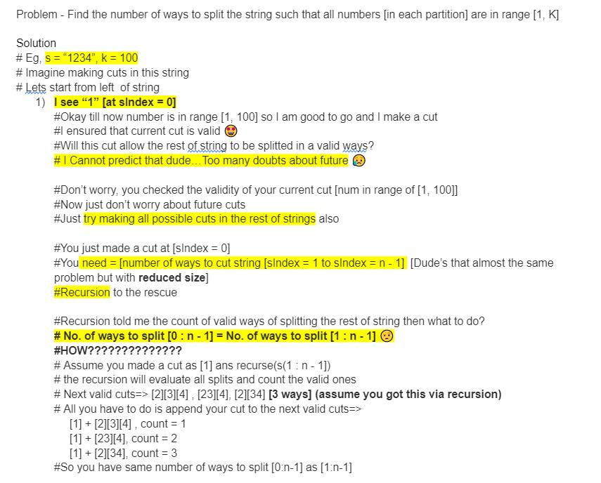
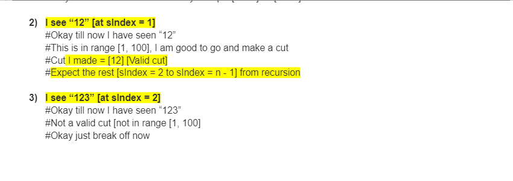

# Recursion->Top Down->Bottom Up || Complete Explanation

**Author:** MohakHarjani
**Votes:** 33
**Link:** [https://leetcode.com/problems/restore-the-array/solutions/3445413/](https://leetcode.com/problems/restore-the-array/solutions/3445413/)

---





## RECURSION
```
class Solution {
public:
    int MOD = 1000000007;
    int solve(string& s, int& k, int startIdx)
    {
        if (startIdx == s.size()) return 1;
        
        long long currNum = 0, ways = 0;
        //=================================================
        for (int i = startIdx; i < s.size(); i++)
        {
            int currDig = s[i] - '0';
            currNum = (currNum * 10) + currDig; //building the number from L->R

            if (currNum < 1 || currNum > k) break;
            int nextWays = solve(s, k, i + 1);
            ways = (ways +  nextWays) % MOD;
        }
        //====================================================
        return (int)ways; 
    }
    int numberOfArrays(string s, int k) 
    {
        int ans = solve(s, k, 0);
        return ans;
    }
};
```
//======================================================================================================================
## TOP DOWN [Accepted]
```
class Solution {
public:
    int MOD = 1000000007;
    int solve(string& s, int& k, vector<int>&dp, int startIdx)
    {
        if (startIdx == s.size()) return 1;
        
        if (dp[startIdx] != -1) return dp[startIdx]; //retrieve results
        long long currNum = 0, ways = 0;
        //=================================================
        for (int i = startIdx; i < s.size(); i++)
        {
            int currDig = s[i] - '0';
            currNum = (currNum * 10) + currDig; //building the number from L->R

            if (currNum < 1 || currNum > k) break;
            int nextWays = solve(s, k, dp, i + 1);
            ways = (ways +  nextWays) % MOD;
        }
        //====================================================
        return dp[startIdx] = ways; //store results
    }
    int numberOfArrays(string s, int k) 
    {
        vector<int>dp(s.size(), -1);
        int ans = solve(s, k, dp, 0);
        return ans;
    }
};
```
//======================================================================================================================
## BOTTOM UP [Accepted]
```
class Solution {
public:
    int MOD = 1000000007;
    int numberOfArrays(string s, int k) 
    {
        int n = s.size();
        vector<int>dp(n + 1, 0);
        //In top down 
        //1) For string starting from startIdx
        //   we needed answers of strings starting from [startIdx+1, startIdx+2, ....]
        //2) Recursion did that for us
        
        //In bottom up
        //1) We need to pre-calculate the desired results first
        //2) So we will go from startIdx = n - 1 to startIdx = 0
        //3) Now for startIdx = x, we would already have answers stored for 
        //           startIdx = [x+1, x+2, x+3......]
        
        dp[n] = 1; //base case implemented here
        for (int startIdx = n - 1; startIdx >= 0; startIdx--)
        {
            long long currNum = 0, ways = 0;
            //=================================================
            for (int i = startIdx; i < s.size(); i++)
            {
                int currDig = s[i] - '0';
                currNum = (currNum * 10) + currDig; //building the number from L->R

                if (currNum < 1 || currNum > k) break;
                int nextWays = dp[i + 1]; 
                ways = (ways +  nextWays) % MOD;
            }
            //====================================================
            dp[startIdx] = ways;
        }
        return dp[0];
    }
};

```