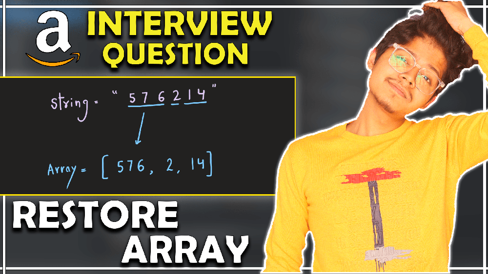
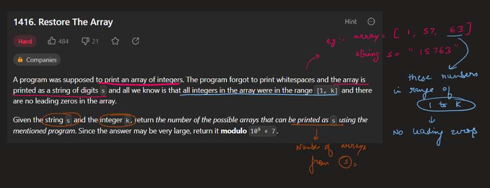
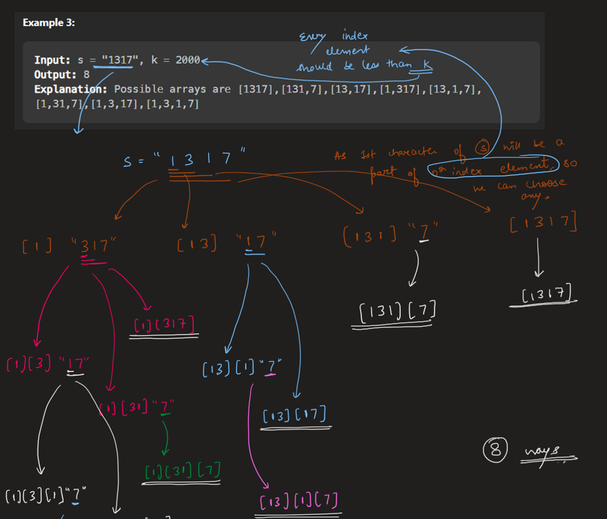
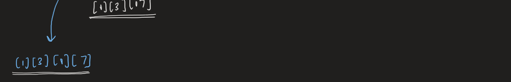
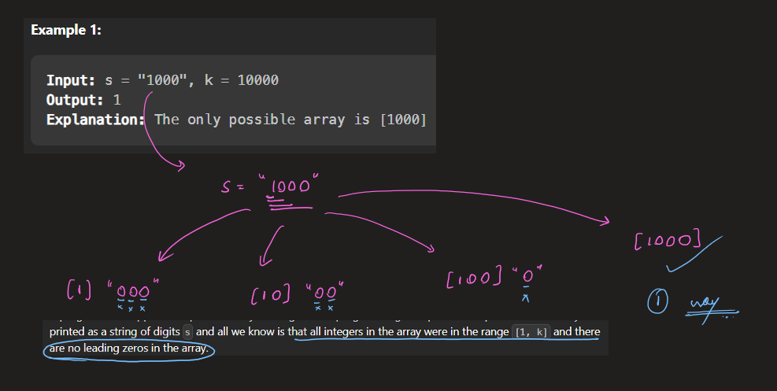
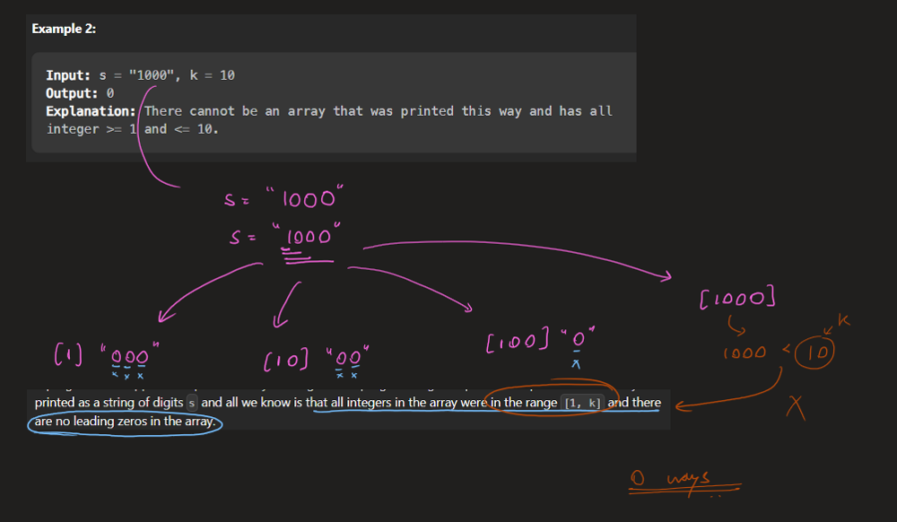
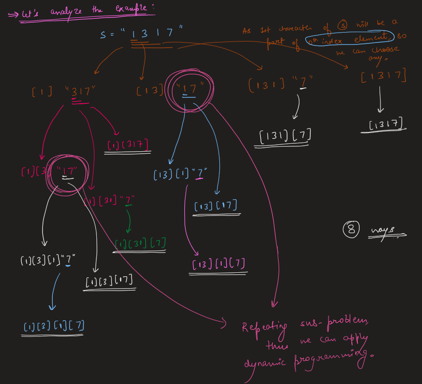
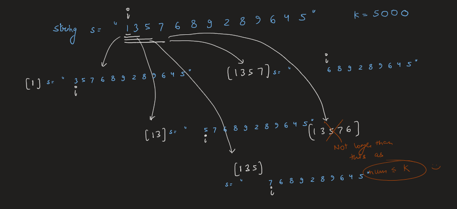
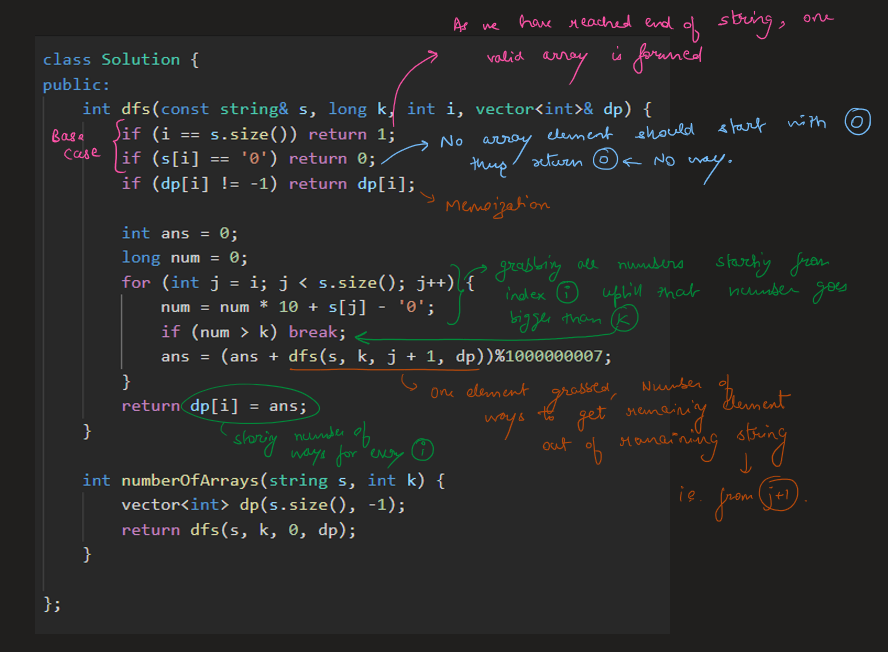
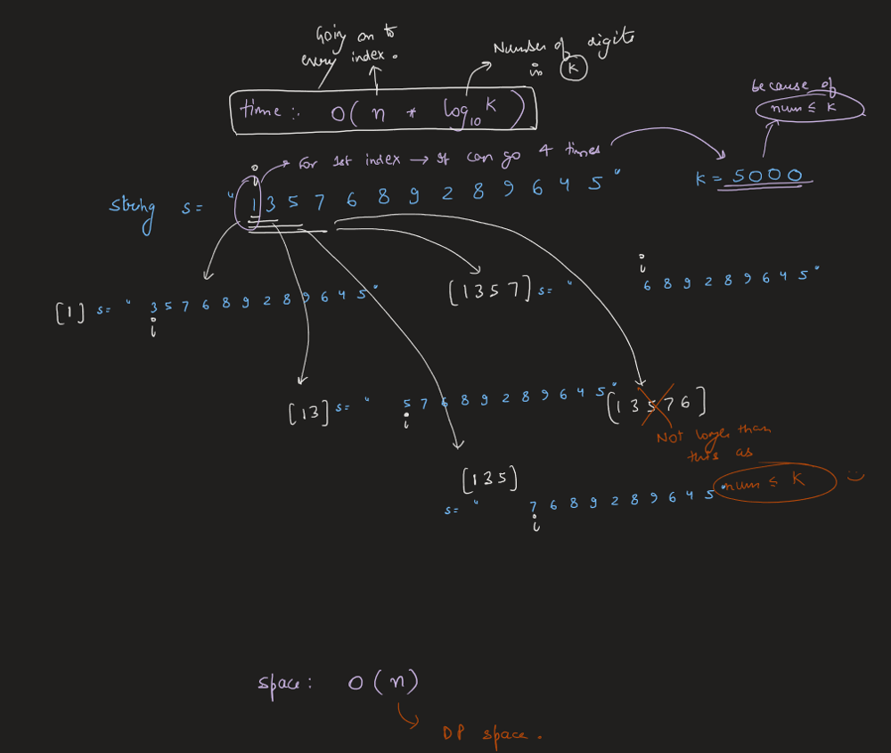

# Image Explanation🏆- [Easiest & Concise] - C++/Java/Python

**Author:** aryan_0077
**Votes:** 106
**Link:** [https://leetcode.com/problems/restore-the-array/solutions/3445455/](https://leetcode.com/problems/restore-the-array/solutions/3445455/)

---

# Video Solution (`Aryan Mittal`) - Link in LeetCode Profile
`Restore The Array` by `Aryan Mittal`



# Approach & Intution











# Code
```C++ []
class Solution {
public:
    int dfs(const string& s, long k, int i, vector<int>& dp) {
        if (i == s.size()) return 1;
        if (s[i] == '0') return 0;
        if (dp[i] != -1) return dp[i];

        int ans = 0;
        long num = 0;
        for (int j = i; j < s.size(); j++) {
            num = num * 10 + s[j] - '0';
            if (num > k) break;
            ans = (ans + dfs(s, k, j + 1, dp))%1000000007;
        }
        return dp[i] = ans;
    }

    int numberOfArrays(string s, int k) {
        vector<int> dp(s.size(), -1);
        return dfs(s, k, 0, dp);
    }
};
```
```Java []
class Solution {
    public int dfs(String s, long k, int i, int[] dp) {
        if (i == s.length()) return 1;
        if (s.charAt(i) == '0') return 0;
        if (dp[i] != -1) return dp[i];

        int ans = 0;
        long num = 0;
        for (int j = i; j < s.length(); j++) {
            num = num * 10 + s.charAt(j) - '0';
            if (num > k) break;
            ans = (ans + dfs(s, k, j + 1, dp)) % 1000000007;
        }
        return dp[i] = ans;
    }

    public int numberOfArrays(String s, int k) {
        int[] dp = new int[s.length()];
        Arrays.fill(dp, -1);
        return dfs(s, k, 0, dp);
    }
}
```
```Python []
class Solution:
    def dfs(self, s: str, k: int, i: int, dp: List[int]) -> int:
        if i == len(s):
            return 1
        if s[i] == '0':
            return 0
        if dp[i] != -1:
            return dp[i]

        ans = 0
        num = 0
        for j in range(i, len(s)):
            num = num * 10 + int(s[j])
            if num > k:
                break
            ans = (ans + self.dfs(s, k, j + 1, dp)) % 1000000007

        dp[i] = ans
        return ans

    def numberOfArrays(self, s: str, k: int) -> int:
        dp = [-1] * len(s)
        return self.dfs(s, k, 0, dp)
```
