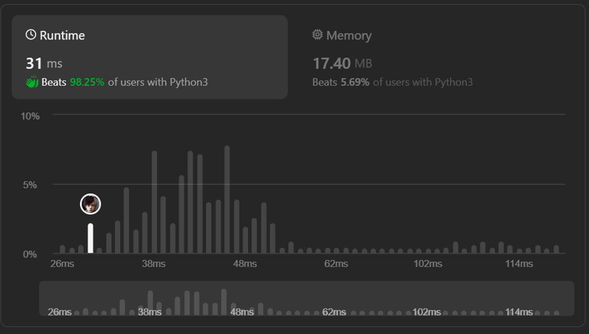

# ✅98.25%🔥Easy Solution🔥With explanation🔥

**Author:** MrAke
**Votes:** 102
**Link:** [https://leetcode.com/problems/maximum-score-after-splitting-a-string/solutions/4438262/](https://leetcode.com/problems/maximum-score-after-splitting-a-string/solutions/4438262/)

---



---
# Intuition
##### To maximize the score, we need to find the optimal split point in the string. The score is calculated by counting the number of zeros on the left side and the number of ones on the right side for each possible split. We want to maximize the sum of these counts.
---

# Approach
##### We can iterate through the string and maintain two counts: the number of zeros on the left (`count_zeros_left`) and the number of ones on the right (`count_ones_right`). We initialize the right count by calculating the total number of ones in the string.

---
# Complexity
- ### Time complexity:
##### $$O(n)$$, where $$n$$ is the length of the input string. We iterate through the string once.

- ### Space complexity:
##### $$O(1)$$. We use a constant amount of extra space for the counts and the maximum score variable.
---
# Code
```python []
class Solution:
    def maxScore(self, s: str) -> int:
        max_score = count_zeros_left = 0
        count_ones_right = s.count('1')

        for i in range(len(s) - 1):
            count_zeros_left += s[i] == '0'
            count_ones_right -= s[i] == '1'
            max_score = max(max_score, count_zeros_left + count_ones_right)

        return max_score
```
```C++ []
class Solution {
public:
    int maxScore(const std::string& s) {
        int max_score = 0;
        int count_zeros_left = 0;
        int count_ones_right = std::count(s.begin(), s.end(), '1');

        for (int i = 0; i < s.size() - 1; ++i) {
            count_zeros_left += (s[i] == '0');
            count_ones_right -= (s[i] == '1');
            max_score = std::max(max_score, count_zeros_left + count_ones_right);
        }

        return max_score;
    }
};
```
```javascript []
var maxScore = function(s) {
    let maxScore = 0;
    let countZerosLeft = 0;
    let countOnesRight = s.split('1').length - 1;

    for (let i = 0; i < s.length - 1; i++) {
        countZerosLeft += s[i] === '0' ? 1 : 0;
        countOnesRight -= s[i] === '1' ? 1 : 0;
        maxScore = Math.max(maxScore, countZerosLeft + countOnesRight);
    }

    return maxScore;
};
```
```java []
public class Solution {
    public int maxScore(String s) {
        int maxScore = 0;
        int countZerosLeft = 0;
        int countOnesRight = (int) s.chars().filter(ch -> ch == '1').count();


        for (int i = 0; i < s.length() - 1; i++) {
            countZerosLeft += s.charAt(i) == '0' ? 1 : 0;
            countOnesRight -= s.charAt(i) == '1' ? 1 : 0;
            maxScore = Math.max(maxScore, countZerosLeft + countOnesRight);
        }

        return maxScore;
    }
}
```
```C# []
public class Solution
{
    public int MaxScore(string s)
    {
        int maxScore = 0;
        int countZerosLeft = 0;
        int countOnesRight = s.Split('1').Length - 1;

        for (int i = 0; i < s.Length - 1; i++)
        {
            countZerosLeft += s[i] == '0' ? 1 : 0;
            countOnesRight -= s[i] == '1' ? 1 : 0;
            maxScore = Math.Max(maxScore, countZerosLeft + countOnesRight);
        }

        return maxScore;
    }
}
```
```PHP []
class Solution {
    function maxScore($s) {
        $maxScore = 0;
        $countZerosLeft = 0;
        $countOnesRight = substr_count($s, '1');

        for ($i = 0; $i < strlen($s) - 1; $i++) {
            $countZerosLeft += $s[$i] == '0' ? 1 : 0;
            $countOnesRight -= $s[$i] == '1' ? 1 : 0;
            $maxScore = max($maxScore, $countZerosLeft + $countOnesRight);
        }

        return $maxScore;
    }
}
```
---


