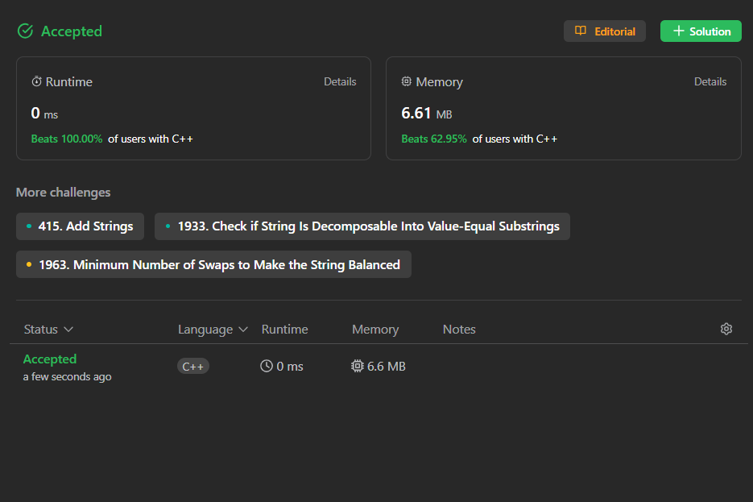

# ✅Beats 100%- 3 Approaches - C++, JAVA, Python, JavaScript || Easiest Solutions with explanation ||

**Author:** Vivekkrsk
**Votes:** 15
**Link:** [https://leetcode.com/problems/maximum-score-after-splitting-a-string/solutions/4438260/](https://leetcode.com/problems/maximum-score-after-splitting-a-string/solutions/4438260/)

---


---

# **Please Upvote If It Is Helpfull**

---



---


# Approach
<!-- Describe your approach to solving the problem. -->


1. **Initialize Result:** Sets `result` to 0 to store the maximum score found so far.
2. **Iterate Through Splitting Points:** Loops through each possible index `i` (except the last character) to consider splitting the string at that point.
3. **Calculate Score for Current Split:**
   - Sets `currentScore` to 0 for the current split.
   - Iterates through the substring from the beginning up to index `i` (inclusive), counting the '0's and adding them to `currentScore`.
   - Iterates through the substring from index `i + 1` to the end, counting the '1's and adding them to `currentScore`.
4. **Update Maximum Score:** Updates `result` with the maximum of `result` and `currentScore`, ensuring the highest score is tracked.
5. **Return Maximum Score:** After checking all possible splits, returns the `result` variable, holding the best possible score.


# Complexity
- Time complexity:O(n^2)
<!-- Add your time complexity here, e.g. $$O(n)$$ -->

- Space complexity:O(1)
<!-- Add your space complexity here, e.g. $$O(n)$$ -->

```C++ []
class Solution {
public:
    int maxScore(string str) {
        int result = 0;
        for (int i = 0; i < str.size() - 1; i++) {
            int currentScore = 0;
            for (int j = 0; j <= i; j++) {
                if (str[j] == '0') {
                    currentScore++;
                }
            }
            
            for (int j = i + 1; j < str.size(); j++) {
                if (str[j] == '1') {
                    currentScore++;
                }
            }
            
            result = max(result, currentScore);
        }
        
        return result;
    }
};
```
```JAVA []
public class Solution {
    public int maxScore(String str) {
        int result = 0;
        for (int i = 0; i < str.length() - 1; i++) {
            int currentScore = 0;
            for (int j = 0; j <= i; j++) {
                if (str.charAt(j) == '0') {
                    currentScore++;
                }
            }

            for (int j = i + 1; j < str.length(); j++) {
                if (str.charAt(j) == '1') {
                    currentScore++;
                }
            }

            result = Math.max(result, currentScore);
        }

        return result;
    }
}

```
```python []
def max_score(str):
    result = 0
    for i in range(len(str) - 1):
        current_score = 0
        for j in range(i + 1):
            if str[j] == '0':
                current_score += 1
        for j in range(i + 1, len(str)):
            if str[j] == '1':
                current_score += 1
        result = max(result, current_score)
    return result

```
```javascript []
function maxScore(str) {
  let result = 0;
  for (let i = 0; i < str.length - 1; i++) {
    let currentScore = 0;
    for (let j = 0; j <= i; j++) {
      if (str[j] === '0') {
        currentScore++;
      }
    }

    for (let j = i + 1; j < str.length; j++) {
      if (str[j] === '1') {
        currentScore++;
      }
    }

    result = Math.max(result, currentScore);
  }

  return result;
}

```
```ruby []
def max_score(str)
  result = 0
  (0...str.length - 1).each do |i|
    current_score = 0
    (0..i).each do |j|
      current_score += 1 if str[j] == '0'
    end
    (i + 1...str.length).each do |j|
      current_score += 1 if str[j] == '1'
    end
    result = [result, current_score].max
  end
  result
end

```
```C# []
public class Solution {
    public int MaxScore(string str) {
        int result = 0;
        for (int i = 0; i < str.Length - 1; i++) {
            int currentScore = 0;
            for (int j = 0; j <= i; j++) {
                if (str[j] == '0') {
                    currentScore++;
                }
            }

            for (int j = i + 1; j < str.Length; j++) {
                if (str[j] == '1') {
                    currentScore++;
                }
            }

            result = Math.Max(result, currentScore);
        }

        return result;
    }
}

```
```Go []
func maxScore(str string) int {
    result := 0
    for i := 0; i < len(str)-1; i++ {
        currentScore := 0
        for j := 0; j <= i; j++ {
            if str[j] == '0' {
                currentScore++
            }
        }
        for j := i + 1; j < len(str); j++ {
            if str[j] == '1' {
                currentScore++
            }
        }
        result = max(result, currentScore)
    }
    return result
}

func max(a, b int) int {
    if a > b {
        return a
    }
    return b
}

```


# Approach
<!-- Describe your approach to solving the problem. -->

1. **Count '1's:** Counts the total number of '1's in the string using `count`.
2. **Initialize Variables:**
   - Sets `result` to 0 to store the maximum score.
   - Sets `zerosCount` to 0 to track the number of '0's encountered.
3. **Iterate Through String:** Loops through each character of the string (except the last one):
   - If the current character is '1', decrements `onesCount`.
   - If the current character is '0', increments `zerosCount`.
   - Updates `result` with the maximum of `result` and `zerosCount + onesCount`.
4. **Return Maximum Score:** Returns the `result` variable, which holds the best possible score.
5. **Key Idea:** The approach cleverly avoids explicit string splitting by maintaining a count of '1's and adjusting it as the loop progresses, effectively simulating different splits implicitly.


# Complexity
- Time complexity:O(n)
<!-- Add your time complexity here, e.g. $$O(n)$$ -->

- Space complexity:O(1)
<!-- Add your space complexity here, e.g. $$O(n)$$ -->

```C++ []
class Solution {
public:
    int maxScore(string inputStr) {
        int onesCount = count(inputStr.begin(), inputStr.end(), '1');
        
        int result = 0;
        int zerosCount = 0;
        for (int i = 0; i < inputStr.size() - 1; i++) {
            if (inputStr[i] == '1') {
                onesCount--;
            } else {
                zerosCount++;
            }
            
            result = max(result, zerosCount + onesCount);
        }
        
        return result;
    }
};

```
```JAVA []
public class Solution {
    public int maxScore(String inputStr) {
        int onesCount = (int) inputStr.chars().filter(ch -> ch == '1').count();

        int result = 0;
        int zerosCount = 0;
        for (int i = 0; i < inputStr.length() - 1; i++) {
            if (inputStr.charAt(i) == '1') {
                onesCount--;
            } else {
                zerosCount++;
            }

            result = Math.max(result, zerosCount + onesCount);
        }

        return result;
    }
}

```
```python []
def max_score(input_str):
    ones_count = input_str.count('1')

    result = 0
    zeros_count = 0
    for i in range(len(input_str) - 1):
        if input_str[i] == '1':
            ones_count -= 1
        else:
            zeros_count += 1

        result = max(result, zeros_count + ones_count)

    return result


```
```javascript []
function maxScore(inputStr) {
  const onesCount = inputStr.split('1').length - 1;

  let result = 0;
  let zerosCount = 0;
  for (let i = 0; i < inputStr.length - 1; i++) {
    if (inputStr[i] === '1') {
      onesCount--;
    } else {
      zerosCount++;
    }

    result = Math.max(result, zerosCount + onesCount);
  }

  return result;
}

```
```ruby []
def max_score(input_str)
  ones_count = input_str.count('1')

  result = 0
  zeros_count = 0
  (0...input_str.length - 1).each do |i|
    if input_str[i] == '1'
      ones_count -= 1
    else
      zeros_count += 1
    end

    result = [result, zeros_count + ones_count].max
  end

  result
end


```
```C# []
public class Solution {
    public int MaxScore(string inputStr) {
        int onesCount = inputStr.Count(ch => ch == '1');

        int result = 0;
        int zerosCount = 0;
        for (int i = 0; i < inputStr.Length - 1; i++) {
            if (inputStr[i] == '1') {
                onesCount--;
            } else {
                zerosCount++;
            }

            result = Math.Max(result, zerosCount + onesCount);
        }

        return result;
    }
}


```
```Go []
func maxScore(inputStr string) int {
    onesCount := strings.Count(inputStr, "1")

    result := 0
    zerosCount := 0
    for i := 0; i < len(inputStr)-1; i++ {
        if inputStr[i] == '1' {
            onesCount--
        } else {
            zerosCount++
        }

        result = max(result, zerosCount+onesCount)
    }

    return result
}

func max(a, b int) int {
    if a > b {
        return a
    }
    return b
}


```

# Approach
<!-- Describe your approach to solving the problem. -->


 **Here's the approach in 5 points:**

1. **Initialize Variables:**
    - `onesCount` to 0 to track the number of '1's encountered.
    - `zerosCount` to 0 to track the number of '0's encountered.
    - `bestScore` to `INT_MIN` to hold the best score found so far.

2. **Iterate Through String (Except Last Character):**
    - For each character in the string (except the last one):
        - If the character is '1', increment `onesCount`.
        - If the character is '0', increment `zerosCount`.
        - Calculate the current score as `zerosCount - onesCount`.
        - Update `bestScore` with the maximum of `bestScore` and the current score.

3. **Count Last Character:**
    - If the last character is '1', increment `onesCount`.

4. **Calculate Final Score:**
    - The final score is calculated as `bestScore + onesCount`.
    - This effectively adds the fixed contribution of '1's in the second substring to the best score found in the first substring.

5. **Return Final Score:**
    - Return the `bestScore + onesCount` value, representing the maximum score achievable.


# Complexity
- Time complexity:O(n)
<!-- Add your time complexity here, e.g. $$O(n)$$ -->

- Space complexity:O(1)
<!-- Add your space complexity here, e.g. $$O(n)$$ -->

```C++ []
class Solution {
public:
    int maxScore(string inputStr) {
        int onesCount = 0;
        int zerosCount = 0;
        int bestScore = INT_MIN;

        for (int i = 0; i < inputStr.size() - 1; i++) {
            if (inputStr[i] == '1') {
                onesCount++;
            } else {
                zerosCount++;
            }
            
            bestScore = max(bestScore, zerosCount - onesCount);
        }
        
        if (inputStr[inputStr.size() - 1] == '1') {
            onesCount++;
        }
        
        return bestScore + onesCount;
    }
};

```
```JAVA []
public class Solution {
    public int maxScore(String inputStr) {
        int onesCount = 0;
        int zerosCount = 0;
        int bestScore = Integer.MIN_VALUE;

        for (int i = 0; i < inputStr.length() - 1; i++) {
            if (inputStr.charAt(i) == '1') {
                onesCount++;
            } else {
                zerosCount++;
            }

            bestScore = Math.max(bestScore, zerosCount - onesCount);
        }

        if (inputStr.charAt(inputStr.length() - 1) == '1') {
            onesCount++;
        }

        return bestScore + onesCount;
    }
}


```
```python []
def max_score(input_str):
    ones_count = 0
    zeros_count = 0
    best_score = float('-inf')

    for i in range(len(input_str) - 1):
        if input_str[i] == '1':
            ones_count += 1
        else:
            zeros_count += 1

        best_score = max(best_score, zeros_count - ones_count)

    if input_str[-1] == '1':
        ones_count += 1

    return best_score + ones_count


```
```javascript []
function maxScore(inputStr) {
  let onesCount = 0;
  let zerosCount = 0;
  let bestScore = -Infinity;

  for (let i = 0; i < inputStr.length - 1; i++) {
    if (inputStr[i] === '1') {
      onesCount++;
    } else {
      zerosCount++;
    }

    bestScore = Math.max(bestScore, zerosCount - onesCount);
  }

  if (inputStr[inputStr.length - 1] === '1') {
    onesCount++;
  }

  return bestScore + onesCount;
}


```
```ruby []
def max_score(input_str)
  ones_count = 0
  zeros_count = 0
  best_score = -Float::INFINITY

  (0...input_str.length - 1).each do |i|
    if input_str[i] == '1'
      ones_count += 1
    else
      zeros_count += 1
    end

    best_score = [best_score, zeros_count - ones_count].max
  end

  ones_count += 1 if input_str[-1] == '1'

  best_score + ones_count
end


```
```C# []
public class Solution {
    public int MaxScore(string inputStr) {
        int onesCount = 0;
        int zerosCount = 0;
        int bestScore = int.MinValue;

        for (int i = 0; i < inputStr.Length - 1; i++) {
            if (inputStr[i] == '1') {
                onesCount++;
            } else {
                zerosCount++;
            }

            bestScore = Math.Max(bestScore, zerosCount - onesCount);
        }

        if (inputStr[inputStr.Length - 1] == '1') {
            onesCount++;
        }

        return bestScore + onesCount;
    }
}


```
```Go []
func maxScore(inputStr string) int {
    onesCount := 0
    zerosCount := 0
    bestScore := math.MinInt64

    for i := 0; i < len(inputStr)-1; i++ {
        if inputStr[i] == '1' {
            onesCount++
        } else {
            zerosCount++
        }

        bestScore = max(bestScore, zerosCount-onesCount)
    }

```

---


---


