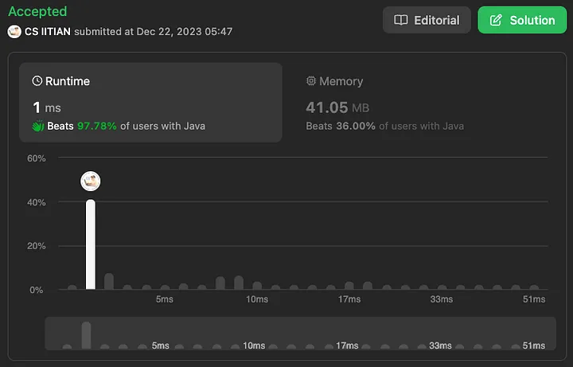
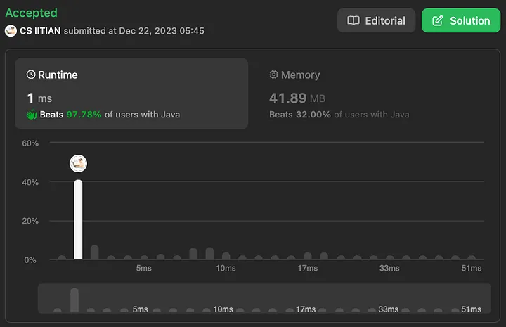

# Interview Approach - 5 Approach Ultra Optimisation Beats 100%

**Author:** cs_iitian
**Votes:** 14
**Link:** [https://leetcode.com/problems/maximum-score-after-splitting-a-string/solutions/4438404/](https://leetcode.com/problems/maximum-score-after-splitting-a-string/solutions/4438404/)

---

# Video Solution ( in Hindi )
https://www.youtube.com/watch?v=7vfUqsauj7g&ab_channel=CSIITIAN

# Approach-1 ( Brute Force )

for every index, count no. of zeros in left side and count no. of ones in right side.

```java
class Solution {
    public int maxScore(String s) {
        int ans = 0;
        int len = s.length();

        for(int i=0;i<len-1;i++) {
            int zeros = 0;
            int ones = 0;
            for(int j=0;j<=i;j++) {
                if(s.charAt(j) == '0')
                    zeros++;
            }
            for(int j=i+1;j<len;j++) {
                if(s.charAt(j) == '1')
                    ones++;
            }
            if(ans < zeros + ones) ans = zeros + ones;
        }

        return ans;
    }
}
```

Time Complexity: O(n^2) where n is length of string

Space Complexity: O(1)


# Approach-2 ( Prefix Sum )

Create two array zeros and ones.

for every index i in array zeros, value would be the no. of zeros till that index i.

for every index i in array ones, value would be the no. of ones from index i+1 to length.

```java
class Solution {
    public int maxScore(String s) {
        int ans = 0;
        int len = s.length();

        int[] zeros = new int[len];
        int cZeros = 0;
        for(int i=0;i<len;i++) {
            if(s.charAt(i) == '0')
                cZeros++;
            zeros[i] = cZeros;
        }

        int[] ones = new int[len];
        int cOnes = 0;
        for(int i=len-1;i>=0;i--) {
            ones[i] = cOnes;
            if(s.charAt(i) == '1')
                cOnes++;
        }
        
        for(int i=0;i<len-1;i++) {
            int temp = zeros[i] + ones[i];
            if(ans < temp) ans = temp;
        }

        return ans;
    }
}
```

Time Complexity: O(n)

Space Complexity: O(n)




# Approach-3 ( Prefix Sum Space Optimisation )

Why should  we use two array ? when we can achieve this in one single array.

The count of zeros we can keep track of while traversing from left.

```java
class Solution {
    public int maxScore(String s) {
        int ans = 0;
        int len = s.length();

        int[] ones = new int[len];
        int cOnes = 0;
        for(int i=len-1;i>=0;i--) {
            ones[i] = cOnes;
            if(s.charAt(i) == '1')
                cOnes++;
        }
        
        int zeros = 0;
        for(int i=0;i<len-1;i++) {
            if(s.charAt(i) == '0')
                zeros++;
            if(ans < zeros + ones[i]) ans = zeros + ones[i];
        }

        return ans;
    }
}
```

Time Complexity: O(n)

Space Complexity: O(n)




# Approach-4 ( Prefix Sum - Using Counter Only )

earlier we were using ones array which store the count of ones from index i+1 to n for every index i.

So if we have total count of 1s in array, we can get the count of 1s in right side, because whenever we encounter 1 , we can decrease count of 1 by 1.

```java
class Solution {
    public int maxScore(String s) {
        int ans = 0;
        int len = s.length();

        int ones = 0;
        for(int i=0;i<len;i++) {
            if(s.charAt(i) == '1')
                ones++;
        }

        int zeros = 0;
        for(int i=0;i<len-1;i++) {
            if(s.charAt(i) == '0') {
                zeros++;
            } else {
                ones--;
            }
            int totalCount = zeros + ones;
            if(ans < totalCount) ans = totalCount;
        }

        return ans;
    }
}
```

Time Complexity: O(n)

Space Complexity: O(n)


# Approach-5 ( Use one loop )

Now in the above approach we were calculating total no. of ones, and every time when we see 1, we were decrementing counter by 1.

total \u2192 total no. of 1s 

maximum of zeros + (total - no. of 1s seen till now)

now you can see total is constant in whole approach and it is no. of ones.

Now let\u2019s extract this total

ans = maximum of zeros + ( - no. of 1s seen till now )  + total no. of ones

ans = maximum of no. of zeros - no. of ones till now + total no. of ones

```java
class Solution {
    public int maxScore(String s) {
        int ans = -1;
        int len = s.length();

        int ones = 0;
        int tempSum = 0;
        for(int i=0;i<len-1;i++) {
            if(s.charAt(i) == '0') tempSum++;
            else {
                ones++;
                tempSum--;
            }
            if(ans < tempSum) ans = tempSum;
        }
				
		// since our loops end at len-1
        ones += s.charAt(len-1) == '1' ? 1 : 0;

        return ones + ans;
    }
}
```

Time Complexity: O(n)

Space Complexity: O(1)


---

Thanks !!!