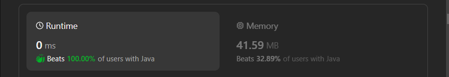

# ✅Beats 100% - Explained with [ Video ] - C++/Java/Python/JS  - Single Pass - Visualized

**Author:** lancertech6
**Votes:** 65
**Link:** [https://leetcode.com/problems/maximum-score-after-splitting-a-string/solutions/4438390/](https://leetcode.com/problems/maximum-score-after-splitting-a-string/solutions/4438390/)

---



# YouTube Video Explanation:

[https://youtu.be/DjnRHni7Yek](https://youtu.be/DjnRHni7Yek)
<!-- **If you want a video for this question please write in the comments** -->

**\uD83D\uDD25 Please like, share, and subscribe to support our channel's mission of making complex concepts easy to understand.**

Subscribe Link: https://www.youtube.com/@leetlogics/?sub_confirmation=1

*Subscribe Goal: 1000 Subscribers*
*Current Subscribers: 930*

---
## Example Explanation
Input: `s = "011101"`

| **Iteration (i)** | **Current Character** | **tmpScore** | **ones** | **score** |
|--------------------|------------------------|--------------|----------|-----------|
| 0                  | '0'                    | 1            | 0        | 1         |
| 1                  | '1'                    | 0            | 1        | 1         |
| 2                  | '1'                    | -1           | 2        | 1         |
| 3                  | '1'                    | -2           | 3        | 1         |
| 4                  | '0'                    | -1           | 3        | 1         |

After the iteration:

- `ones` = 2 (count of ones in the string)
- `score` = 1 (maximum score achieved)
- If Char at length-1 equals to 1  so add 1

Now, calculate the final result:

[ Result = ones + score = 3 + 1 +1  = 5]

So, the output for the input "011101" is 5.

---

# Intuition
<!-- Describe your first thoughts on how to solve this problem. -->
The task is to split a binary string into two non-empty substrings and maximize the score based on the given criteria. The score is calculated as the sum of the number of zeros in the left substring and the number of ones in the right substring.

# Approach
<!-- Describe your approach to solving the problem. -->
1. Initialize variables: `length` to store the length of the string, `ones` to count the number of ones in the string, `tmpScore` to store the current score, and `score` to store the maximum score.
2. Iterate through the string from index 1 to `length - 2` (excluding the first and last characters).
   - Update `tmpScore` and `ones` based on the current character.
   - Update `score` if `tmpScore` is greater than the current `score`.
3. Add the count of ones at the last index to `ones`.
4. Return the sum of `ones` and `score` as the maximum score.


# Complexity
- Time complexity: The time complexity is O(n), where n is the length of the string, as we iterate through the string once.
<!-- Add your time complexity here, e.g. $$O(n)$$ -->

- Space complexity: The space complexity is O(1) as we use a constant amount of space.
<!-- Add your space complexity here, e.g. $$O(n)$$ -->

# Code
```java []
class Solution {
    public int maxScore(String s) {
        int length = s.length();
        int ones = 0;
        int tmpScore = s.charAt(0) == '0' ? 1 : 0;
        int score = tmpScore;
        for (int i = 1; i < length - 1; i++) {
            if (s.charAt(i) == '0') {
                tmpScore += 1;
            } else {
                ones++;
                tmpScore -= 1;
            }

            if (tmpScore > score) {
                score = tmpScore;
            }
        }
        ones += (s.charAt(length - 1) == '1' ? 1 : 0);

        return ones + score;
    }
}
```
```C++ []
class Solution {
public:
    int maxScore(string s) {
        int length = s.length();
        int ones = 0;
        int tmpScore = s[0] == '0' ? 1 : 0;
        int score = tmpScore;
        
        for (int i = 1; i < length - 1; i++) {
            if (s[i] == '0') {
                tmpScore += 1;
            } else {
                ones++;
                tmpScore -= 1;
            }

            if (tmpScore > score) {
                score = tmpScore;
            }
        }
        
        ones += (s[length - 1] == '1' ? 1 : 0);

        return ones + score;
    }
};
```
```Python []
class Solution(object):
    def maxScore(self, s):
        length = len(s)
        ones = 0
        tmpScore = 1 if s[0] == '0' else 0
        score = tmpScore
        
        for i in range(1, length - 1):
            if s[i] == '0':
                tmpScore += 1
            else:
                ones += 1
                tmpScore -= 1

            if tmpScore > score:
                score = tmpScore
        
        ones += 1 if s[length - 1] == '1' else 0

        return ones + score
        
```
```JavaScript []
/**
 * @param {string} s
 * @return {number}
 */
var maxScore = function(s) {
    const length = s.length;
        let ones = 0;
        let tmpScore = s[0] === '0' ? 1 : 0;
        let score = tmpScore;
        
        for (let i = 1; i < length - 1; i++) {
            if (s[i] === '0') {
                tmpScore += 1;
            } else {
                ones += 1;
                tmpScore -= 1;
            }

            if (tmpScore > score) {
                score = tmpScore;
            }
        }
        
        ones += s[length - 1] === '1' ? 1 : 0;

        return ones + score;
};
```

