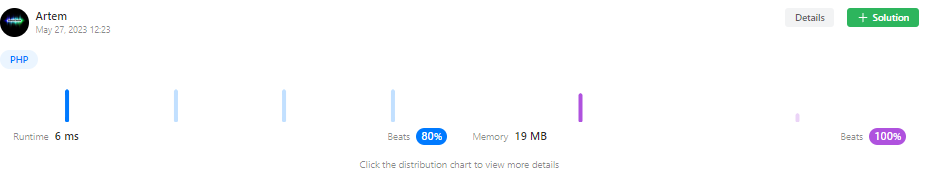

# Beats 80%. PHP solution

**Author:** akolobnevstudio
**Votes:** 0
**Link:** [https://leetcode.com/problems/consecutive-characters/solutions/3567517/](https://leetcode.com/problems/consecutive-characters/solutions/3567517/)

---



```
class Solution {

    function maxPower($s) {
        $max = 0;
        $curr = 1;
        for($i = 0;$i < strlen($s);$i++)
        {
            if($s[$i] === $s[$i + 1]) $curr += 1;
            else $curr = 1;
            $max = max($curr,$max);
        }
        return $max;
    }
}
```