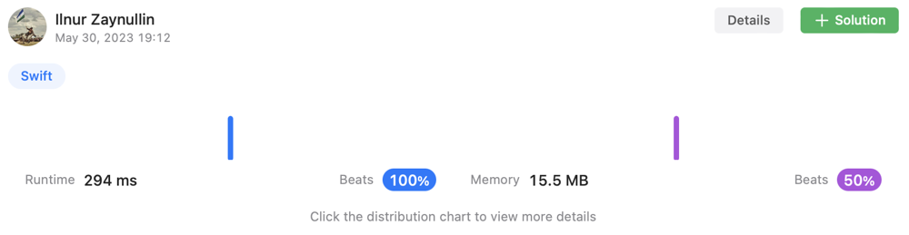

# ✅ [Swift] One-line solution + extension (fast 100%)

**Author:** IlnurZayn
**Votes:** 1
**Link:** [https://leetcode.com/problems/rearrange-words-in-a-sentence/solutions/3579058/](https://leetcode.com/problems/rearrange-words-in-a-sentence/solutions/3579058/)

---

# Intuition

<!-- Describe your first thoughts on how to solve this problem. -->

# Approach
<!-- Describe your approach to solving the problem. -->

# Complexity
- Time complexity:
<!-- Add your time complexity here, e.g. $$O(n)$$ -->

- Space complexity:
<!-- Add your space complexity here, e.g. $$O(n)$$ -->

# Code
```
class Solution {
    func arrangeWords(_ text: String) -> String {
        text
        .lowercased()
        .split(separator: " ")
        .sorted { $0.count < $1.count }
        .joined(separator: " ")
        .firstCharUp()
    }
}

extension String {
    func firstCharUp() -> String {
        prefix(1).uppercased() + self.dropFirst()
    }
}
```