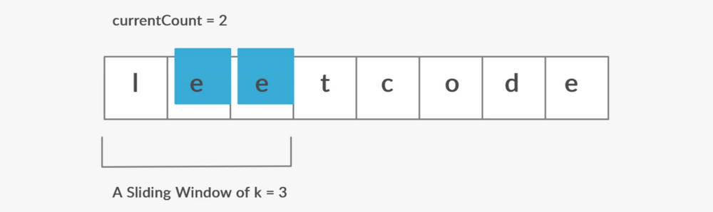
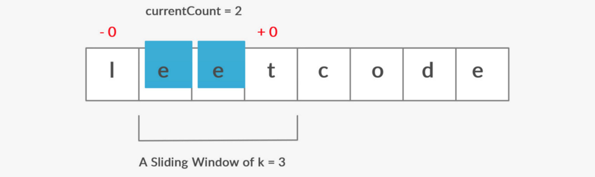
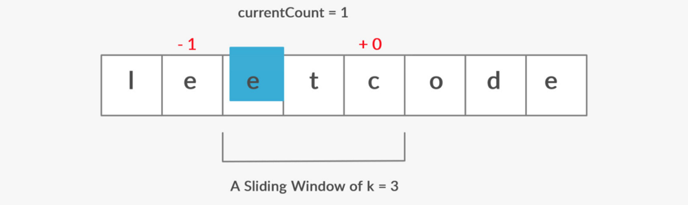

# [C++/Py3] Explained w/ Diagram - Sliding Window

**Author:** luctivud
**Votes:** 92
**Link:** [https://leetcode.com/problems/maximum-number-of-vowels-in-a-substring-of-given-length/solutions/648458/](https://leetcode.com/problems/maximum-number-of-vowels-in-a-substring-of-given-length/solutions/648458/)

---

# **Idea and Approach**
The basic idea to solve this kind of problem is to create a window of the given size and keep on moving it till the end while maintaining the count of the vowels we *gain* and *lose* in this transition.

Below is the implementation and steps explained through diagram:

* Traverse through all the elements of the first window and keep track of the vowels.



* Move the window to the right side without changing the size.
* Decrement the count in currentCount if any vowel is removed from the left side during transition
* Increase if vowel is added from the right side.



* The answer will be the maximum of all the counts encountered while moving the window.



# **Python 3 Code**

```
class Solution:
    def maxVowels(self, s: str, k: int) -> int:
        # Maximum vowels i.e. ans
        ans: int = 0
            
        # Vowels in current window
        currCount: int = 0
            
        # String of vowels
        vowels: str = "aeiou"
            
        # Using sliding window technique to 
        # calculate number of vowels in each window and 
        # update the count
        for i, v in enumerate(s):
            if i >= k:
                if s[i-k] in vowels:
                    currCount -= 1
            if s[i] in vowels:
                currCount += 1
            ans = max(currCount, ans)
        return ans
```

# **C++ Code**
```
class Solution {
public:
    int maxVowels(string s, int k) {
        
        // Store current count of vowels in currCount
        // and maximum currCount occurred in ans
        int currCount = 0;
        int ans = 0;
        
        // An array to mark all the vowels' position to true
        // for checking whether the char is vowel or not
        bool vowels[26] = {false};
        vowels[0] = vowels[4] = vowels[8] = vowels[14] = vowels[20] = true;
        
        // Sliding window implementation
        for (int i=0; i < s.length(); i++) {
            
            // if any vowel is removed from left-> decrement
            if (i >= k and vowels[s[i-k]-'a']) {
                currCount -= 1;
            }
            
            // if any vowel is inserted from right-> increment
            if (vowels[s[i]-'a']) {
                currCount += 1;
            }
            
            // Store maximum occurence of currCount in ans
            ans = max (ans, currCount);
        }
        
        return ans ;
    }
};
```
# **Complexity Analysis**:
Time Complexity: **O(n)**
Space : O(1)

*Plz Upvote if you like it.*