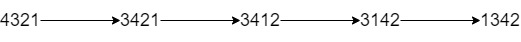

# [1505. Minimum Possible Integer After at Most K Adjacent Swaps On Digits](https://leetcode.com/problems/minimum-possible-integer-after-at-most-k-adjacent-swaps-on-digits/)

| Category | Difficulty | Likes | Dislikes |
| :------: | :--------: | :---: | :------: |
| Algorithms | Hard | 499 | 28 |

**Tags:** [`string`](https://leetcode.com/tag/string), [`greedy`](https://leetcode.com/tag/greedy), [`binary-indexed-tree`](https://leetcode.com/tag/binary-indexed-tree), [`segment-tree`](https://leetcode.com/tag/segment-tree)


## Description

You are given a string `num` representing **the digits** of a very large integer and an integer `k`. You are allowed to swap any two adjacent digits of the integer **at most** `k` times.

Return *the minimum integer you can obtain also as a string*.

 

**Example 1:**


```

Input: num = &quot;4321&quot;, k = 4
Output: &quot;1342&quot;
Explanation: The steps to obtain the minimum integer from 4321 with 4 adjacent swaps are shown.

```

**Example 2:**

```

Input: num = &quot;100&quot;, k = 1
Output: &quot;010&quot;
Explanation: It&#39;s ok for the output to have leading zeros, but the input is guaranteed not to have any leading zeros.

```

**Example 3:**

```

Input: num = &quot;36789&quot;, k = 1000
Output: &quot;36789&quot;
Explanation: We can keep the number without any swaps.

```

 

**Constraints:**

	- `1 <= num.length <= 3 * 10^4`

	- `num` consists of only **digits** and does not contain **leading zeros**.

	- `1 <= k <= 10^9`

---

**Links:** [Submissions](https://leetcode.com/problems/minimum-possible-integer-after-at-most-k-adjacent-swaps-on-digits/) | [Solutions](https://leetcode.com/problems/minimum-possible-integer-after-at-most-k-adjacent-swaps-on-digits/)
