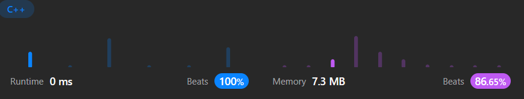

# ✅☑Beats 100% users || [C++/Java/Python/JavaScript] || DP || EXPLAINED🔥

**Author:** MarkSPhilip31
**Votes:** 104
**Link:** [https://leetcode.com/problems/string-compression-ii/solutions/4468632/](https://leetcode.com/problems/string-compression-ii/solutions/4468632/)

---

# PLEASE UPVOTE IF IT HELPED

---


---

# Approaches
(Also explained in the code)

1. **Initialization:**

    - `n` is the length of the string s.
    - `dp` is a 2D vector representing the minimum length for substrings with at most 'k' deletions.
    - `dp[0][0]` is initialized to 0 representing the base case of having no characters and deletions.
1. **Dynamic Programming:**

    - The nested loops iterate through the string `s` and the maximum number of deletions allowed (`k`).
    - For each character `s[i]`, it calculates the count of the same characters in the range `[i, l]` and the number of deletions.
    - The `dp` array is updated based on the conditions considering the characters and deletions.
1. **Return:**

    - Finally, the function returns `dp[n][k]`, representing the minimum length for `s` with at most `k` deletions.


# Complexity
- Time complexity:
   $$O(n^2 * k)$$
    

- Space complexity:
   $$O(n*k)$$
    


# Code
```C++ []

class Solution {
public:
    int getLengthOfOptimalCompression(string s, int k) {
        int n = s.length();
        vector<vector<int>> dp(110, vector<int>(110, 9999)); // Initializing a 2D vector 'dp' of size 110x110 with value 9999
        dp[0][0] = 0; // Initializing the base case where no characters and deletions exist

        for (int i = 1; i <= n; i++) {
            for (int j = 0; j <= k; j++) {
                int cnt = 0, del = 0;
                for (int l = i; l >= 1; l--) {
                    // Count the frequency of characters from 'i' to 'l'
                    if (s[l - 1] == s[i - 1]) 
                        cnt++;
                    else 
                        del++;
                    
                    // Check if the remaining allowed deletions are valid (j - del >= 0)
                    if (j - del >= 0) {
                        // Update the dp array based on the conditions
                        dp[i][j] = min(dp[i][j],
                            dp[l - 1][j - del] + 1 + (cnt >= 100 ? 3 : cnt >= 10 ? 2 : cnt >= 2 ? 1 : 0));
                    }
                }
                
                // If there are remaining allowed deletions (j > 0), consider the case without deleting current character
                if (j > 0)
                    dp[i][j] = min(dp[i][j], dp[i - 1][j - 1]);
            }
        }
        return dp[n][k]; // Return the minimum length for 's' with at most 'k' deletions
    }
};


```
```Java []
class Solution {
    public int getLengthOfOptimalCompression(String s, int k) {
        int n = s.length();
        int[][] dp = new int[110][110];
        for (int i = 0; i <= n; i++)
            for (int j = 0; j <= n; j++)
                dp[i][j] = 9999;
        dp[0][0] = 0;
        
        for (int i = 1; i <= n; i++) {
            for (int j = 0; j <= k; j++) {
                int cnt = 0, del = 0;
                for (int l = i; l >= 1; l--) {
                    if (s.charAt(l - 1) == s.charAt(i - 1)) 
                        cnt++;
                    else 
                        del++;
                    
                    if (j - del >= 0) {
                        dp[i][j] = Math.min(dp[i][j], dp[l - 1][j - del] + 1 + (cnt >= 100 ? 3 : cnt >= 10 ? 2 : cnt >= 2 ? 1 : 0));
                    }
                }
                if (j > 0)
                    dp[i][j] = Math.min(dp[i][j], dp[i - 1][j - 1]);
            }
        }
        return dp[n][k];
    }
}


```
```python3 []
class Solution:
    def getLengthOfOptimalCompression(self, s: str, k: int) -> int:
        n = len(s)
        dp = [[9999] * 110 for _ in range(110)]
        dp[0][0] = 0

        for i in range(1, n + 1):
            for j in range(0, k + 1):
                cnt, del_ = 0, 0
                for l in range(i, 0, -1):
                    if s[l - 1] == s[i - 1]:
                        cnt += 1
                    else:
                        del_ += 1

                    if j - del_ >= 0:
                        dp[i][j] = min(dp[i][j], dp[l - 1][j - del_] + 1 + (3 if cnt >= 100 else 2 if cnt >= 10 else 1 if cnt >= 2 else 0))

                if j > 0:
                    dp[i][j] = min(dp[i][j], dp[i - 1][j - 1])

        return dp[n][k]


```
```javascript []
var getLengthOfOptimalCompression = function(s, k) {
    const n = s.length;
    const dp = Array.from({ length: 110 }, () => Array(110).fill(9999));
    dp[0][0] = 0;

    for (let i = 1; i <= n; i++) {
        for (let j = 0; j <= k; j++) {
            let cnt = 0, del = 0;
            for (let l = i; l >= 1; l--) {
                if (s.charAt(l - 1) === s.charAt(i - 1)) 
                    cnt++;
                else 
                    del++;
                
                if (j - del >= 0) {
                    dp[i][j] = Math.min(dp[i][j], dp[l - 1][j - del] + 1 + (cnt >= 100 ? 3 : cnt >= 10 ? 2 : cnt >= 2 ? 1 : 0));
                }
            }
            if (j > 0)
                dp[i][j] = Math.min(dp[i][j], dp[i - 1][j - 1]);
        }
    }
    return dp[n][k];
};


```
---


# PLEASE UPVOTE IF IT HELPED

---
---


---