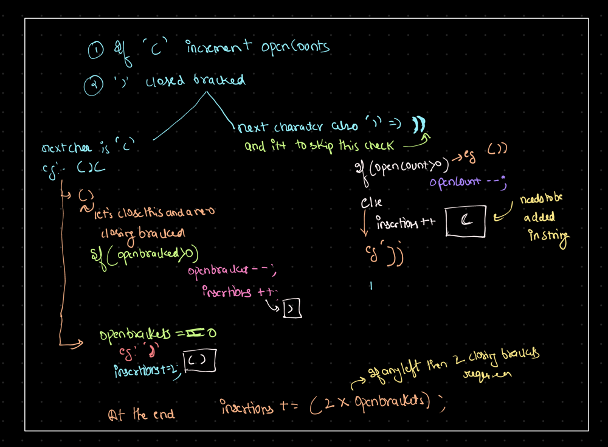

# 🔥BEATS 💯 % 🎯 |✨SUPER EASY BEGINNERS 👏

**Author:** CodeWithSparsh
**Votes:** 2
**Link:** [https://leetcode.com/problems/minimum-insertions-to-balance-a-parentheses-string/solutions/6129319/](https://leetcode.com/problems/minimum-insertions-to-balance-a-parentheses-string/solutions/6129319/)

---


---




---

# Intuition
The problem requires ensuring that every opening parenthesis `(` is balanced with two closing parentheses `))`. This means:
1. Track unmatched `(` using a counter.
2. Process `)` while handling cases where it is a single or part of a pair.
3. Add insertions to balance unpaired `)` or leftover `(`.

---

# Approach
1. **Iterate through the string**:
   - Use a counter to track unmatched `(`.
   - For every `)`, check if it's a pair (`))`) or a single `)` and adjust the count of unmatched parentheses or insertions.
2. **Handle unmatched `(`** at the end by adding the required `))` to close them.

---

# Complexity
- **Time Complexity**:  
  $$O(n)$$ where `n` is the length of the string.
- **Space Complexity**:  
  $$O(1)$$ as only a few variables are used.

---


```python []
class Solution:
    def minInsertions(self, s: str) -> int:
        open_counts = 0
        insertions = 0

        i = 0
        while i < len(s):
            if s[i] == '(':
                open_counts += 1
            elif i + 1 < len(s) and s[i + 1] == ')':
                if open_counts > 0:
                    open_counts -= 1
                else:
                    insertions += 1
                i += 1  # Skip the next ')'
            else:
                if open_counts > 0:
                    open_counts -= 1
                    insertions += 1
                else:
                    insertions += 2
            i += 1

        return insertions + 2 * open_counts
```


```cpp []
#include <string>
using namespace std;

class Solution {
public:
    int minInsertions(string s) {
        int openCounts = 0; // Tracks unmatched '('
        int insertions = 0; // Tracks required insertions

        for (int i = 0; i < s.size(); i++) {
            if (s[i] == '(') {
                openCounts++;
            } else if (i + 1 < s.size() && s[i + 1] == ')') {
                if (openCounts > 0) openCounts--;
                else insertions++;
                i++; // Skip the next ')'
            } else {
                if (openCounts > 0) {
                    openCounts--;
                    insertions++;
                } else {
                    insertions += 2;
                }
            }
        }

        return insertions + 2 * openCounts;
    }
};
```


```java []
class Solution {
    public int minInsertions(String s) {
        int openCounts = 0; // Tracks unmatched '('
        int insertions = 0; // Tracks required insertions

        for (int i = 0; i < s.length(); i++) {
            if (s.charAt(i) == '(') {
                openCounts++;
            } else if (i + 1 < s.length() && s.charAt(i + 1) == ')') {
                if (openCounts > 0) openCounts--;
                else insertions++;
                i++; // Skip the next ')'
            } else {
                if (openCounts > 0) {
                    openCounts--;
                    insertions++;
                } else {
                    insertions += 2;
                }
            }
        }

        return insertions + 2 * openCounts;
    }
}
```


```javascript []
var minInsertions = function(s) {
    let openCounts = 0; // Tracks unmatched '('
    let insertions = 0; // Tracks required insertions

    for (let i = 0; i < s.length; i++) {
        if (s[i] === '(') {
            openCounts++;
        } else if (i + 1 < s.length && s[i + 1] === ')') {
            if (openCounts > 0) openCounts--;
            else insertions++;
            i++; // Skip the next ')'
        } else {
            if (openCounts > 0) {
                openCounts--;
                insertions++;
            } else {
                insertions += 2;
            }
        }
    }

    return insertions + 2 * openCounts;
};
```


```go []
func minInsertions(s string) int {
    openCounts := 0 // Tracks unmatched '('
    insertions := 0 // Tracks required insertions

    for i := 0; i < len(s); i++ {
        if s[i] == '(' {
            openCounts++
        } else if i+1 < len(s) && s[i+1] == ')' {
            if openCounts > 0 {
                openCounts--
            } else {
                insertions++
            }
            i++ // Skip the next ')'
        } else {
            if openCounts > 0 {
                openCounts--
                insertions++
            } else {
                insertions += 2
            }
        }
    }

    return insertions + 2*openCounts
}
```


```dart []
class Solution {
  int minInsertions(String s) {
    int openCounts = 0; // Tracks unmatched '('
    int insertions = 0; // Tracks required insertions

    for (int i = 0; i < s.length; i++) {
      if (s[i] == '(') {
        openCounts++;
      } else if (i + 1 < s.length && s[i + 1] == ')') {
        if (openCounts > 0) {
          openCounts--;
        } else {
          insertions++;
        }
        i++; // Skip the next ')'
      } else {
        if (openCounts > 0) {
          openCounts--;
          insertions++;
        } else {
          insertions += 2;
        }
      }
    }

    return insertions + 2 * openCounts;
  }
}
```

---

 {:style='width:250px'}