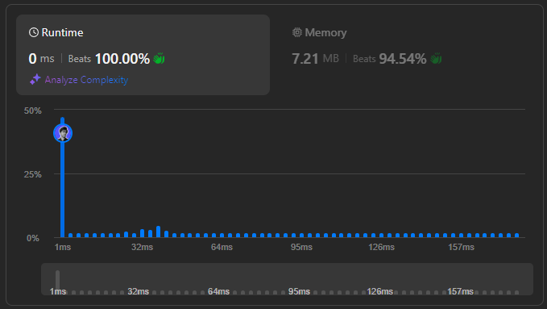

# 🌟 Beats 100.00% 👏  ||  Step-by-Step Breakdown 💯🔥

**Author:** withaarzoo
**Votes:** 157
**Link:** [https://leetcode.com/problems/find-kth-bit-in-nth-binary-string/solutions/5934232/](https://leetcode.com/problems/find-kth-bit-in-nth-binary-string/solutions/5934232/)

---


## **\uD83C\uDF1F Access Daily LeetCode Solutions Repo :** [click here](https://github.com/withaarzoo/LeetCode-Solutions)

---




# Intuition
When solving this problem, I first observed the pattern in the generation of binary strings. Each binary string is constructed recursively by adding a "1" in the middle and concatenating an inverted and reversed version of the previous string. This structure is symmetric, which leads us to a more efficient approach than generating the whole string. Instead of generating the string explicitly, we can use recursion to directly compute the value of the k-th bit by understanding its position relative to the midpoint of the string.

---

# Approach
1. **Recursive Structure**: We know that each string is formed from the previous one. For any string `Sn`, it has a clear midpoint (at index `2^(n-1)`). The second half of the string is the inverted and reversed version of the first half.
   
2. **Base Case**: When `n = 1`, the string is "0", so the first bit is always "0".

3. **Recursion**: 
   - If `k` is the middle bit, return '1' since that\u2019s how the binary string is defined.
   - If `k` is in the first half of the string, it directly corresponds to a position in the previous string `Sn-1`.
   - If `k` is in the second half, find its corresponding position in the first half of `Sn-1`, then invert the result.

This approach avoids generating the string explicitly, instead using recursive calls to efficiently determine the k-th bit.

---

# Complexity

- **Time complexity**: The time complexity is $$O(n)$$ because we recursively reduce the problem size with each step by one level.
  
- **Space complexity**: The space complexity is $$O(n)$$ due to the recursion stack.

---

# Code
```C++ []
class Solution {
public:
    char findKthBit(int n, int k) {
        // Base case: When n = 1, the binary string is "0"
        if (n == 1) return '0';
        
        // Find the length of the current string Sn, which is 2^n - 1
        int length = (1 << n) - 1;
        
        // Find the middle position
        int mid = length / 2 + 1;
        
        // If k is the middle position, return '1'
        if (k == mid) return '1';
        
        // If k is in the first half, find the bit in Sn-1
        if (k < mid) return findKthBit(n - 1, k);
        
        // If k is in the second half, find the bit in Sn-1 and invert it
        return findKthBit(n - 1, length - k + 1) == '0' ? '1' : '0';
    }
};

```
```Java []
class Solution {
    public char findKthBit(int n, int k) {
        // Base case: When n = 1, the binary string is "0"
        if (n == 1) return '0';
        
        // Find the length of the current string Sn, which is 2^n - 1
        int length = (1 << n) - 1;
        
        // Find the middle position
        int mid = length / 2 + 1;
        
        // If k is the middle position, return '1'
        if (k == mid) return '1';
        
        // If k is in the first half, find the bit in Sn-1
        if (k < mid) return findKthBit(n - 1, k);
        
        // If k is in the second half, find the bit in Sn-1 and invert it
        return findKthBit(n - 1, length - k + 1) == '0' ? '1' : '0';
    }
}

```
```JavaScript []
/**
 * @param {number} n
 * @param {number} k
 * @return {character}
 */
var findKthBit = function(n, k) {
    // Base case: When n = 1, the binary string is "0"
    if (n === 1) return '0';
    
    // Find the length of the current string Sn, which is 2^n - 1
    let length = (1 << n) - 1;
    
    // Find the middle position
    let mid = Math.floor(length / 2) + 1;
    
    // If k is the middle position, return '1'
    if (k === mid) return '1';
    
    // If k is in the first half, find the bit in Sn-1
    if (k < mid) return findKthBit(n - 1, k);
    
    // If k is in the second half, find the bit in Sn-1 and invert it
    return findKthBit(n - 1, length - k + 1) === '0' ? '1' : '0';
};

```
```Python []
class Solution:
    def findKthBit(self, n: int, k: int) -> str:
        # Base case: When n = 1, the binary string is "0"
        if n == 1:
            return '0'
        
        # Find the length of the current string Sn, which is 2^n - 1
        length = (1 << n) - 1
        
        # Find the middle position
        mid = length // 2 + 1
        
        # If k is the middle position, return '1'
        if k == mid:
            return '1'
        
        # If k is in the first half, find the bit in Sn-1
        if k < mid:
            return self.findKthBit(n - 1, k)
        
        # If k is in the second half, find the bit in Sn-1 and invert it
        return '1' if self.findKthBit(n - 1, length - k + 1) == '0' else '0'

```
```Go []
func findKthBit(n int, k int) byte {
    // Base case: When n = 1, the binary string is "0"
    if n == 1 {
        return '0'
    }
    
    // Find the length of the current string Sn, which is 2^n - 1
    length := (1 << n) - 1
    
    // Find the middle position
    mid := length / 2 + 1
    
    // If k is the middle position, return '1'
    if k == mid {
        return '1'
    }
    
    // If k is in the first half, find the bit in Sn-1
    if k < mid {
        return findKthBit(n - 1, k)
    }
    
    // If k is in the second half, find the bit in Sn-1 and invert it
    if findKthBit(n - 1, length - k + 1) == '0' {
        return '1'
    }
    return '0'
}

```

---

# Step-by-Step Detailed Explanation

1. **Base Case**: 
   - If `n == 1`, the string is "0", so if `k == 1`, return '0'.

2. **Length Calculation**: 
   - For each level `n`, the length of the string is `2^n - 1`. This is calculated as `1 << n` (left shift operation to calculate 2^n).

3. **Middle Element**: 
   - The middle element of Sn is at the position `mid = length / 2 + 1`. If `k` equals `mid`, return '1' because the middle bit is always '1'.

4. **First Half**:
   - If `k` is less than `mid`, it means that the bit lies in the first half of the string, so we recurse into `Sn-1` with the same `k`.

5. **Second Half**:
   - If `k` is greater than `mid`, it lies in the second half, which is the reversed and inverted version of the first half. To find the corresponding bit, we recursively check the bit in the first half and invert it.

---


