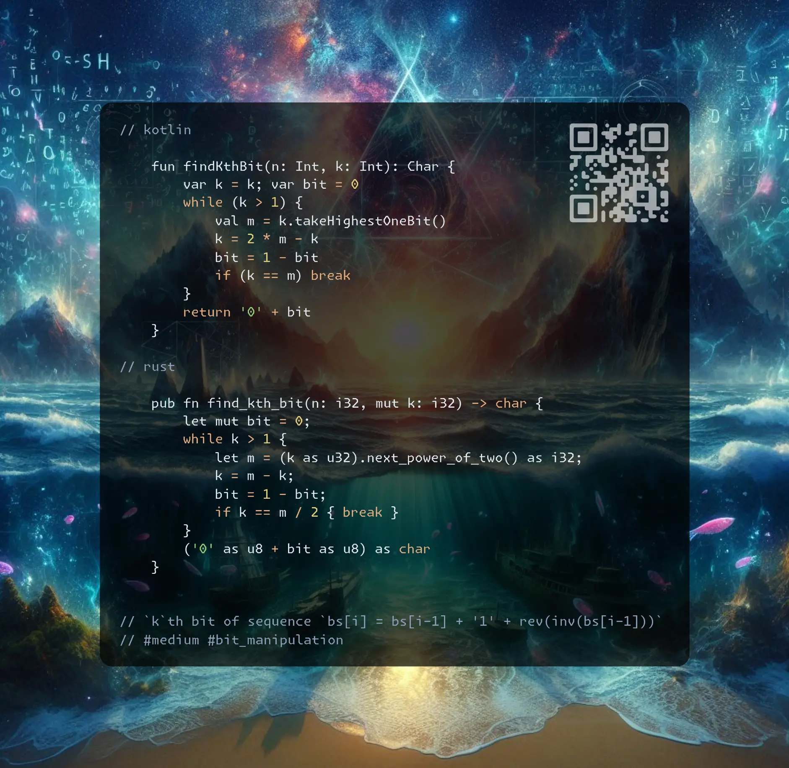

# Kotlin | Rust

**Author:** SamoylenkoDmitry
**Votes:** 3
**Link:** [https://leetcode.com/problems/find-kth-bit-in-nth-binary-string/solutions/5935718/](https://leetcode.com/problems/find-kth-bit-in-nth-binary-string/solutions/5935718/)

---



https://youtu.be/MoikypABASM

#### Join me on Telegram

https://t.me/leetcode_daily_unstoppable/773

#### Problem TLDR

`k`th bit of sequence `bs[i] = bs[i-1] + '1' + rev(inv(bs[i-1]))` #medium #bit_manipulation

#### Intuition

Several examples:

```j
    S1 = "0"
    S2 = "011"
    S3 = "0111001"
    S4 = "0 11 1001 10110001"
```
Let's construct `S5` from `S4`:

```j
          1  2    3        4                     5
    S5 = "0 11 1001 10110001 1 [(0 11 1001 10110001)]"
    S5 = "0 11 1001 10110001 1 [100011011001110]"
          1 23 4567 89
    S5 = "0 11 1001 10110001 1 011100100110001"
```

* As wee see, we have all the previous `S_i` in the prefix of `S5`.

The interesting properties are:

```j

    S5 = "0 11 1001 10110001 1 011100100110001"
                *
    n=4 k=5 sizes: 1 -> 3 -> 2*3+1 -> ... = 2^n - 1
    middle bit: 2 -> 4 -> 8 -> ... ->2*(n-1)=  2^(n-1)


```

* we can find a `middle bit` and a `size` for any given `k`

Now, let's try to go back from the `destination bit` by reversing the operations:

```j

        1234567
    S3: 0111001
           mk
        middle bit = 2^(3-1) = 4,
        size = 2^3 - 1 = 8-1 = 7
        k = 5 , 5 > 4, pos = 5-4 = 1, inverts++, 
        reverse_pos = 4-pos = 4 - 5 + 4 = 2*m - k = 3
        n--
            123  n=2
        S2: 011
             mk
        m = 2^(2-1) = 2, size = 2^2-1 = 3
        k=3, 3>m, reverse_pos = 2*m-k = 2*2-3 = 1, inverts++
        n-- n=1

        S1: 0 -> inverts = 2, ans = 0

          123456789101112131415
    S4 =  0111001101 1 0 0 0 1     k=12
             .   m     k
             k
    m = 2^(4-1) = 8
    pos = 2 * 8 - k = 16 - 12 = 4
    bit = 1

```

* we do total of `n` reverse operations
* we move `k` to `2^n - k` in each `Sn` operation


#### Approach

* the `n` is irrelevant, as the sequence is always the same for any `k`, `n = highest one bit of (k)`
* the corner case is when `k` points to the middle
* there is O(1) solution possible (by lee215 https://leetcode.com/problems/find-kth-bit-in-nth-binary-string/solutions/785548/JavaC++Python-O(1)-Solutions/)
* there are built-in methods to find next power of two and there are bit hacks (https://graphics.stanford.edu/%7Eseander/bithacks.html#RoundUpPowerOf2)

#### Complexity

- Time complexity:
$$O(n)$$

- Space complexity:
$$O(1)$$

#### Code

```kotlin []

    fun findKthBit(n: Int, k: Int): Char {
        var k = k; var bit = 0
        while (k > 1) {
            val m = k.takeHighestOneBit()
            k = 2 * m - k
            bit = 1 - bit
            if (k == m) break
        }
        return '0' + bit
    }

```
```rust []

    pub fn find_kth_bit(n: i32, mut k: i32) -> char {
        let mut bit = 0;
        while k > 1 {
            let m = (k as u32).next_power_of_two() as i32;
            k = m - k;
            bit = 1 - bit;
            if k == m / 2 { break }
        }
        ('0' as u8 + bit as u8) as char
    }

```
```c++ []

    char findKthBit(int n, int k) {
        int bit = 0;
        while (k > 1) {
            int m = 1 << (31 - __builtin_clz(k));
            k = 2 * m - k;
            bit = 1 - bit;
            if (k == m) break;
        }
        return '0' + bit;
    }

```