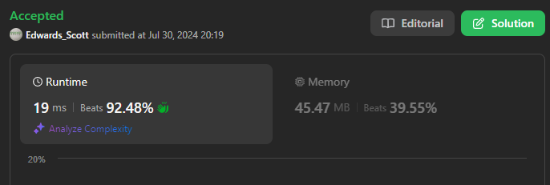

# 💢☠💫Easiest👾Faster✅💯 Lesser🧠 🎯 C++✅Python3🐍✅Java✅C✅Python🐍✅C#✅💥🔥💫Explained☠💥🔥 Beats 💯

**Author:** Edwards310
**Votes:** 3
**Link:** [https://leetcode.com/problems/minimum-deletions-to-make-string-balanced/solutions/5560244/](https://leetcode.com/problems/minimum-deletions-to-make-string-balanced/solutions/5560244/)

---

# Intuition


```javascript []
/**
 * @param {string} s
 * @return {number}
 */
var minimumDeletions = function(s) {
    var cb = 0, del = 0
    for(char of s){
        if(char === 'a')
            del = Math.min(++del, cb)
        else
            cb++
    }
    return del
};
```
```python3 []
class Solution:
    def minimumDeletions(self, s: str) -> int:
        cnt_b = dlt = 0
        for c in s:
            if c == 'a':
                dlt = min(dlt + 1, cnt_b)
            else:
                cnt_b += 1
        
        return dlt
```
```C++ []
// Start Of Anuj Bhati aka Edwards310's Template...
#pragma GCC optimize("O2")
#include <bits/stdc++.h>
using namespace std;
#define FOR(a, b, c) for (int a = b; a < c; a++)
#define FOR1(a, b, c) for (int a = b; a <= c; ++a)
#define Rep(i, n) FOR(i, 0, n)


// end of Anuj Bhati's aka Edwards310's Template
class Solution {
public:
    int minimumDeletions(string s) {
        int aCount = 0;
        int bCount = 0;
        int output = INT_MAX;
        Rep(i, s.length()) aCount += ('b' - s[i]);

        Rep(i, s.length()) {
            output = fmin(output, aCount + bCount);
            aCount -= ('b' - s[i]);
            bCount += (s[i] - 'a');
        }

        output = fmin(output, aCount + bCount);
        return output;
    }
};
```
```Java []
class Solution {
    public int minimumDeletions(String s) {
        int cb = 0;
        int dlt = 0;

        for (char c : s.toCharArray()) {
            if (c == 'a')
                dlt = Math.min(dlt + 1, cb);
            else
                cb++;
        }

        return dlt;
    }
}
```
```C []
int minimumDeletions(char* s) {
    int cnt_b = 0, delete = 0;
    while (*s) {
        if (*s == 'a')
            delete = fmin(++delete, cnt_b);
        else
            cnt_b++;
        *s++;
    }
    return delete;
}
```
```Python []
class Solution(object):
    def minimumDeletions(self, s):
        """
        :type s: str
        :rtype: int
        """
        cnt_b = dlt = 0
        for c in s:
            if c == 'a':
                dlt = min(dlt + 1, cnt_b)
            else:
                cnt_b += 1
        
        return dlt
```
```C# []
public class Solution {
    public int MinimumDeletions(string s) {
        int cb = 0;
        int delete = 0;
        foreach(char ch in s){
            if(ch == 'a')
                delete = Math.Min(++delete, cb);
            else
                cb++;
            }
        return delete;
    }
}
```
<!-- Describe your first thoughts on how to solve this problem. -->

# Approach
<!-- Describe your approach to solving the problem. -->

# Complexity
- Time complexity:
<!-- Add your time complexity here, e.g. $$O(n)$$ -->
     O(n)
- Space complexity:
<!-- Add your space complexity here, e.g. $$O(n)$$ -->
     O(1)
# Code
```
class Solution {
    public int minimumDeletions(String s) {
        int cb = 0;
        int dlt = 0;

        for (char c : s.toCharArray()) {
            if (c == 'a')
                dlt = Math.min(dlt + 1, cb);
            else
                cb++;
        }

        return dlt;
    }
}
```

