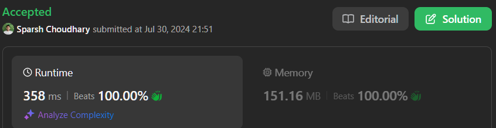

# 🔥BEATS 💯 % 🎯 |✨SUPER EASY👏| DART | JAVA | JAVASCRIPT | PYTHON |C++|C| SWIFT | RUST|GO|RUBY

**Author:** CodeWithSparsh
**Votes:** 2
**Link:** [https://leetcode.com/problems/minimum-deletions-to-make-string-balanced/solutions/5559759/](https://leetcode.com/problems/minimum-deletions-to-make-string-balanced/solutions/5559759/)

---




# Intuition
To make the string balanced, we need to ensure that there are no 'b's followed by 'a's. This can be achieved by deleting some characters. We want to minimize the number of deletions required. 

# Approach
We will traverse the string and keep track of the number of 'a's and 'b's seen so far. For each character, we decide whether to delete it based on the characters seen so far. We update the count of deletions required to maintain a balanced string up to the current index.

# Complexity
- Time complexity: $$O(n)$$
  - We traverse the string once.
- Space complexity: $$O(1)$$
  - We use only a constant amount of extra space.

# Code


```dart []
import 'dart:math';

class Solution {
  int minimumDeletions(String s) {
    int aCount = 0;
    int bCount = 0;
    int deletions = 0;
    
    for (int i = 0; i < s.length; i++) {
      if (s[i] == 'a') {
        aCount++;
      } else {
        bCount++;
      }
      deletions = min(deletions + (s[i] == 'a' ? 1 : 0), bCount);
    }
    return deletions;
  }
}
```
```c []
#include <stdio.h>
#include <string.h>

int minimumDeletions(char* s) {
    int aCount = 0, bCount = 0, deletions = 0;
    int length = strlen(s);
    
    for (int i = 0; i < length; i++) {
        if (s[i] == 'a') {
            aCount++;
        } else {
            bCount++;
        }
        deletions = (deletions + (s[i] == 'a' ? 1 : 0)) < bCount ? (deletions + (s[i] == 'a' ? 1 : 0)) : bCount;
    }
    return deletions;
}

```

```cpp []
#include <iostream>
#include <string>
#include <algorithm>

class Solution {
public:
    int minimumDeletions(std::string s) {
        int aCount = 0, bCount = 0, deletions = 0;
        
        for (char c : s) {
            if (c == 'a') {
                aCount++;
            } else {
                bCount++;
            }
            deletions = std::min(deletions + (c == 'a' ? 1 : 0), bCount);
        }
        return deletions;
    }
};

```
```java []
public class Solution {
    public int minimumDeletions(String s) {
        int aCount = 0, bCount = 0, deletions = 0;
        
        for (char c : s.toCharArray()) {
            if (c == 'a') {
                aCount++;
            } else {
                bCount++;
            }
            deletions = Math.min(deletions + (c == 'a' ? 1 : 0), bCount);
        }
        return deletions;
    }
}
```

```python []
class Solution:
    def minimumDeletions(self, s: str) -> int:
        a_count = 0
        b_count = 0
        deletions = 0
        
        for c in s:
            if c == 'a':
                a_count += 1
            else:
                b_count += 1
            deletions = min(deletions + (1 if c == 'a' else 0), b_count)
        
        return deletions

```

```javascript []
function minimumDeletions(s) {
    let aCount = 0, bCount = 0, deletions = 0;
    
    for (let i = 0; i < s.length; i++) {
        if (s[i] === 'a') {
            aCount++;
        } else {
            bCount++;
        }
        deletions = Math.min(deletions + (s[i] === 'a' ? 1 : 0), bCount);
    }
    return deletions;
}
```
```go []
package main

import (
    "fmt"
    "math"
)

func minimumDeletions(s string) int {
    aCount, bCount, deletions := 0, 0, 0
    
    for _, c := range s {
        if c == 'a' {
            aCount++
        } else {
            bCount++
        }
        deletions = int(math.Min(float64(deletions+(if c == 'a' { 1 } else { 0 })), float64(bCount)))
    }
    return deletions
}

```

```ruby []
def minimum_deletions(s)
    a_count = 0
    b_count = 0
    deletions = 0
    
    s.each_char do |c|
        if c == 'a'
            a_count += 1
        else
            b_count += 1
        end
        deletions = [deletions + (c == 'a' ? 1 : 0), b_count].min
    end
    deletions
end

```

```swift []
import Foundation

class Solution {
    func minimumDeletions(_ s: String) -> Int {
        var aCount = 0
        var bCount = 0
        var deletions = 0
        
        for c in s {
            if c == "a" {
                aCount += 1
            } else {
                bCount += 1
            }
            deletions = min(deletions + (c == "a" ? 1 : 0), bCount)
        }
        return deletions
    }
}

```
```kotlin []
class Solution {
    fun minimumDeletions(s: String): Int {
        var aCount = 0
        var bCount = 0
        var deletions = 0
        
        for (c in s) {
            if (c == 'a') {
                aCount++
            } else {
                bCount++
            }
            deletions = minOf(deletions + if (c == 'a') 1 else 0, bCount)
        }
        return deletions
    }
}

```
```rust []
fn minimum_deletions(s: String) -> i32 {
    let mut a_count = 0;
    let mut b_count = 0;
    let mut deletions = 0;
    
    for c in s.chars() {
        if c == 'a' {
            a_count += 1;
        } else {
            b_count += 1;
        }
        deletions = deletions + if c == 'a' { 1 } else { 0 };
        deletions = std::cmp::min(deletions, b_count);
    }
    deletions
}
```

##### The goal is to maintain a balanced string where there are no 'b's followed by 'a's. To achieve this, we need to decide for each character whether to keep it or delete it to maintain or achieve balance. The line in question is crucial for updating the minimum number of deletions required to keep the string balanced up to the current index i.

##### Components of the Line
###### Current Character Check: (s[i] == 'a' ? 1 : 0)

This part checks if the current character s[i] is 'a'.
If it is 'a', it returns 1 (indicating we might need to delete this 'a').
If it is not 'a' (i.e., it is 'b'), it returns 0 (indicating no immediate need to delete).
Previous Deletions Count: deletions

This variable keeps track of the minimum number of deletions required to maintain a balanced string up to the previous character.
Increment Deletions if 'a': deletions + (s[i] == 'a' ? 1 : 0)

If the current character is 'a', we consider the possibility of deleting it by adding 1 to the previous deletions count.
If the current character is 'b', the deletions count remains the same.
Number of 'b's Seen So Far: bCount

This variable tracks the number of 'b's encountered up to the current index i.
This helps determine if it's better to delete enough 'a's to make the remaining string balanced.
Choose the Minimum: min(deletions + (s[i] == 'a' ? 1 : 0), bCount)

We take the minimum of two options:
Deleting the current 'a' if it's an 'a' (deletions + 1).
Keeping all 'b's encountered so far (bCount).
Purpose of the Line
The line updates the deletions variable to the minimum number of deletions needed to keep the string balanced up to the current index i. By taking the minimum of deleting the current 'a' or keeping all 'b's seen so far, we ensure that we make the optimal choice at each step, minimizing the total number of deletions required.

##### Example Walkthrough
Let's walk through a simple example to see how this line works in practice.

Example: s = "aababbab"
Initial State:

deletions = 0, aCount = 0, bCount = 0.
First Character (s[0] = 'a'):

aCount = 1.
deletions = min(0 + 1, 0) = 0.
Second Character (s[1] = 'a'):

aCount = 2.
deletions = min(0 + 1, 0) = 0.
Third Character (s[2] = 'b'):

bCount = 1.
deletions = min(0 + 0, 1) = 0.
Fourth Character (s[3] = 'a'):

aCount = 3.
deletions = min(0 + 1, 1) = 1 (delete this 'a').
Fifth Character (s[4] = 'b'):

bCount = 2.
deletions = min(1 + 0, 2) = 1.
Sixth Character (s[5] = 'b'):

bCount = 3.
deletions = min(1 + 0, 3) = 1.
Seventh Character (s[6] = 'a'):

aCount = 4.
deletions = min(1 + 1, 3) = 2 (delete this 'a').
Eighth Character (s[7] = 'b'):

bCount = 4.
deletions = min(2 + 0, 4) = 2.
Result
The final value of deletions is 2, indicating that we need to delete 2 characters to make the string balanced.

###### This approach ensures that we maintain a balanced string with the minimum number of deletions by making optimal choices at each step.

 {:style='width:250px'}```