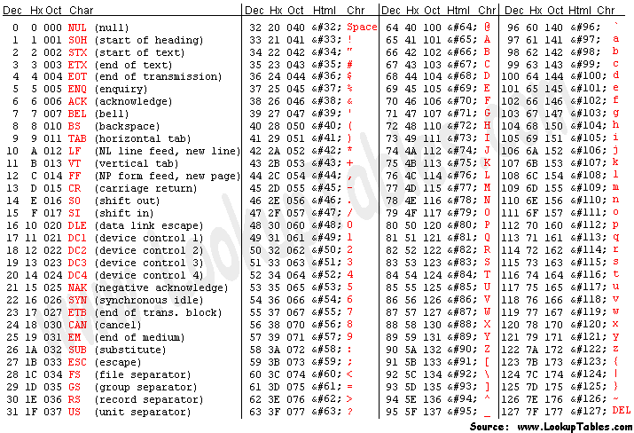

# ✅C++ || DETAILED_EXPLAINED || BEATS 100% || TC -> O(n)

**Author:** ayushsenapati123
**Votes:** 42
**Link:** [https://leetcode.com/problems/partitioning-into-minimum-number-of-deci-binary-numbers/solutions/2202970/](https://leetcode.com/problems/partitioning-into-minimum-number-of-deci-binary-numbers/solutions/2202970/)

---

**PLEASE UPVOTE IF YOU FIND MY APPROACH HELPFUL, MEANS A LOT \uD83D\uDE0A**

**Explanation:**


* We need the minimum number of positive deci-binary numbers needed so that they sum up to the given number in string format.
* We can only use 0 and 1.
* So we just gave to subtract the maximum value made out of 0 and 1, and keep on doing so until the net resultant becomes 0.

**Use this ASCII table for reference**



**Lets do a dry run and and see how it works:-**
```
Given test_case -
Input: n = "82734"
Output: 8


    82734
(-) 11111(max value)
-------------
	71662
(-) 11111(max value)
-------------
	60511
(-) 10111(max value, as one of the positions became 0)
-------------
	50400
(-) 10100(max value, as two of the positions became 0)
-------------
	40300
(-) 10100(max value)
-------------
	30200
(-) 10100(max value)
-------------
	20000
(-) 10000(max value)
-------------
	10000
(-) 10000(max value)
-------------
	00000(net resultant is now 0)

We can observe that total no. of iterations made is 8 which is the required answer.
The no. of iteration is directly proportional to the maximum value of digit in the given string.
```
**Code:-**
```
class Solution {
public:
    int minPartitions(string n) {
        int len = n.length();
        int max_digit_in_string = 0;
        
        for(auto element : n)
        {
            // convert the string number into integer number by subtracting the ascii value.
            int digit = element - '0';
            max_digit_in_string = max(max_digit_in_string,digit);
        }
        
        return max_digit_in_string;
    }
};
```

TC -> `O(n)`