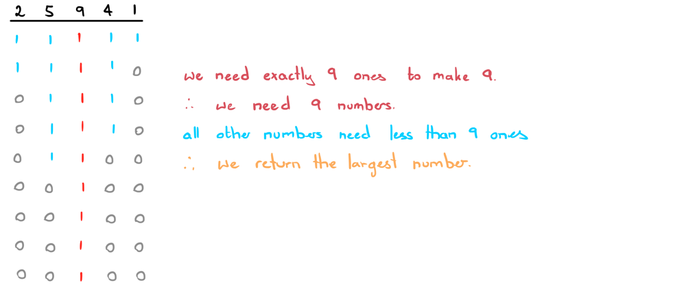

# One Main Observation + Interview Tips | JAVA Explained

**Author:** ciote
**Votes:** 285
**Link:** [https://leetcode.com/problems/partitioning-into-minimum-number-of-deci-binary-numbers/solutions/2202690/](https://leetcode.com/problems/partitioning-into-minimum-number-of-deci-binary-numbers/solutions/2202690/)

---

### Logic:
This question is super deceptive. At first, you might come to the conclusion that this is a DP problem similar to [Coin Change](https://leetcode.com/problems/coin-change/). However, there is a super useful trick that comes with the fact that all deci-binary numbers consist of 1's and 0's.

> Note: Keep in mind in this question that <ins>deci-binary</ins> numbers are not binary numbers. As in, the deci-binary number 10 is "ten", not 2 (as it would be in binary). With this out of the way, let's get to that observation!

### The Main Observation:
Let's use the string `n = "25941"` for our example.
One way to think about this number, or any number, is that for our deci-binary numbers to sum up to `n`, each digit `d` needs to consist of exactly `d` 1's. For example, our first digit is 2 which suggests that we need 2 1's to make up that number.



As you can see, if we follow the above principle for all the numbers, our answer will quite simply be **the largest digit in the string**.
Therefore, all we'd need to do is loop through each character in our string and keep track of the largest digit. If we ever come across a 9, we can return 9 straight away since that would be the maximum.
___
### How could I have come up with this solution?
This is definitely a question worth considering. How would one know that the solution is not a DP solution? <ins>We need to look at the question constraints and hints hidden in the description of the question</ins>.

One major hint was our input. We were given a String, not an int. The string can be really long as implied by the constraints of its length. Just from this, we can already conclude that we can't just change our String to an integer. This already puts the coin change strategy out of the picture. 

Another hint would come from the fact that the numbers only consist of 1's and 0's and that `n` is strictly positive. 

From here, it's important to think about a linear solution to the question since the length of the string could be quite large. With all of these things put into consideration, you should have more than enough information to assume that there's probably some trick involved in the question that's specific to the description of this question. The best thing to do from here is to draw out some short yet distinct examples and try and extract out any patterns.

> Interview tip: In an interview, you likely won't be given any of these constraints straight away. This question is a really good example that demonstrates the importance of <ins>clarifying the question</ins> during an interview. Make sure you always clarify the constraints of the problem with the interviewer as well as the input and output types.

I hope this helps!
___
### Code:
If you have any questions, suggestions or improvements, feel free to let me know!
```java
public int minPartitions(String n) {
	int max = 0;
	for (int i=0; i<n.length(); i++) {
		if (n.charAt(i) - '0' == 9) return 9;
		max = Math.max(max, (n.charAt(i) - '0'));
	}
	return max;
}
```
**Time complexity:** `O(m)` where `m` is the length of the string `n`.
**Space complexity:** `O(1)`