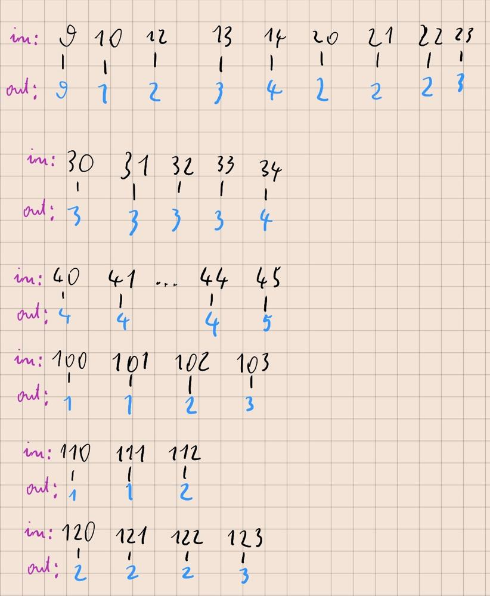

# [Kotlin] - Easy | 1 line | Max digit

**Author:** AdamDawi
**Votes:** 0
**Link:** [https://leetcode.com/problems/partitioning-into-minimum-number-of-deci-binary-numbers/solutions/4987072/](https://leetcode.com/problems/partitioning-into-minimum-number-of-deci-binary-numbers/solutions/4987072/)

---

# Approach
We can track results for small numbers:

As a result, we can see that the largest digit in the number is always the result of our problem.


# Complexity
- Time complexity:
O(n)

- Space complexity:
O(1)

# Code
```
class Solution {
    fun minPartitions(n: String): Int = n.map{it.digitToInt()}.maxOrNull() ?: 1
}
```