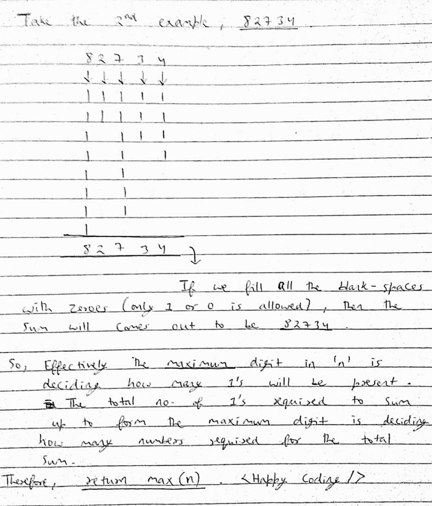

# Detailed Easiest Explanation of Solution

**Author:** coder1311
**Votes:** 164
**Link:** [https://leetcode.com/problems/partitioning-into-minimum-number-of-deci-binary-numbers/solutions/1039096/](https://leetcode.com/problems/partitioning-into-minimum-number-of-deci-binary-numbers/solutions/1039096/)

---

I was trying it hard for several days , then checked out the discussion group for some hints.
I really got surprised by the one-liner solutions. I'm just providing here the detailed explanation to the solution for others to get help from it.

**In Python**
```
class Solution:
    def minPartitions(self, n: str) -> int:
        return max(n)
```




**If you find this helpful, please upvote to motivate me to do it regularly!! Thank You.**
