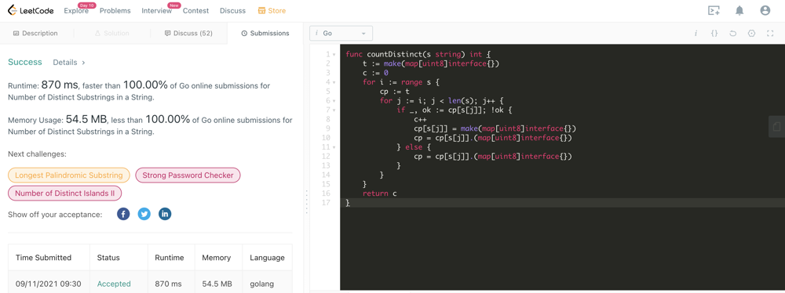

# [golang] 100 % faster and 100  % memory

**Author:** vl4deee11
**Votes:** 0
**Link:** [https://leetcode.com/problems/number-of-distinct-substrings-in-a-string/solutions/1456770/](https://leetcode.com/problems/number-of-distinct-substrings-in-a-string/solutions/1456770/)

---



```
func countDistinct(s string) int {
	t := make(map[uint8]interface{})
	c := 0
	for i := range s {
		cp := t
		for j := i; j < len(s); j++ {
			if _, ok := cp[s[j]]; !ok {
				c++
				cp[s[j]] = make(map[uint8]interface{})
				cp = cp[s[j]].(map[uint8]interface{})
			} else {
				cp = cp[s[j]].(map[uint8]interface{})
			}
		}
	}
	return c
}

```