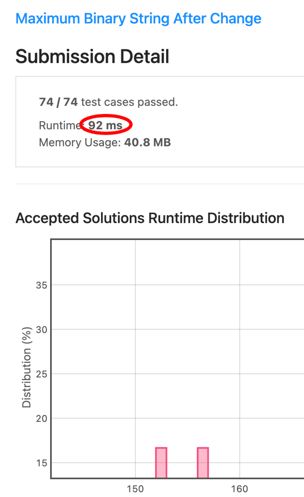

# [C++] Linear Time Solution in 2 Passes, 100% Time, 100% Space

**Author:** Ajna
**Votes:** 14
**Link:** [https://leetcode.com/problems/maximum-binary-string-after-change/solutions/987787/](https://leetcode.com/problems/maximum-binary-string-after-change/solutions/987787/)

---

This to me was the most fun of the day; and, as it is often the case, one has to love a problem that is easy to understand and not so easy to solve.

The core idea is to try to maximise the transformations that increase the value of the number (`"00"` => `"10"`), but only after we worked to prepare the ground as much as possible with the second transformation, which per se is actually reducing the number (`"10"` => `"01"`).

Initially I went for a simple approach where I was first performing the second transformation as long as I get at least a change done to my string; but then I realised that was potentially rather expensive and just opted for moving all the available `'1'`s to the end, provided we had at least a `'0'`s.

Once there, again I saw there was room to do things in a smarter way, so I turned to my current approach.

First of all we declare 3 variables, all integers:
* `zeros`, as the name implies, will count how many `'0'`s we have in our string;
* `i` is going to be our pointer, initially set to `0`;
* `len` will store the length of our input.

First of all, we need to move `i` to where it is actually meaningful to make changes: if we have any leading `'1'`s, then we want them to stay where they are, since we can't get any better than that up for that part of the string.

After that point, we will go on counting all the `'0'`s with another loop starting from `i` (it seems trivial, but I actually got relatively good improvements fixing that, instead of looping again through each possible leading `'1'`s i might have).

Then we need to make a check: if we have `zeros < 2`, then we can just return the original string, since we have no way to improve it, since the advantageous transformation requires at least two of them and the other actually decreases the value.

If not, we can just start writing `zeroes -1` times `'1'`s starting from `i`, followed by a single `'0'` and then by `'1'`s for the remainder of the string.

To understand why, let's consider `"11010110"` as our initial input.

First of all, we will move `i` to the first cell `== '0'`, that is to say, we will assign it value `2`.

We will then count the `zeros` and find `3` of them.

That would equate to operating the second transformation a number of times, starting from the right (because this will decrease our value, so we want to it with the less significant bits), until we have `s == "11000111"`.

And now life is rather easy, since we know for sure what to do next: take each `"00"` sequence we can find and turn it into a `"10"`, starting from the left (because this will increase our value). If you do the math, you will see that each sequence of `x` `'0'`s will eventually just boil down to `x - 1` times `'1'` followed by a single `'0'`.

Once done, we can return the properly mutated `s` :)

The code:

```cpp
class Solution {
public:
    string maximumBinaryString(string s) {
        // support variables
        int zeros = 0, i = 0, len = s.size();
        // moving the pointer after the first leading 1s
        while (s[i] == '1') i++; 
        // counting the 0s
        for (int j = i; j < len; j++) zeros += s[j] == '0';
        // edge case: not enough 0s to make any move convenient
        if (zeros < 2) return s;
        // turning all the zeros but one into 1s
        while (--zeros) s[i++] = '1';
        s[i++] = '0';
        // setting all the remaining original 1s to the end
        while (i < len) s[i++] = '1';
        return s;
    }
};
```

The brag:



