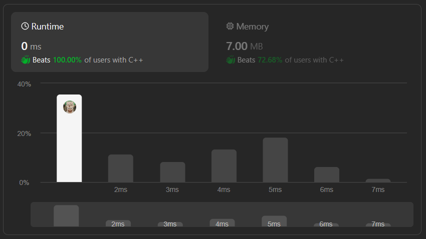

# ✅☑Beats 100% Users || [C++/Java/Python/JavaScript] || EXPLAINED🔥

**Author:** MarkSPhilip31
**Votes:** 74
**Link:** [https://leetcode.com/problems/determine-if-string-halves-are-alike/solutions/4549086/](https://leetcode.com/problems/determine-if-string-halves-are-alike/solutions/4549086/)

---

# PLEASE UPVOTE IF IT HELPED

---


---
# Approaches
(Also explained in the code)

1. **Vowel Set:**

    - Create an unordered set (`vowels`) containing all the vowel characters.
1. **Initialize Variables:**

    - Initialize `vowelsCount` to 0 to keep track of the difference in the count of vowels between the two halves.
    - Find the `midIndex` of the string, which represents the index where the second half starts.
1. **Iterate Over Halves:**

    - Use a loop to iterate over the first half and the corresponding characters in the second half simultaneously.
    - Check if each character in both halves is a vowel, updating `vowelsCount` accordingly.
1. **Check Equality:**

    - After the loop, check if `vowelsCount` is equal to 0. If so, the two halves have an equal number of vowels.


# Complexity
- Time complexity:
   $$O(n)$$
    

- Space complexity:
   $$O(1)$$
    


# Code
```C++ []

class Solution {
public:
    bool halvesAreAlike(std::string s) {
        unordered_set<char> vowels = {'a', 'e', 'i', 'o', 'u', 'A', 'E', 'I', 'O', 'U'};
        int vowelsCount = 0;
        int midIndex = s.length() / 2;

        for (int i = 0; i < midIndex; i++) {
            char charA = s[i];
            char charB = s[midIndex + i];
            if (vowels.count(charA)) vowelsCount++;
            if (vowels.count(charB)) vowelsCount--;
        }

        return vowelsCount == 0;
    }
};


```
```Java []


public class Solution {
    public boolean halvesAreAlike(String s) {
        Set<Character> vowels = new HashSet<>();
        vowels.add('a'); vowels.add('e'); vowels.add('i'); vowels.add('o'); vowels.add('u');
        vowels.add('A'); vowels.add('E'); vowels.add('I'); vowels.add('O'); vowels.add('U');

        int vowelsCount = 0;
        int midIndex = s.length() / 2;

        for (int i = 0; i < midIndex; i++) {
            char charA = s.charAt(i);
            char charB = s.charAt(midIndex + i);
            if (vowels.contains(charA)) vowelsCount++;
            if (vowels.contains(charB)) vowelsCount--;
        }

        return vowelsCount == 0;
    }
}


```
```python3 []

class Solution:
    def halvesAreAlike(self, s: str) -> bool:
        vowels = set('a', 'e', 'i', 'o', 'u', 'A', 'E', 'I', 'O', 'U')
        vowels_count = 0
        mid_index = len(s) // 2

        for i in range(mid_index):
            char_a = s[i]
            char_b = s[mid_index + i]
            if char_a in vowels:
                vowels_count += 1
            if char_b in vowels:
                vowels_count -= 1

        return vowels_count == 0


```
```javascript []
class Solution {
    halvesAreAlike(s) {
        const vowels = new Set(['a', 'e', 'i', 'o', 'u', 'A', 'E', 'I', 'O', 'U']);
        let vowelsCount = 0;
        const midIndex = Math.floor(s.length / 2);

        for (let i = 0; i < midIndex; i++) {
            const charA = s[i];
            const charB = s[midIndex + i];
            if (vowels.has(charA)) vowelsCount++;
            if (vowels.has(charB)) vowelsCount--;
        }

        return vowelsCount === 0;
    }
}


```
---


# PLEASE UPVOTE IF IT HELPED

---
---


---