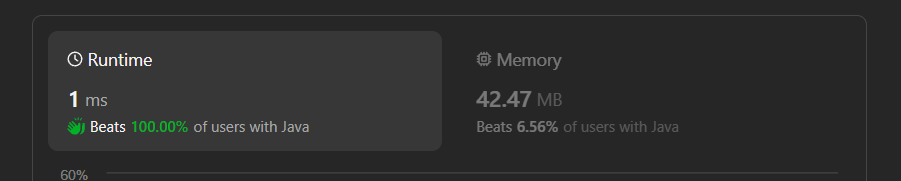

# ✅Beats 100% - Explained with [ Video ] - C++/Java/Python/JS  - O(n) Time O(1) Space - Visualized

**Author:** lancertech6
**Votes:** 74
**Link:** [https://leetcode.com/problems/minimum-changes-to-make-alternating-binary-string/solutions/4449097/](https://leetcode.com/problems/minimum-changes-to-make-alternating-binary-string/solutions/4449097/)

---



# YouTube Video Explanation:

[https://youtu.be/qUsW1d8A4cQ](https://youtu.be/qUsW1d8A4cQ)
<!-- **If you want a video for this question please write in the comments** -->

**\uD83D\uDD25 Please like, share, and subscribe to support our channel's mission of making complex concepts easy to understand.**

Subscribe Link: https://www.youtube.com/@leetlogics/?sub_confirmation=1

*Subscribe Goal: 1000 Subscribers*
*Current Subscribers: 960*

---

# Example Explanation
Let's break down the logic using a step-by-step table for better clarity.

**Example:**
Consider the input string `s = "0100"`.

| Index | Character | Current Count (Starting with '0') | Current Count (Starting with '1') |
|-------|-----------|-----------------------------------|-----------------------------------|
|   0   |     0     |                 0                 |                 1                 |
|   1   |     1     |                 1                 |                 1                 |
|   2   |     0     |                 1                 |                 2                 |
|   3   |     0     |                 1                 |                 3                 |

- Count for starting with '0': 1 operations
- Count for starting with '1': 3 operation

The minimum count is 1, which is our result.

1. Initialize counts:
   - count1 (starting with '0') = 0
   - count2 (starting with '1') = 1

2. Loop through the characters of the string (starting from index 1):
   a. At index 1:
      - Character: 1
      - For starting with '0', no need to flip, so count1 = 0 (total count1 = 0)
      - For starting with '1', we need to flip, so count2 +=1 (total count2 = 2)

   b. At index 2:
      - Character: 0
      - For starting with '0', no need to flip, so count1 remains the same (total count1 = 0)
      - For starting with '1', we need to flip, so count2 += 1 (total count2 = 3)

   c. At index 3:
      - Character: 0
      - For starting with '0', we need to flip, so count1 += 1 (total count1 = 1)
      - For starting with '1', no need to flip, so count2 += 1 (total count2 = 3)

3. Final counts:
   - count1 (starting with '0') = 1
   - count2 (starting with '1') = 3

4. Return the minimum of count1 and count2, which is 2.

I hope this breakdown helps you understand the logic!

---

# Intuition
<!-- Describe your first thoughts on how to solve this problem. -->
To make a string alternating, we need to flip the characters at specific positions. The key is to observe that there are two possibilities for the starting character: '0' or '1'. We need to count the number of operations needed to make the string alternating starting with '0' and '1', and then return the minimum of these two counts.

# Approach
<!-- Describe your approach to solving the problem. -->
1. Initialize two counts: `count1` for starting with '0' and `count2` for starting with '1'.
2. Use the `count` function to count the number of operations needed for each starting character. This function takes the string `s` and the previous character `c_pre` and returns the count of operations needed.
3. Compare `count1` and `count2` and return the minimum of the two.

# Complexity
- Time complexity: The time complexity is O(n), where n is the length of the input string.
<!-- Add your time complexity here, e.g. $$O(n)$$ -->

- Space complexity: The space complexity is O(1) as we are using a constant amount of space.
<!-- Add your space complexity here, e.g. $$O(n)$$ -->

# Code
```java []
class Solution {
    public int minOperations(String s) {
        char c_0 = s.charAt(0);
        int count1 = count(s, c_0);
        int count2 = count(s, c_0=='0'?'1':'0')+1;
        return Math.min(count1, count2);
    }

    private int count(String s, char c_pre){
        int count = 0;
        for(int i=1; i<s.length(); i++){
            char current = s.charAt(i);
            if(current==c_pre){
                count++;
                c_pre = c_pre == '0' ? '1' : '0';
            }else{
                c_pre = current;   
            }
        }
        return count;
    }
}
```
```C++ []
class Solution {
public:
    int minOperations(string s) {
        char c_0 = s[0];
        int count1 = count(s, c_0);
        int count2 = count(s, c_0 == '0' ? '1' : '0') + 1;
        return min(count1, count2);
    }

private:
    int count(string s, char c_pre) {
        int count = 0;
        for (int i = 1; i < s.length(); i++) {
            char current = s[i];
            if (current == c_pre) {
                count++;
                c_pre = c_pre == '0' ? '1' : '0';
            } else {
                c_pre = current;
            }
        }
        return count;
    }
};
```
```Python []
class Solution(object):
    def minOperations(self, s):
        c_0 = s[0]
        count1 = self.count(s, c_0)
        count2 = self.count(s, '0' if c_0 == '1' else '1') + 1
        return min(count1, count2)

    def count(self, s, c_pre):
        count = 0
        for i in range(1, len(s)):
            current = s[i]
            if current == c_pre:
                count += 1
                c_pre = '0' if c_pre == '1' else '1'
            else:
                c_pre = current
        return count
        
```
```JavaScript []
var minOperations = function(s) {
    let c_0 = s[0];
    let count1 = count(s, c_0);
    let count2 = count(s, c_0 === '0' ? '1' : '0') + 1;
    return Math.min(count1, count2);
};

const count = function(s, c_pre) {
    let count = 0;
    for (let i = 1; i < s.length; i++) {
        let current = s[i];
        if (current === c_pre) {
            count++;
            c_pre = c_pre === '0' ? '1' : '0';
        } else {
            c_pre = current;
        }
    }
    return count;
};
```

