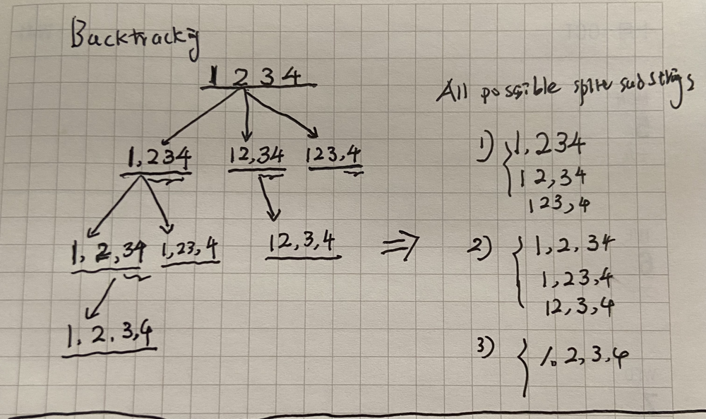

# Backtracking explain

**Author:** keepsharp
**Votes:** 1
**Link:** [https://leetcode.com/problems/splitting-a-string-into-descending-consecutive-values/solutions/2077769/](https://leetcode.com/problems/splitting-a-string-into-descending-consecutive-values/solutions/2077769/)

---

# Backtracking

> from brute force step by step optimize

One picture is worth a thousand words.




## 1. Solution1 Brute force DFS

Use DFS generate all possible split substrings and check to descend.

````
//					 1234
//     1,234		 12,34		123,4
// 1,2,34  1,23,4    12,3,4
// 1,2,3,4

// S1:) TLE 182 / 196 test cases passed.
func splitString(s string) bool {
	if len(s) <= 1 {
		return false
	}
	res := make([][]int, 0)
	backtrack(s, 0, &[]int{}, &res)
	for _, lst := range res {
		if isDescending(lst) {
			return true
		}
	}
	return false
}

func backtrack(s string, start int, tmp *[]int, res *[][]int) {
	if start == len(s) && len(*tmp) > 1 {
		lst := make([]int, len(*tmp))
		copy(lst, *tmp)
		*res = append(*res, lst)
	}
	for i := start; i < len(s); i++ {
		x, _ := strconv.Atoi(s[start : i+1])
		*tmp = append(*tmp, x)
		backtrack(s, i+1, tmp, res)
		*tmp = (*tmp)[:len(*tmp)-1]
	}
}

func isDescending(lst []int) bool {
	if len(lst) < 2 {
		return false
	}
	for i := 1; i < len(lst); i++ {
		if lst[i-1]-lst[i] == 1 {
			continue
		} else {
			return false
		}
	}
	return true
}


````

## 2. Optimize solution 1

Because solution 1 generates all possible substrings, there are many substrings
is not descend, so we drop this substring.

```
// S2:) Optimize S1
func splitString(s string) bool {
	if len(s) <= 1 {
		return false
	}
	return isDesc(s, 0, &[]int{})
}

// Backtracking
func isDesc(s string, start int, tmp *[]int) bool {
	if start == len(s) {
		return len(*tmp) >= 2
	}
	for i := start; i < len(s); i++ {
		curr, _ := strconv.Atoi(s[start : i+1])
		if len(*tmp) == 0 || (*tmp)[len(*tmp)-1]-curr == 1 { // prev - curr == 1
			*tmp = append(*tmp, curr)
			if isDesc(s, i+1, tmp) {
				return true
			}
			*tmp = (*tmp)[:len(*tmp)-1]
		}
	}
	return false
}

```
