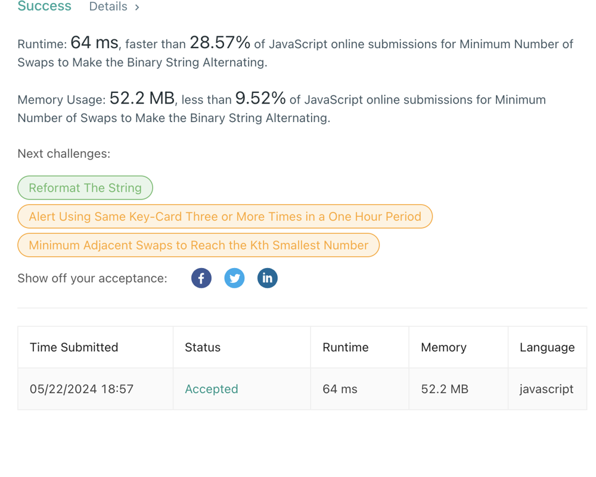

# minimum-number-swaps-make-binary-string-alternating👌 🏆O(N)❤️ Javascript🎯 Memory👀28.57%🕕

**Author:** anurag-sindhu
**Votes:** 2
**Link:** [https://leetcode.com/problems/minimum-number-of-swaps-to-make-the-binary-string-alternating/solutions/5193463/](https://leetcode.com/problems/minimum-number-of-swaps-to-make-the-binary-string-alternating/solutions/5193463/)

---

Time Complexity: O(N)
Space Complexity: O(N)
```
var minSwaps = function (s) {
    const onePresenceWithIndexMapping = {};
    const totalCountOfOne = (function () {
        let count = 0;
        for (let index = 0; index < s.length; index++) {
            if (s[index] === '1') {
                onePresenceWithIndexMapping[index] = true;
                count += 1;
            }
        }
        return count;
    })();
    let minCountOfOneRequired = Math.floor(s.length / 2);
    let maxCountOfOneAllowed = Math.ceil(s.length / 2);
    //Only this range is allowed
    if (!(minCountOfOneRequired <= totalCountOfOne && maxCountOfOneAllowed >= totalCountOfOne)) {
        return -1;
    }
    let minSwapsRequired = Infinity;
    let tempOnePresenceWithIndexMapping = { ...onePresenceWithIndexMapping };
    let tempSwaps = function () {
        let count = 0;
        for (const key in tempOnePresenceWithIndexMapping) {
            if (tempOnePresenceWithIndexMapping[key] === true) {
                count += 1;
            }
        }
        return count;
    };
    /**
     * Its ends with only two possibilities.
     * Either this:
     * 010101
     * or that:
     * 101010
     * which ever requires less swaps
     */
    if (s.length % 2 === 0) {
        /**
         * firstPossibility
         * 101010
         */
        for (let index = 0; index < s.length - 1; index += 2) {
            tempOnePresenceWithIndexMapping[index] = false;
        }
        minSwapsRequired = Math.min(minSwapsRequired, tempSwaps());
        /**
         * secondPossibility
         * 010101
         */
        tempOnePresenceWithIndexMapping = { ...onePresenceWithIndexMapping };
        for (let index = 1; index < s.length; index += 2) {
            tempOnePresenceWithIndexMapping[index] = false;
        }
        minSwapsRequired = Math.min(minSwapsRequired, tempSwaps());
    } else {
        /**
         * Its ends with only two possibilities. depending on the count of one,
         * as per the count we will be fitting on the kind of pattern possible
         * pattern one:
         * 10101
         * pattern two:
         * 01010
         */
        if (totalCountOfOne === maxCountOfOneAllowed) {
            for (let index = 0; index < s.length; index += 2) {
                tempOnePresenceWithIndexMapping[index] = false;
            }
            /**
             * pattern one:
             * 10101
             */
        } else {
            /**
             * pattern two:
             * 01010
             */
            for (let index = 1; index < s.length - 1; index += 2) {
                tempOnePresenceWithIndexMapping[index] = false;
            }
        }
        minSwapsRequired = Math.min(minSwapsRequired, tempSwaps());
    }
    return minSwapsRequired;
};
```


