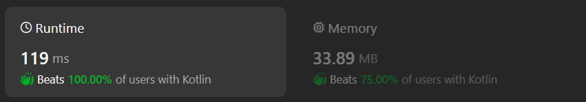

# Kotlin simple solution with counter

**Author:** chayangkoon
**Votes:** 0
**Link:** [https://leetcode.com/problems/longer-contiguous-segments-of-ones-than-zeros/solutions/5079740/](https://leetcode.com/problems/longer-contiguous-segments-of-ones-than-zeros/solutions/5079740/)

---




# Complexity
- Time complexity:
O(n)

- Space complexity:
O(1)

# Code
```
class Solution {
    fun checkZeroOnes(s: String): Boolean {
        val length = s.length
        var longestZero = 0
        var longestOne = 0
        var index = 0
        var count = 0

        while (index < length) {
            count = 0
            while (index < length && s[index] == '0') {
                count++
                index++
            }
            longestZero = max(count, longestZero)

            count = 0
            while (index < length && s[index] == '1') {
                count++
                index++
            }
            longestOne = max(count, longestOne)
        }

        return longestOne > longestZero
    }
}
```