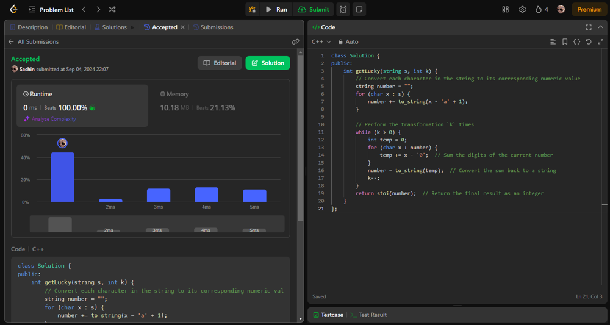

# Easy Solution | Beats 100%

**Author:** Sachinonly__
**Votes:** 172
**Link:** [https://leetcode.com/problems/sum-of-digits-of-string-after-convert/solutions/5728491/](https://leetcode.com/problems/sum-of-digits-of-string-after-convert/solutions/5728491/)

---

# Complexity
- Time complexity: O(K*N)
<!-- Add your time complexity here, e.g. $$O(n)$$ -->

- Space complexity: O(N)
<!-- Add your space complexity here, e.g. $$O(n)$$ -->

# Code
```python []
class Solution(object):
    def getLucky(self, s, k):
        # Convert each character in the string to its corresponding numeric value
        number = ''
        for x in s:
            number += str(ord(x) - ord('a') + 1)
        
        # Perform the transformation `k` times
        while k > 0:
            temp = 0
            for x in number:
                temp += int(x)  # Sum the digits of the current number
            number = str(temp)  # Convert the sum back to a string
            k -= 1
        return int(number)  # Return the final result as an integer
```
```C++ []
class Solution {
public:
    int getLucky(string s, int k) {
        // Convert each character in the string to its corresponding numeric value
        string number = "";
        for (char x : s) {
            number += to_string(x - 'a' + 1);
        }
        
        // Perform the transformation `k` times
        while (k > 0) {
            int temp = 0;
            for (char x : number) {
                temp += x - '0';  // Sum the digits of the current number
            }
            number = to_string(temp);  // Convert the sum back to a string
            k--;
        }
        return stoi(number);  // Return the final result as an integer
    }
};
```
```Java []
class Solution {
    public int getLucky(String s, int k) {
        // Convert each character in the string to its corresponding numeric value
        StringBuilder number = new StringBuilder();
        for (char x : s.toCharArray()) {
            number.append(x - 'a' + 1);
        }
        
        // Perform the transformation `k` times
        while (k > 0) {
            int temp = 0;
            for (char x : number.toString().toCharArray()) {
                temp += x - '0';  // Sum the digits of the current number
            }
            number = new StringBuilder(String.valueOf(temp));  // Convert the sum back to a string
            k--;
        }
        return Integer.parseInt(number.toString());  // Return the final result as an integer
    }
}
```



