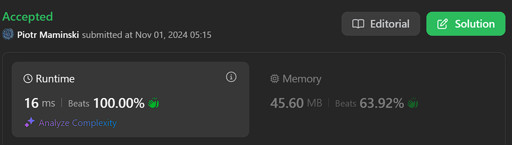

# ✅ Beats 100% | Simple | Explained step by step

**Author:** Piotr_Maminski
**Votes:** 7
**Link:** [https://leetcode.com/problems/delete-characters-to-make-fancy-string/solutions/5991578/](https://leetcode.com/problems/delete-characters-to-make-fancy-string/solutions/5991578/)

---

```python3 []
class Solution:
    def makeFancyString(self, s: str) -> str:
        # Return original string if length is less than 3
        if len(s) < 3:
            return s
        
        # Convert string to list for easier manipulation
        chars = list(s)
        j = 2
        
        # Iterate through string starting from index 2
        for i in range(2, len(s)):
            # Add current character if it's different from
            # either of the two previous characters
            if chars[i] != chars[j-1] or chars[i] != chars[j-2]:
                chars[j] = chars[i]
                j += 1
        
        # Join the characters up to index j to form the fancy string
        return ''.join(chars[:j])
```
```cpp []
class Solution {
public:
    string makeFancyString(string s) {
        // Return original string if length is less than 3
        // since we can't have 3 consecutive same characters
        if(s.length() < 3) {
            return s;
        }
        
        // j keeps track of the position where we'll place
        // the next valid character
        int j = 2;
        
        // Iterate through string starting from index 2
        for (int i = 2; i < s.size(); ++i) {
            // Add current character if it's different from
            // either of the two previous characters
            // This prevents three consecutive same characters
            if (s[i] != s[j - 1] || s[i] != s[j - 2]) {
                s[j++] = s[i];
            }
        }
        
        // Resize string to remove any excess characters
        // j represents the new length of the fancy string
        s.resize(j);
        return s;
    }
};
```
```java []
class Solution {
    public String makeFancyString(String s) {
        // Return original string if length is less than 3
        if (s.length() < 3) {
            return s;
        }
        
        // Convert string to char array for easier manipulation
        char[] chars = s.toCharArray();
        
        // j keeps track of the position where we'll place
        // the next valid character
        int j = 2;
        
        // Iterate through string starting from index 2
        for (int i = 2; i < chars.length; ++i) {
            // Add current character if it's different from
            // either of the two previous characters
            // This prevents three consecutive same characters
            if (chars[i] != chars[j - 1] || chars[i] != chars[j - 2]) {
                chars[j++] = chars[i];
            }
        }
        
        // Create new string with only the valid characters
        return new String(chars, 0, j);
    }
}
```
```csharp []
public class Solution {
    public string MakeFancyString(string s) {
        // Return original string if length is less than 3
        if (s.Length < 3) {
            return s;
        }
        
        // Convert string to char array for in-place modification
        char[] chars = s.ToCharArray();
        
        // j keeps track of the position where we'll place
        // the next valid character
        int j = 2;
        
        // Iterate through string starting from index 2
        for (int i = 2; i < chars.Length; ++i) {
            // Add current character if it's different from
            // either of the two previous characters
            // This prevents three consecutive same characters
            if (chars[i] != chars[j - 1] || chars[i] != chars[j - 2]) {
                chars[j++] = chars[i];
            }
        }
        
        // Create new string with the correct length
        return new string(chars, 0, j);
    }
}
```
```golang []
func makeFancyString(s string) string {
    // Convert string to rune slice since Go strings are immutable
    // and we need to modify characters
    chars := []rune(s)
    
    // If string length is less than 3, it can't have
    // three consecutive same characters, so return as-is
    if len(chars) < 3 {
        return s
    }
    
    // j tracks where to place the next valid character
    // Start from position 2 since we need to look at previous 2 chars
    j := 2
    
    // Iterate through string starting from third character
    for i := 2; i < len(chars); i++ {
        // Add current character if it differs from either
        // of the two previous characters at positions j-1 and j-2
        // This ensures we never have more than two consecutive same chars
        if chars[i] != chars[j-1] || chars[i] != chars[j-2] {
            chars[j] = chars[i]
            j++
        }
    }
    
    // Convert back to string, taking only the valid portion
    // j represents the new length of our fancy string
    return string(chars[:j])
}
```
```swift []
class Solution {
    func makeFancyString(_ s: String) -> String {
        // Convert string to array for easier manipulation
        var chars = Array(s)
        
        // Return original string if length is less than 3
        if chars.count < 3 {
            return s
        }
        
        // j keeps track of the position where we'll place
        // the next valid character
        var j = 2
        
        // Iterate through string starting from index 2
        for i in 2..<chars.count {
            // Add current character if it's different from
            // either of the two previous characters
            if chars[i] != chars[j-1] || chars[i] != chars[j-2] {
                chars[j] = chars[i]
                j += 1
            }
        }
        
        // Create new string from the modified array up to index j
        return String(chars[0..<j])
    }
}
```
```javascript [JS]
// JavaScript

/**
 * @param {string} s
 * @return {string}
 */
function makeFancyString(s) {
    // Convert string to array since strings are immutable in JavaScript
    let chars = s.split('');
    
    // Return original string if length is less than 3
    if (chars.length < 3) {
        return s;
    }
    
    // j keeps track of the position where we'll place
    // the next valid character
    let j = 2;
    
    // Iterate through string starting from index 2
    for (let i = 2; i < chars.length; i++) {
        // Add current character if it's different from
        // either of the two previous characters
        if (chars[i] !== chars[j - 1] || chars[i] !== chars[j - 2]) {
            chars[j++] = chars[i];
        }
    }
    
    // Return the fancy string by joining the array
    // and slicing to the correct length
    return chars.slice(0, j).join('');
}
```
```typescript [TS]
// TypeScript

function makeFancyString(s) {
    // Convert string to array since strings are immutable in JavaScript
    let chars = s.split('');
    
    // Return original string if length is less than 3
    if (chars.length < 3) {
        return s;
    }
    
    // j keeps track of the position where we'll place
    // the next valid character
    let j = 2;
    
    // Iterate through string starting from index 2
    for (let i = 2; i < chars.length; i++) {
        // Add current character if it's different from
        // either of the two previous characters
        if (chars[i] !== chars[j - 1] || chars[i] !== chars[j - 2]) {
            chars[j++] = chars[i];
        }
    }
    
    // Return the fancy string by joining the array
    // and slicing to the correct length
    return chars.slice(0, j).join('');
}
```
```rust []
impl Solution {
    pub fn make_fancy_string(s: String) -> String {
        let mut chars: Vec<char> = s.chars().collect();
        
        // Return original string if length is less than 3
        if chars.len() < 3 {
            return s;
        }
        
        // j keeps track of the position where we'll place
        // the next valid character
        let mut j = 2;
        
        // Iterate through string starting from index 2
        for i in 2..chars.len() {
            // Add current character if it's different from
            // either of the two previous characters
            if chars[i] != chars[j - 1] || chars[i] != chars[j - 2] {
                chars[j] = chars[i];
                j += 1;
            }
        }
        
        // Truncate vector to remove excess characters
        chars.truncate(j);
        
        // Convert back to String
        chars.into_iter().collect()
    }
}
```
```ruby []
def make_fancy_string(s)
  # Return original string if length is less than 3
  return s if s.length < 3
  
  # Convert string to array for easier manipulation
  chars = s.chars
  
  # j keeps track of the position where we'll place
  # the next valid character
  j = 2
  
  # Iterate through string starting from index 2
  (2...chars.length).each do |i|
    # Add current character if it's different from
    # either of the two previous characters
    if chars[i] != chars[j-1] || chars[i] != chars[j-2]
      chars[j] = chars[i]
      j += 1
    end
  end
  
  # Join and return only the valid portion of the array
  chars[0...j].join
end
```
# Without comments
```python3 []
class Solution:
    def makeFancyString(self, s: str) -> str:
        if len(s) < 3:
            return s
        
        chars = list(s)
        j = 2
        
        for i in range(2, len(s)):
            if chars[i] != chars[j-1] or chars[i] != chars[j-2]:
                chars[j] = chars[i]
                j += 1
        
        return ''.join(chars[:j])
```
```cpp []
class Solution {
public:
    string makeFancyString(string s) {
    if(s.length()<3) {
        return s;
    }
    int j = 2;
    for (int i = 2; i < s.size(); ++i)
        if (s[i] != s[j - 1] || s[i] != s[j - 2])
            s[j++] = s[i];
    s.resize(j);
    return s;
}
};
```
```java []
class Solution {
    public String makeFancyString(String s) {
        if (s.length() < 3) {
            return s;
        }
        
        char[] chars = s.toCharArray();
        int j = 2;
        
        for (int i = 2; i < chars.length; ++i) {
            if (chars[i] != chars[j - 1] || chars[i] != chars[j - 2]) {
                chars[j++] = chars[i];
            }
        }
        
        return new String(chars, 0, j);
    }
}
```
```csharp []
public class Solution {
    public string MakeFancyString(string s) {
        if (s.Length < 3) {
            return s;
        }
        
        char[] chars = s.ToCharArray();
        int j = 2;
        
        for (int i = 2; i < chars.Length; ++i) {
            if (chars[i] != chars[j - 1] || chars[i] != chars[j - 2]) {
                chars[j++] = chars[i];
            }
        }
        
        return new string(chars, 0, j);
    }
}
```
```golang []
func makeFancyString(s string) string {
    chars := []rune(s)
    
    if len(chars) < 3 {
        return s
    }
    
    j := 2
    
    for i := 2; i < len(chars); i++ {
        if chars[i] != chars[j-1] || chars[i] != chars[j-2] {
            chars[j] = chars[i]
            j++
        }
    }
    
    return string(chars[:j])
}
```
```swift []
class Solution {
    func makeFancyString(_ s: String) -> String {
        var chars = Array(s)
        if chars.count < 3 {
            return s
        }
        var j = 2
        for i in 2..<chars.count {
            if chars[i] != chars[j-1] || chars[i] != chars[j-2] {
                chars[j] = chars[i]
                j += 1
            }
        }
        return String(chars[0..<j])
    }
}
```
```javascript [JS]
// JavaScript

function makeFancyString(s) {
    let chars = s.split('');
    
    if (chars.length < 3) {
        return s;
    }
    
    let j = 2;
    
    for (let i = 2; i < chars.length; i++) {
        if (chars[i] !== chars[j - 1] || chars[i] !== chars[j - 2]) {
            chars[j++] = chars[i];
        }
    }
    
    return chars.slice(0, j).join('');
}
```
```typescript [TS]
// TypeScript

function makeFancyString(s) {
    let chars = s.split('');
    
    if (chars.length < 3) {
        return s;
    }
    
    let j = 2;
    
    for (let i = 2; i < chars.length; i++) {
        if (chars[i] !== chars[j - 1] || chars[i] !== chars[j - 2]) {
            chars[j++] = chars[i];
        }
    }
    
    return chars.slice(0, j).join('');
}
```
```rust []
impl Solution {
    pub fn make_fancy_string(s: String) -> String {
        let mut chars: Vec<char> = s.chars().collect();
        
        if chars.len() < 3 {
            return s;
        }
        
        let mut j = 2;
        
        for i in 2..chars.len() {
            if chars[i] != chars[j - 1] || chars[i] != chars[j - 2] {
                chars[j] = chars[i];
                j += 1;
            }
        }
        
        chars.truncate(j);
        chars.into_iter().collect()
    }
}
```
```ruby []
def make_fancy_string(s)
  return s if s.length < 3
  
  chars = s.chars
  j = 2
  
  (2...chars.length).each do |i|
    if chars[i] != chars[j-1] || chars[i] != chars[j-2]
      chars[j] = chars[i]
      j += 1
    end
  end
  
  chars[0...j].join
end
```
### Complexity 
- Time complexity: O(n)

- Space complexity: O(n)


# Most common/key Interview String Problems


[[3. Longest Substring Without Repeating Characters]](https://leetcode.com/problems/longest-substring-without-repeating-characters) [[76. Minimum Window Substring]](https://leetcode.com/problems/minimum-window-substring) [[10. Regular Expression Matching]](https://leetcode.com/problems/regular-expression-matching) [[72. Edit Distance]](https://leetcode.com/problems/edit-distance) [[8. String to Integer (atoi)]](https://leetcode.com/problems/string-to-integer-atoi) [[49. Group Anagrams]](https://leetcode.com/problems/group-anagrams) [[5. Longest Palindromic Substring]](https://leetcode.com/problems/longest-palindromic-substring) [[6. ZigZag Conversion]](https://leetcode.com/problems/zigzag-conversion) [[20. Valid Parentheses]](https://leetcode.com/problems/valid-parentheses) [[443. String Compression]](https://leetcode.com/problems/string-compression)


# Interview Priorities

| Patterns                | Difficulty | Interview Frequently           |
|----------------------|---------------------|----------------------|
| **Two Pointers**         | **Easy**                | **High**                 |
| **Sliding Window**       | **Easy**                | **High**                 |
| **Breadth-First Search** | **Easy**                | **High**                 |
| **Depth-First Search**   | **Medium**              | **High**                 |
| **Backtracking**         | **High**                | **High**                 |
| Heap                 | Medium              | Medium               |
| Binary Search        | Easy                | Medium               |
| Dynamic Programming  | High                | Medium               |
| Divide and Conquer   | Medium              | Low                  |
| Trie                 | Medium              | Low                  |
| Union Find           | Medium              | Low                  |
| Greedy               | High                | Low                  |





