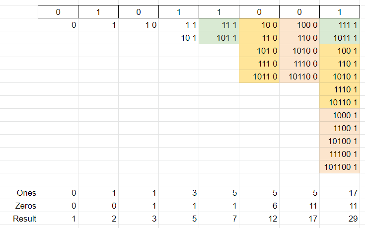

# DP O(n) | O(1)

**Author:** votrubac
**Votes:** 159
**Link:** [https://leetcode.com/problems/number-of-unique-good-subsequences/solutions/1432051/](https://leetcode.com/problems/number-of-unique-good-subsequences/solutions/1432051/)

---

You just need to go through few examples to figure out the transition formula. Here is an example for "01011001":



**C++**
```cpp
int numberOfUniqueGoodSubsequences(string binary) {
    int mod = 1000000007, zeros = 0, ones = 0;
    for (auto ch : binary)
        if (ch == '1')
            ones = (zeros + ones + 1) % mod;
        else
            zeros = (zeros + ones) % mod;
    return (ones + zeros + (zeros || binary[0] == '0')) % mod;
}  
```