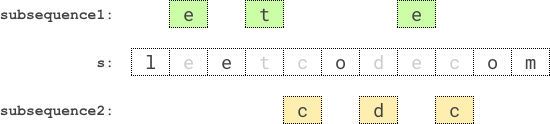

# [2002. Maximum Product of the Length of Two Palindromic Subsequences](https://leetcode.com/problems/maximum-product-of-the-length-of-two-palindromic-subsequences/)

| Category | Difficulty | Likes | Dislikes |
| :------: | :--------: | :---: | :------: |
| Algorithms | Medium | 1008 | 90 |

**Tags:** [`string`](https://leetcode.com/tag/string), [`dynamic-programming`](https://leetcode.com/tag/dynamic-programming), [`backtracking`](https://leetcode.com/tag/backtracking), [`bit-manipulation`](https://leetcode.com/tag/bit-manipulation), [`bitmask`](https://leetcode.com/tag/bitmask)

**Companies:** `google`, `microsoft`, `ascend`

## Description

Given a string `s`, find two **disjoint palindromic subsequences** of `s` such that the **product** of their lengths is **maximized**. The two subsequences are **disjoint** if they do not both pick a character at the same index.

Return *the **maximum** possible **product** of the lengths of the two palindromic subsequences*.

A **subsequence** is a string that can be derived from another string by deleting some or no characters without changing the order of the remaining characters. A string is **palindromic** if it reads the same forward and backward.

 

**Example 1:**


```

Input: s = &quot;leetcodecom&quot;
Output: 9
Explanation: An optimal solution is to choose &quot;ete&quot; for the 1st subsequence and &quot;cdc&quot; for the 2nd subsequence.
The product of their lengths is: 3 * 3 = 9.

```

**Example 2:**

```

Input: s = &quot;bb&quot;
Output: 1
Explanation: An optimal solution is to choose &quot;b&quot; (the first character) for the 1st subsequence and &quot;b&quot; (the second character) for the 2nd subsequence.
The product of their lengths is: 1 * 1 = 1.

```

**Example 3:**

```

Input: s = &quot;accbcaxxcxx&quot;
Output: 25
Explanation: An optimal solution is to choose &quot;accca&quot; for the 1st subsequence and &quot;xxcxx&quot; for the 2nd subsequence.
The product of their lengths is: 5 * 5 = 25.

```

 

**Constraints:**

	- `2 <= s.length <= 12`

	- `s` consists of lowercase English letters only.

---

**Links:** [Submissions](https://leetcode.com/problems/maximum-product-of-the-length-of-two-palindromic-subsequences/) | [Solutions](https://leetcode.com/problems/maximum-product-of-the-length-of-two-palindromic-subsequences/)
