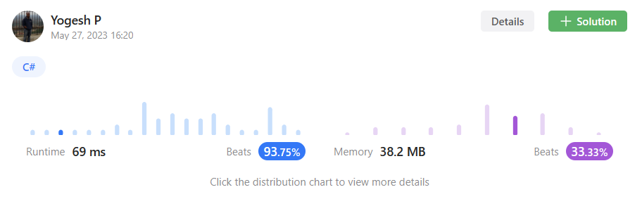

# Simple solution | C# | +93% efficient

**Author:** Baymax_
**Votes:** 2
**Link:** [https://leetcode.com/problems/check-if-numbers-are-ascending-in-a-sentence/solutions/3567771/](https://leetcode.com/problems/check-if-numbers-are-ascending-in-a-sentence/solutions/3567771/)

---

# Intuition & Approach
<!-- Describe your first thoughts on how to solve this problem. -->
Simple and straight forward solution where we ***loop over the list of tokens, check if it can be parsed into string and check if the current number is less that the previous encountered number.***
<br>




# Complexity
- Time complexity:
<!-- Add your time complexity here, e.g. $$O(n)$$ -->
O(N) - as we loop over the string once

- Space complexity:
<!-- Add your space complexity here, e.g. $$O(n)$$ -->
O(1) - as we use constant memory space

## Please upvote if you like the approach

# Code
```
public class Solution {
    public bool AreNumbersAscending(string s) {
        string[] list = s.Split(' ');
        int prevNum = -1;
        for (int i = 0; i < list.Length; i++)
        {
            int num = 0;
            if (int.TryParse(list[i], out num))
            {
                if (num <= prevNum)
                    return false;

                prevNum = num;
            }
        }

        return true;
    }
}
```

## Please upvote if you like the approach

