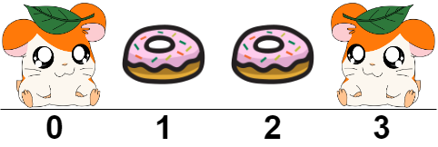
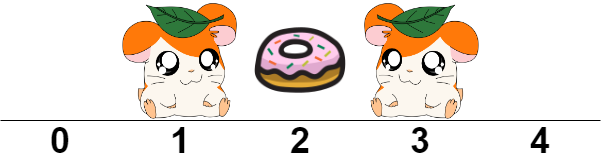
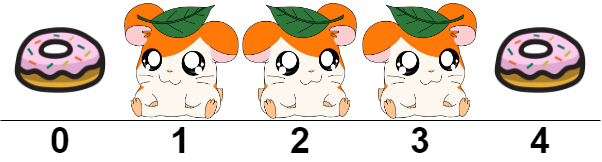

# [2086. Minimum Number of Food Buckets to Feed the Hamsters](https://leetcode.com/problems/minimum-number-of-food-buckets-to-feed-the-hamsters/)

| Category | Difficulty | Likes | Dislikes |
| :------: | :--------: | :---: | :------: |
| Algorithms | Medium | 569 | 31 |

**Tags:** [`string`](https://leetcode.com/tag/string), [`dynamic-programming`](https://leetcode.com/tag/dynamic-programming), [`greedy`](https://leetcode.com/tag/greedy)

**Companies:** `palo-alto-networks`, `microsoft`, `grab`

## Description

You are given a **0-indexed** string `hamsters` where `hamsters[i]` is either:

	- `'H'` indicating that there is a hamster at index `i`, or

	- `'.'` indicating that index `i` is empty.

You will add some number of food buckets at the empty indices in order to feed the hamsters. A hamster can be fed if there is at least one food bucket to its left or to its right. More formally, a hamster at index `i` can be fed if you place a food bucket at index `i - 1` **and/or** at index `i + 1`.

Return *the minimum number of food buckets you should **place at empty indices** to feed all the hamsters or *`-1`* if it is impossible to feed all of them*.

 

**Example 1:**


```

Input: hamsters = &quot;H..H&quot;
Output: 2
Explanation: We place two food buckets at indices 1 and 2.
It can be shown that if we place only one food bucket, one of the hamsters will not be fed.

```

**Example 2:**


```

Input: hamsters = &quot;.H.H.&quot;
Output: 1
Explanation: We place one food bucket at index 2.

```

**Example 3:**


```

Input: hamsters = &quot;.HHH.&quot;
Output: -1
Explanation: If we place a food bucket at every empty index as shown, the hamster at index 2 will not be able to eat.

```

 

**Constraints:**

	- `1 <= hamsters.length <= 10^5`

	- `hamsters[i]` is either`'H'` or `'.'`.

---

**Links:** [Submissions](https://leetcode.com/problems/minimum-number-of-food-buckets-to-feed-the-hamsters/) | [Solutions](https://leetcode.com/problems/minimum-number-of-food-buckets-to-feed-the-hamsters/)
