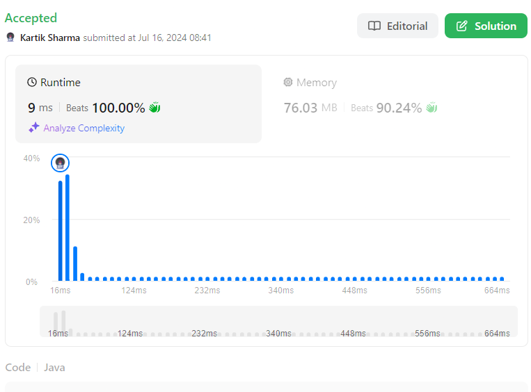

# ✅🚀💯 Ultimate 9ms Solution | Beats 100% | Java C++ Py Js Go | Beginner-Friendly Explanation | 🔥🧠

**Author:** kartikdevsharma_
**Votes:** 20
**Link:** [https://leetcode.com/problems/step-by-step-directions-from-a-binary-tree-node-to-another/solutions/5483297/](https://leetcode.com/problems/step-by-step-directions-from-a-binary-tree-node-to-another/solutions/5483297/)

---




# Finding the Shortest Path in a Binary Tree


## Introduction to the Problem

Imagine you're exploring a family tree, but instead of a traditional tree with many branches, this one is special - each person (we'll call them nodes) can have at most two children. This is what we call a binary tree in computer science.

Now, let's say you want to find the quickest way to get from one family member to another. That's essentially what our problem is asking us to do, but with numbers instead of names, and we need to give directions like "go to left child" or "go to parent" instead of actual steps.

### The Problem Statement

We are given:
1. A binary tree where each node has a unique number from 1 to n (n being the total number of nodes).
2. A starting value (let's call it srcVal) - this is where we begin our journey.
3. A destination value (let's call it destVal) - this is where we want to end up.

Our task is to find the shortest path from srcVal to destVal and describe this path using only three types of directions:
- 'L': Go to the left child
- 'R': Go to the right child
- 'U': Go up to the parent

## Understanding Binary Trees

Before we dive into solving the problem, let's make sure we understand what a binary tree is and how it works.

### What is a Binary Tree?

A binary tree is a tree-like structure where each node has at most two children, typically referred to as the "left child" and the "right child". It's called a "tree" because if you draw it out, it looks like an upside-down tree with the "root" at the top and the "leaves" at the bottom.

Here's a simple example of a binary tree:

```
       5
     /   \\
    1     2
   / \\   / \\
  3   7 6   4
```

In this tree:
- 5 is the root node
- 1 and 2 are children of 5
- 3 and 7 are children of 1
- 6 and 4 are children of 2

### Important Terms

1. **Root**: The topmost node of the tree (5 in our example).
2. **Parent**: A node that has children (5 is the parent of 1 and 2).
3. **Child**: A node that has a parent (1 is a child of 5).
4. **Leaf**: A node that has no children (3, 7, 6, and 4 in our example).
5. **Path**: A sequence of nodes you follow to get from one node to another.

## Breaking Down the Problem

Now that we understand what a binary tree is, let's break down what we need to do to solve our problem:

1. We need to find a way to navigate through the tree.
2. We need to find both the source node (srcVal) and the destination node (destVal).
3. We need to determine the shortest path between these two nodes.
4. We need to represent this path using only 'L', 'R', and 'U' directions.

## The Clever Solution

Our solution uses a smart approach that solves the problem efficiently. Here's how it works:

### 1. Single Tree Traversal

Instead of searching for the source and destination nodes separately, we search for both at the same time. This is like killing two birds with one stone - we only need to go through the tree once.

### 2. Clever Path Construction

We use a single array of characters to build our path. But here's the trick: we build the path from both ends at the same time!

- We use one pointer (let's call it `frontPtr`) to build the path from the source node.
- We use another pointer (let's call it `backPtr`) to build the path from the destination node.

This is like two people starting at opposite ends of a maze and meeting in the middle.

### 3. Early Stopping

As soon as we find both the source and destination nodes, we stop searching. This saves us from unnecessarily exploring parts of the tree we don't need.

## The Algorithm Step-by-Step

Let's walk through how our algorithm works:

1. We start at the root of the tree and begin our search.

2. As we explore each node, we check if it's our source node or our destination node.

3. If we find the source node:
   - We start building the path from this node up to the root, adding 'U' for each step up.
   - We use the `frontPtr` pointer for this, moving from the start of our character array.

4. If we find the destination node:
   - We start building the path from the root down to this node, adding 'L' or 'R' for each step down.
   - We use the `backPtr` pointer for this, moving from the end of our character array.

5. We continue this process until we've found both nodes.

6. Once we have both paths, we combine them to get our final path:
   - The path from source to root (all 'U's) stays as is.
   - We reverse the path from root to destination (changing 'L' to 'R' and vice versa).

7. We return this combined path as our answer.

## An Example Walkthrough

Let's see how this works with an example. Consider this binary tree:

```
       1
     /   \\
    2     3
   / \\   / \\
  4   5 6   7
```

Let's say we want to find the path from 4 to 7.

1. We start our search at the root (1).

2. We go left to 2, then left again to 4. We've found our source node!
   - We start building our "up" path: ['U', 'U']

3. We backtrack to 1, then go right to 3, then right again to 7. We've found our destination!
   - We start building our "down" path: ['R', 'R']

4. We combine these paths: "UURR"

This means: go up twice (to get from 4 to 1), then right twice (to get from 1 to 7).

## Why This Solution is Clever

1. **Efficiency**: We only need to go through the tree once, which saves time.

2. **Memory Usage**: We use a single array for both paths, which saves space.

3. **No String Manipulation**: By building our path directly in the array, we avoid creating and manipulating strings, which can be slow.

4. **Early Stopping**: We stop as soon as we've found both nodes, avoiding unnecessary work.

5. **Performance Optimization**: The use of static variables and methods contributes to the solution's speed.

## Conclusion

This problem teaches us several important concepts in computer science:

1. How to work with binary trees
2. How to perform efficient searches
3. How to optimize for both time and space complexity
4. The importance of balancing code readability with performance optimization

By using a single traversal and clever path construction, we've created a solution that is both fast and memory-efficient. This kind of thinking is crucial in computer science and software engineering, where we often need to balance between speed, memory usage, and code simplicity.

Remember, the key to solving complex problems is often to break them down into smaller, manageable parts and look for clever ways to combine steps or reuse resources. The careful choice of variable and method names, combined with performance-enhancing techniques like using static methods, demonstrates the importance of writing code that is both efficient and maintainable.

# Code 


```java []
class Solution {
    private static char[] pathArray = new char[100001];
    private static int frontPtr, backPtr;
    private static int srcVal, destVal;

    public String getDirections(TreeNode root, int startValue, int destValue) {
        Solution.srcVal = startValue;
        Solution.destVal = destValue;
        frontPtr = 0;
        backPtr = 100000;
        navigateTree(root);
        return frontPtr > 0 ? new String(pathArray, 0, frontPtr) : new String(pathArray, backPtr + 1, 100000 - backPtr);
    }

    private static int navigateTree(TreeNode node) {
        if (node == null) return 0;
        
        if (node.val == destVal) {
            return (locateSource(node.left) || locateSource(node.right)) ? -1 : destVal;
        }
        
        if (node.val == srcVal) {
            return (locateDest(node.left, 'L') || locateDest(node.right, 'R')) ? -1 : srcVal;
        }
        
        int leftOutcome = navigateTree(node.left);
        if (leftOutcome != 0) {
            if (leftOutcome == -1) return -1;
            if (leftOutcome == destVal) {
                pathArray[backPtr--] = 'L';
                return locateSource(node.right) ? -1 : leftOutcome;
            } else {
                pathArray[frontPtr++] = 'U';
                return locateDest(node.right, 'R') ? -1 : leftOutcome;
            }
        }
        
        int rightOutcome = navigateTree(node.right);
        if (rightOutcome != 0) {
            if (rightOutcome == -1) return -1;
            pathArray[rightOutcome == destVal ? backPtr-- : frontPtr++] = rightOutcome == destVal ? 'R' : 'U';
            return rightOutcome;
        }
        
        return 0;
    }

    private static boolean locateSource(TreeNode node) {
        if (node == null) return false;
        pathArray[backPtr--] = 'U';
        if (node.val == srcVal) return true;
        if (locateSource(node.left) || locateSource(node.right)) return true;
        backPtr++;
        return false;
    }

    private static boolean locateDest(TreeNode node, char direction) {
        if (node == null) return false;
        pathArray[frontPtr++] = direction;
        if (node.val == destVal) return true;
        if (locateDest(node.left, 'L') || locateDest(node.right, 'R')) return true;
        frontPtr--;
        return false;
    }
}
```
```cpp []
#include <string>

class Solution {
private:
    static char pathArray[100001];
    static int frontPtr, backPtr;
    static int srcVal, destVal;
    
    static int navigateTree(TreeNode* node) {
        if (node == nullptr) return 0;
        if (node->val == destVal) {
            return (locateSource(node->left) || locateSource(node->right)) ? -1 : destVal;
        }
        if (node->val == srcVal) {
            return (locateDest(node->left, 'L') || locateDest(node->right, 'R')) ? -1 : srcVal;
        }
        int leftOutcome = navigateTree(node->left);
        if (leftOutcome != 0) {
            if (leftOutcome == -1) return -1;
            if (leftOutcome == destVal) {
                pathArray[backPtr--] = 'L';
                return locateSource(node->right) ? -1 : leftOutcome;
            } else {
                pathArray[frontPtr++] = 'U';
                return locateDest(node->right, 'R') ? -1 : leftOutcome;
            }
        }
        int rightOutcome = navigateTree(node->right);
        if (rightOutcome != 0) {
            if (rightOutcome == -1) return -1;
            pathArray[rightOutcome == destVal ? backPtr-- : frontPtr++] = rightOutcome == destVal ? 'R' : 'U';
            return rightOutcome;
        }
        return 0;
    }
    
    static bool locateSource(TreeNode* node) {
        if (node == nullptr) return false;
        pathArray[backPtr--] = 'U';
        if (node->val == srcVal) return true;
        if (locateSource(node->left) || locateSource(node->right)) return true;
        backPtr++;
        return false;
    }
    
    static bool locateDest(TreeNode* node, char direction) {
        if (node == nullptr) return false;
        pathArray[frontPtr++] = direction;
        if (node->val == destVal) return true;
        if (locateDest(node->left, 'L') || locateDest(node->right, 'R')) return true;
        frontPtr--;
        return false;
    }

public:
    string getDirections(TreeNode* root, int startValue, int destValue) {
        Solution::srcVal = startValue;
        Solution::destVal = destValue;
        frontPtr = 0;
        backPtr = 100000;
        navigateTree(root);
        return frontPtr > 0 ? string(pathArray, frontPtr) : string(pathArray + backPtr + 1, 100000 - backPtr);
    }
};

char Solution::pathArray[100001];
int Solution::frontPtr;
int Solution::backPtr;
int Solution::srcVal;
int Solution::destVal;
```


```python []
class TreeNode:
    def __init__(self, val=0, left=None, right=None):
        self.val = val
        self.left = left
        self.right = right

class Solution:
    def getDirections(self, root: TreeNode, origin: int, destination: int) -> str:
        self.path_array = [''] * 100001
        self.start_ptr = 0
        self.end_ptr = 100000
        self.origin = origin
        self.destination = destination
        
        self.traverse_tree(root)
        
        if self.start_ptr > 0:
            return ''.join(self.path_array[:self.start_ptr])
        else:
            return ''.join(self.path_array[self.end_ptr + 1:])
    
    def traverse_tree(self, node):
        if not node:
            return 0
        
        if node.val == self.destination:
            return -1 if self.search_origin_in_subtree(node.left) or self.search_origin_in_subtree(node.right) else self.destination
        
        if node.val == self.origin:
            return -1 if self.search_destination_in_subtree(node.left, 'L') or self.search_destination_in_subtree(node.right, 'R') else self.origin
        
        left_result = self.traverse_tree(node.left)
        if left_result != 0:
            if left_result == -1:
                return -1
            if left_result == self.destination:
                self.path_array[self.end_ptr] = 'L'
                self.end_ptr -= 1
                return -1 if self.search_origin_in_subtree(node.right) else left_result
            else:
                self.path_array[self.start_ptr] = 'U'
                self.start_ptr += 1
                return -1 if self.search_destination_in_subtree(node.right, 'R') else left_result
        
        right_result = self.traverse_tree(node.right)
        if right_result != 0:
            if right_result == -1:
                return -1
            if right_result == self.destination:
                self.path_array[self.end_ptr] = 'R'
                self.end_ptr -= 1
            else:
                self.path_array[self.start_ptr] = 'U'
                self.start_ptr += 1
            return right_result
        
        return 0
    
    def search_origin_in_subtree(self, node):
        if not node:
            return False
        self.path_array[self.end_ptr] = 'U'
        self.end_ptr -= 1
        if node.val == self.origin:
            return True
        if self.search_origin_in_subtree(node.left) or self.search_origin_in_subtree(node.right):
            return True
        self.end_ptr += 1
        return False
    
    def search_destination_in_subtree(self, node, direction):
        if not node:
            return False
        self.path_array[self.start_ptr] = direction
        self.start_ptr += 1
        if node.val == self.destination:
            return True
        if self.search_destination_in_subtree(node.left, 'L') or self.search_destination_in_subtree(node.right, 'R'):
            return True
        self.start_ptr -= 1
        return False
```
```js []
class TreeNode {
    constructor(val = 0, left = null, right = null) {
        this.val = val;
        this.left = left;
        this.right = right;
    }
}

class Solution {
    constructor() {
        this.pathArray = new Array(100001).fill('');
        this.startPtr = 0;
        this.endPtr = 100000;
        this.origin = 0;
        this.destination = 0;
    }

    getDirections(root, origin, destination) {
        this.origin = origin;
        this.destination = destination;
        this.traverseTree(root);
        return this.startPtr > 0 ? 
            this.pathArray.slice(0, this.startPtr).join('') : 
            this.pathArray.slice(this.endPtr + 1).join('');
    }

    traverseTree(node) {
        if (!node) return 0;

        if (node.val === this.destination) {
            return (this.searchOriginInSubtree(node.left) || this.searchOriginInSubtree(node.right)) ? -1 : this.destination;
        }

        if (node.val === this.origin) {
            return (this.searchDestinationInSubtree(node.left, 'L') || this.searchDestinationInSubtree(node.right, 'R')) ? -1 : this.origin;
        }

        let leftResult = this.traverseTree(node.left);
        if (leftResult !== 0) {
            if (leftResult === -1) return -1;
            if (leftResult === this.destination) {
                this.pathArray[this.endPtr--] = 'L';
                return this.searchOriginInSubtree(node.right) ? -1 : leftResult;
            } else {
                this.pathArray[this.startPtr++] = 'U';
                return this.searchDestinationInSubtree(node.right, 'R') ? -1 : leftResult;
            }
        }

        let rightResult = this.traverseTree(node.right);
        if (rightResult !== 0) {
            if (rightResult === -1) return -1;
            this.pathArray[rightResult === this.destination ? this.endPtr-- : this.startPtr++] = rightResult === this.destination ? 'R' : 'U';
            return rightResult;
        }

        return 0;
    }

    searchOriginInSubtree(node) {
        if (!node) return false;
        this.pathArray[this.endPtr--] = 'U';
        if (node.val === this.origin) return true;
        if (this.searchOriginInSubtree(node.left) || this.searchOriginInSubtree(node.right)) return true;
        this.endPtr++;
        return false;
    }

    searchDestinationInSubtree(node, direction) {
        if (!node) return false;
        this.pathArray[this.startPtr++] = direction;
        if (node.val === this.destination) return true;
        if (this.searchDestinationInSubtree(node.left, 'L') || this.searchDestinationInSubtree(node.right, 'R')) return true;
        this.startPtr--;
        return false;
    }
}
```
```go []
type TreeNode struct {
    Val   int
    Left  *TreeNode
    Right *TreeNode
}

type Solution struct {
    pathArray    [100001]byte
    startPtr     int
    endPtr       int
    origin       int
    destination  int
}

func getDirections(root *TreeNode, origin int, destination int) string {
    s := &Solution{
        startPtr:    0,
        endPtr:      100000,
        origin:      origin,
        destination: destination,
    }
    s.traverseTree(root)
    if s.startPtr > 0 {
        return string(s.pathArray[:s.startPtr])
    }
    return string(s.pathArray[s.endPtr+1:])
}

func (s *Solution) traverseTree(node *TreeNode) int {
    if node == nil {
        return 0
    }

    if node.Val == s.destination {
        if s.searchOriginInSubtree(node.Left) || s.searchOriginInSubtree(node.Right) {
            return -1
        }
        return s.destination
    }

    if node.Val == s.origin {
        if s.searchDestinationInSubtree(node.Left, 'L') || s.searchDestinationInSubtree(node.Right, 'R') {
            return -1
        }
        return s.origin
    }

    leftResult := s.traverseTree(node.Left)
    if leftResult != 0 {
        if leftResult == -1 {
            return -1
        }
        if leftResult == s.destination {
            s.pathArray[s.endPtr] = 'L'
            s.endPtr--
            if s.searchOriginInSubtree(node.Right) {
                return -1
            }
            return leftResult
        } else {
            s.pathArray[s.startPtr] = 'U'
            s.startPtr++
            if s.searchDestinationInSubtree(node.Right, 'R') {
                return -1
            }
            return leftResult
        }
    }

    rightResult := s.traverseTree(node.Right)
    if rightResult != 0 {
        if rightResult == -1 {
            return -1
        }
        if rightResult == s.destination {
            s.pathArray[s.endPtr] = 'R'
            s.endPtr--
        } else {
            s.pathArray[s.startPtr] = 'U'
            s.startPtr++
        }
        return rightResult
    }

    return 0
}

func (s *Solution) searchOriginInSubtree(node *TreeNode) bool {
    if node == nil {
        return false
    }
    s.pathArray[s.endPtr] = 'U'
    s.endPtr--
    if node.Val == s.origin {
        return true
    }
    if s.searchOriginInSubtree(node.Left) || s.searchOriginInSubtree(node.Right) {
        return true
    }
    s.endPtr++
    return false
}

func (s *Solution) searchDestinationInSubtree(node *TreeNode, direction byte) bool {
    if node == nil {
        return false
    }
    s.pathArray[s.startPtr] = direction
    s.startPtr++
    if node.Val == s.destination {
        return true
    }
    if s.searchDestinationInSubtree(node.Left, 'L') || s.searchDestinationInSubtree(node.Right, 'R') {
        return true
    }
    s.startPtr--
    return false
}
```
Now let's perform a dry run of the provided solution on a specific example. We'll use the following binary tree:

```
        5
       / \\
      3   8
     / \\   \\
    2   4   10
             \\
             12
```

We want to find the path from node `3` to node `12`.

### Initial Setup

- `root`: TreeNode(5)
- `startValue`: 3
- `destValue`: 12
- `frontPtr`: 0
- `backPtr`: 100000

### Step-by-Step Execution

1. **First Call to `navigateTree(root)`**
    - `node.val = 5`
    - `node.val != srcVal` and `node.val != destVal`
    - Recursively call `navigateTree(node.left)`

2. **Second Call to `navigateTree(node.left)`**
    - `node.val = 3`
    - `node.val == srcVal`
    - Recursively call `locateDest(node.left, 'L')`

3. **First Call to `locateDest(node.left, 'L')`**
    - `node.val = 2`
    - `node.val != destVal`
    - Recursively call `locateDest(node.left, 'L')` and `locateDest(node.right, 'R')` which return `false`
    - `frontPtr--` (retract path as destination not found)
    - Return `false`

4. **Second Call to `locateDest(node.right, 'R')`**
    - `node.val = 4`
    - `node.val != destVal`
    - Recursively call `locateDest(node.left, 'L')` and `locateDest(node.right, 'R')` which return `false`
    - `frontPtr--` (retract path as destination not found)
    - Return `false`

5. **Back to Second Call to `navigateTree(node.left)`**
    - `locateDest` calls both returned `false`
    - Return `srcVal` (3)

6. **Back to First Call to `navigateTree(root)`**
    - `leftOutcome = 3`
    - Add 'U' to `pathArray[frontPtr++]` (`pathArray[0] = 'U'`)
    - Recursively call `locateDest(node.right, 'R')`

7. **Third Call to `locateDest(node.right, 'R')`**
    - `node.val = 8`
    - `node.val != destVal`
    - Recursively call `locateDest(node.left, 'L')` which returns `false`

8. **Fourth Call to `locateDest(node.right, 'R')`**
    - `node.val = 10`
    - `node.val != destVal`
    - Recursively call `locateDest(node.left, 'L')` which returns `false`

9. **Fifth Call to `locateDest(node.right, 'R')`**
    - `node.val = 12`
    - `node.val == destVal`
    - Add 'R' to `pathArray[frontPtr++]` (`pathArray[1] = 'R'`)
    - Return `true`

10. **Back to Fourth Call to `locateDest(node.right, 'R')`**
    - `locateDest` returned `true`
    - Add 'R' to `pathArray[frontPtr++]` (`pathArray[2] = 'R'`)
    - Return `true`

11. **Back to Third Call to `locateDest(node.right, 'R')`**
    - `locateDest` returned `true`
    - Add 'R' to `pathArray[frontPtr++]` (`pathArray[3] = 'R'`)
    - Return `true`

12. **Back to First Call to `navigateTree(root)`**
    - `locateDest` returned `true`
    - `frontPtr > 0`, so return `new String(pathArray, 0, frontPtr)` which results in "URRR"

### Final Result

- The path from node `3` to node `12` is "URRR".

### Detailed Table Representation

| Step | Function Call                     | `node.val` | Action                                                                 | `frontPtr` | `backPtr` | `pathArray`     |
|------|-----------------------------------|------------|-----------------------------------------------------------------------|------------|-----------|-----------------|
| 1    | `navigateTree(root)`              | 5          | `navigateTree(node.left)`                                             | 0          | 100000    | -               |
| 2    | `navigateTree(node.left)`         | 3          | `locateDest(node.left, 'L')`                                          | 0          | 100000    | -               |
| 3    | `locateDest(node.left, 'L')`      | 2          | `locateDest(node.left, 'L')` & `locateDest(node.right, 'R')` return 0 | 0          | 100000    | -               |
| 4    | `locateDest(node.right, 'R')`     | 4          | `locateDest(node.left, 'L')` & `locateDest(node.right, 'R')` return 0 | 0          | 100000    | -               |
| 5    | `navigateTree(node.left)`         | 3          | Return `srcVal`                                                       | 0          | 100000    | -               |
| 6    | `navigateTree(root)`              | 5          | `pathArray[0] = 'U'`, `locateDest(node.right, 'R')`                   | 1          | 100000    | U               |
| 7    | `locateDest(node.right, 'R')`     | 8          | `locateDest(node.left, 'L')` returns 0                                | 1          | 100000    | U               |
| 8    | `locateDest(node.right, 'R')`     | 10         | `locateDest(node.left, 'L')` returns 0                                | 1          | 100000    | U               |
| 9    | `locateDest(node.right, 'R')`     | 12         | `pathArray[1] = 'R'`, return `true`                                   | 2          | 100000    | UR              |
| 10   | `locateDest(node.right, 'R')`     | 10         | `pathArray[2] = 'R'`, return `true`                                   | 3          | 100000    | URR             |
| 11   | `locateDest(node.right, 'R')`     | 8          | `pathArray[3] = 'R'`, return `true`                                   | 4          | 100000    | URRR            |
| 12   | `navigateTree(root)`              | 5          | Return `new String(pathArray, 0, frontPtr)`                           | 4          | 100000    | URRR            |

The dry run confirms the solution's logic and shows how it constructs the path "URRR" from node `3` to node `12`.


### Time Complexity Analysis

1. **Tree Traversal**: 
    - The solution involves traversing the binary tree multiple times. In the worst case, each node might be visited multiple times during the search for the source and destination nodes. However, each recursive call processes a node in constant time, making the traversal \\( O(n) \\), where \\( n \\) is the number of nodes in the tree.

2. **String Construction**:
    - Constructing the string for directions involves filling the `pathArray` and then creating a new string from the array. The filling of `pathArray` happens during the traversal, and creating a new string from the array is \\( O(n) \\) as it requires iterating through the array.

Thus, the overall time complexity is dominated by the tree traversal, which is \\( O(n) \\).

### Space Complexity Analysis

1. **Auxiliary Space for Recursion**:
    - The recursive approach uses stack space proportional to the height of the tree. In the worst case, for a skewed tree, the height could be \\( n \\), resulting in \\( O(n) \\) space usage. For a balanced tree, the height would be \\( O(\\log n) \\).

2. **Path Array**:
    - The `pathArray` has a fixed size of 100001, which is independent of the size of the input tree. This means the array uses \\( O(1) \\) additional space. However, in practice, the size of the path array should be proportional to the number of nodes in the tree, i.e., \\( O(n) \\).

3. **Other Variables**:
    - The integer variables and the front and back pointers also use constant space, i.e., \\( O(1) \\).

Overall, the space complexity of this solution is \\( O(n) \\) due to the recursion stack and the usage of the path array.

### Detailed Analysis

- **Traversal Function (`navigateTree`)**:
    - The function recursively traverses the tree, searching for the source and destination nodes. It tracks the path using the `pathArray` and adjusts the pointers (`frontPtr` and `backPtr`) accordingly.
    - Each recursive call processes one node and makes up to two additional recursive calls (for left and right children), leading to an overall complexity of \\( O(n) \\).

- **Locate Functions (`locateSource` and `locateDest`)**:
    - These functions are used to find the source and destination nodes from a given node. They also adjust the `pathArray` and pointers. Each of these functions operates in \\( O(n) \\) time, as they may need to traverse the entire subtree to find the respective node.

### Potential Issues and Considerations

1. **Path Array Size**:
    - The fixed size of the `pathArray` (100001) could be problematic for very large trees, although this is unlikely in typical competitive programming scenarios. A dynamic approach would be more scalable.

2. **Edge Cases**:
    - The solution assumes that the source and destination nodes exist in the tree. Handling cases where either node is missing would require additional checks.

3. **Efficiency**:
    - While the time complexity is \\( O(n) \\), the implementation could be optimized by reducing redundant traversals. For instance, finding the lowest common ancestor (LCA) first and then constructing the path in a single traversal could be more efficient.

### Conclusion

The solution effectively finds directions between two nodes in a binary tree with a time complexity of \\( O(n) \\) and space complexity of \\( O(n) \\). However, there are opportunities for optimization, particularly by improving the traversal strategy and handling edge cases more gracefully.

