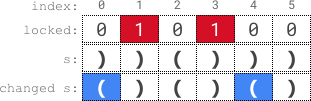

# [2116. Check if a Parentheses String Can Be Valid](https://leetcode.com/problems/check-if-a-parentheses-string-can-be-valid/)

| Category | Difficulty | Likes | Dislikes |
| :------: | :--------: | :---: | :------: |
| Algorithms | Medium | 2008 | 131 |

**Tags:** [`string`](https://leetcode.com/tag/string), [`stack`](https://leetcode.com/tag/stack), [`greedy`](https://leetcode.com/tag/greedy)

**Companies:** `facebook`, `google`, `servicenow`, `amazon`

## Description

A parentheses string is a **non-empty** string consisting only of `'('` and `')'`. It is valid if **any** of the following conditions is **true**:

	- It is `()`.

	- It can be written as `AB` (`A` concatenated with `B`), where `A` and `B` are valid parentheses strings.

	- It can be written as `(A)`, where `A` is a valid parentheses string.

You are given a parentheses string `s` and a string `locked`, both of length `n`. `locked` is a binary string consisting only of `'0'`s and `'1'`s. For **each** index `i` of `locked`,

	- If `locked[i]` is `'1'`, you **cannot** change `s[i]`.

	- But if `locked[i]` is `'0'`, you **can** change `s[i]` to either `'('` or `')'`.

Return `true` *if you can make `s` a valid parentheses string*. Otherwise, return `false`.

 

**Example 1:**


```

Input: s = &quot;))()))&quot;, locked = &quot;010100&quot;
Output: true
Explanation: locked[1] == &#39;1&#39; and locked[3] == &#39;1&#39;, so we cannot change s[1] or s[3].
We change s[0] and s[4] to &#39;(&#39; while leaving s[2] and s[5] unchanged to make s valid.
```

**Example 2:**

```

Input: s = &quot;()()&quot;, locked = &quot;0000&quot;
Output: true
Explanation: We do not need to make any changes because s is already valid.

```

**Example 3:**

```

Input: s = &quot;)&quot;, locked = &quot;0&quot;
Output: false
Explanation: locked permits us to change s[0]. 
Changing s[0] to either &#39;(&#39; or &#39;)&#39; will not make s valid.

```

**Example 4:**

```

Input: s = &quot;(((())(((())&quot;, locked = &quot;111111010111&quot;
Output: true
Explanation: locked permits us to change s[6] and s[8]. 
We change s[6] and s[8] to &#39;)&#39; to make s valid.

```

 

**Constraints:**

	- `n == s.length == locked.length`

	- `1 <= n <= 10^5`

	- `s[i]` is either `'('` or `')'`.

	- `locked[i]` is either `'0'` or `'1'`.

---

**Links:** [Submissions](https://leetcode.com/problems/check-if-a-parentheses-string-can-be-valid/) | [Solutions](https://leetcode.com/problems/check-if-a-parentheses-string-can-be-valid/)
